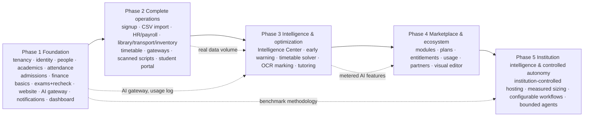

# 03 — Feature matrix

The complete long-term catalog. Nothing is lost while the demo stays small. Columns: **Phase** 1–5 (see §2); **Demo** = status in the 20-day demo (`impl` fully implemented and tested · `limited` functional but limited · `sim` simulated and labeled · `planned` not built); **Pri** P0 (demo critical path) · P1 (demo if time) · P2 (next release) · P3 (later); **Owner** = owning module (`05-data-architecture.md` §3); **Sens** = data class (`07-security-and-ai-governance.md` §3): pub / int / conf / restr; **Accept** = acceptance reference in `08-testing-and-acceptance.md` (journey J-n or case C-n). Assumptions are recorded once per area.

## 1. Catalog

### A. Institution, identity, tenancy

| ID | Feature | Value | Phase | Demo | Pri | Deps | Owner | Sens | Accept |
|---|---|---|---|---|---|---|---|---|---|
| F-IDN-01 | Multi-tenant institutions with slug, settings JSON, `is_demo` | Isolation + configurability | 1 | impl | P0 | — | core | int | C-01 |
| F-IDN-02 | Email/password login (seeded users) | Demo access | 1 | impl | P0 | F-IDN-01 | core | restr | J-00 |
| F-IDN-03 | Memberships: user × institution × role (multi-institution users) | Groups, consultants | 1 | impl | P0 | F-IDN-01 | core | conf | C-02 |
| F-IDN-04 | Static role→permission matrix + `requirePermission` | Enforceable authorization | 1 | impl | P0 | F-IDN-03 | core | int | C-03 |
| F-IDN-05 | Table-driven permissions, custom roles | Per-school flexibility | 4 | planned | P3 | F-IDN-04 | core | int | — |
| F-IDN-06 | Preconfigured demo tenant bootstrap + guarded reset | Repeatable demos | 1 | impl | P0 | F-IDN-01 | core | int | C-04 |
| F-IDN-07 | Self-service institution signup and onboarding wizard | Growth | 2 | planned | P2 | F-IDN-01 | core | conf | — |
| F-IDN-08 | Google sign-in | Convenience | 2 | planned | P2 | F-IDN-02 | core | restr | — |
| F-IDN-09 | Campuses (multi-campus groups) | Chains | 2 | limited (table + default campus) | P1 | F-IDN-01 | core | int | — |
| F-IDN-10 | Academic years and terms, current-year switch | Everything is year-scoped | 1 | impl | P0 | F-IDN-01 | core | int | C-05 |
| F-IDN-11 | Human-readable sequences (admission/employee/invoice/receipt numbers) | Trust, paper compatibility | 1 | impl | P0 | F-IDN-01 | core | int | C-06 |
| F-IDN-12 | Append-only audit log with viewer | Accountability | 1 | impl (viewer limited) | P0 | F-IDN-03 | core | conf | C-07 |
| F-IDN-13 | Platform superadmin console | Operations | 3 | planned | P3 | F-IDN-03 | core | restr | — |
| F-IDN-14 | Consent and data-retention records | Compliance (DPDP Act) | 3 | planned | P2 | F-IDN-01 | core | conf | — |

Assumptions: one institution per demo; roles fixed for the demo; superadmin is a profile flag used only by seed/reset.

### B. Student lifecycle and people

| ID | Feature | Value | Phase | Demo | Pri | Deps | Owner | Sens | Accept |
|---|---|---|---|---|---|---|---|---|---|
| F-STU-01 | Student master record with admission number | Core registry | 1 | impl | P0 | F-IDN-11 | people | conf | C-10 |
| F-STU-02 | Guardians linked to students (relationship, primary, portal access) | Parent portal scope | 1 | impl | P0 | F-STU-01 | people | conf | C-11 |
| F-STU-03 | Staff master with employee number, departments | HR base | 1 | impl | P0 | F-IDN-11 | people | conf | C-12 |
| F-STU-04 | Enrolments per academic year with status history | Promotion, transfer | 1 | impl | P0 | F-STU-01, F-ACA-02 | academics | int | C-13 |
| F-STU-05 | Student/guardian CSV import with duplicate detection | Onboarding real schools | 2 | planned | P1 | F-STU-01 | people | conf | — |
| F-STU-06 | Student profile page (360° view) | Daily use | 1 | impl | P0 | F-STU-01..04 | people | conf | J-07 |
| F-STU-07 | Promotion / transfer / withdrawal workflows, transfer certificate | Year end | 2 | planned | P2 | F-STU-04 | academics | int | — |
| F-STU-08 | Documents and photos (Storage, per-institution paths) | Records | 2 | planned | P1 | F-STU-01 | people | conf | — |
| F-STU-09 | Health, counselling, discipline records | Welfare | 3 | planned | P3 | F-STU-01 | people | conf | — |
| F-STU-10 | Alumni | Community | 4 | planned | P3 | F-STU-07 | people | int | — |
| F-STU-11 | Student portal (own attendance, results, assignments) | Older students | 2 | limited (role + RLS, no dedicated UI) | P1 | F-STU-01 | people | conf | C-14 |

Assumptions: phone is the guardian's primary identity; one guardian record per phone per institution.

### C. Website, admissions, communication

| ID | Feature | Value | Phase | Demo | Pri | Deps | Owner | Sens | Accept |
|---|---|---|---|---|---|---|---|---|---|
| F-WEB-01 | Data-driven public website with published page versions | First impression | 1 | impl | P0 | F-IDN-01 | website | pub | J-01 |
| F-WEB-02 | Block-form page editor with draft/publish | School updates its site | 1 | impl | P0 | F-WEB-01 | website | int | J-01 |
| F-WEB-03 | Public notices and events | Live site | 1 | impl | P0 | F-WEB-01 | website | pub | J-01 |
| F-WEB-04 | Public enquiry form → admissions (rate limit, dedupe) | Lead capture | 1 | impl | P0 | F-WEB-01, F-ADM-01 | admissions | conf | J-02 |
| F-WEB-05 | Custom domains / subdomains | Branding | 2 | planned | P2 | F-WEB-01 | website | pub | — |
| F-WEB-06 | Visual drag-and-drop editor, AI site generation | Polish | 4 | planned | P3 | F-WEB-02 | website | int | — |
| F-ADM-01 | Enquiry CRM pipeline with stages, assignment, notes | Conversion | 1 | impl | P0 | F-IDN-03 | admissions | conf | J-03 |
| F-ADM-02 | Application record and decision (offer/reject) | Formal process | 1 | impl | P0 | F-ADM-01 | admissions | conf | J-04 |
| F-ADM-03 | Enrolment transaction (student + guardian + section + fees + first invoice), idempotent | Correctness | 1 | impl | P0 | F-ADM-02, F-FIN-02 | admissions | conf | J-05, C-20 |
| F-ADM-04 | Online application form on public site, document upload | Convenience | 2 | planned | P2 | F-WEB-04, F-STU-08 | admissions | conf | — |
| F-ADM-05 | Interaction/entrance scheduling, waitlists, seat matrix | Scale | 2 | planned | P2 | F-ADM-02 | admissions | conf | — |
| F-ADM-06 | Admissions funnel analytics | Principal insight | 1 | impl (counts) | P0 | F-ADM-01 | admissions | int | J-13 |
| F-COM-01 | In-app notifications | Core channel | 1 | impl | P0 | F-IDN-03 | notifications | int | C-30 |
| F-COM-02 | SMS and email delivery via adapters | Reach parents | 1 | impl (email live when `RESEND_API_KEY` set; SMS sim) | P0 | F-COM-01 | notifications | conf | C-31 |
| F-COM-03 | Circulars/notices to classes, PTM scheduling, diary notes | Daily communication | 2 | planned | P2 | F-COM-01 | notifications | int | — |
| F-COM-04 | WhatsApp channel, bilingual templates | Reach | 2 | planned | P2 | F-COM-02 | notifications | conf | — |
| F-COM-05 | Message log with simulated/sent/failed badge per delivery row | Demo honesty | 1 | impl | P0 | F-COM-02 | notifications | conf | C-31 |

Assumptions: website blocks are a fixed set of eight; one website per institution.

### D. Academics, attendance, examinations

| ID | Feature | Value | Phase | Demo | Pri | Deps | Owner | Sens | Accept |
|---|---|---|---|---|---|---|---|---|---|
| F-ACA-01 | Grades, grade groups, subjects (configurable) | Structure | 1 | impl | P0 | F-IDN-10 | academics | int | C-13 |
| F-ACA-02 | Class sections with class teacher, roll numbers | Daily unit | 1 | impl | P0 | F-ACA-01, F-STU-03 | academics | int | C-13 |
| F-ACA-03 | Subject–teacher assignments | Permissions, timetable | 1 | impl | P0 | F-ACA-02 | academics | int | C-13 |
| F-ACA-04 | Curriculum units per subject/grade | AI input, planning | 1 | impl | P0 | F-ACA-01 | academics | int | J-08 |
| F-ACA-05 | Assignments (create, publish, guardian/student view) | Homework | 1 | impl | P0 | F-ACA-02 | academics | int | J-08 |
| F-ACA-06 | Assignment submissions and grading | Learning loop | 2 | impl | P1 | F-ACA-05 | academics | int | tests/db/submissions-acceptance.test.ts |
| F-ACA-07 | Timetable (manual) | Operations | 2 | planned | P2 | F-ACA-03 | academics | int | — |
| F-ACA-08 | Timetable optimization solver | Efficiency | 3 | planned | P3 | F-ACA-07 | academics | int | — |
| F-ATT-01 | Daily attendance session per section, bulk marking | Core routine | 1 | impl | P0 | F-ACA-02 | attendance | conf | J-06 |
| F-ATT-02 | Corrections with reason and audit | Trust | 1 | impl | P0 | F-ATT-01 | attendance | conf | C-15 |
| F-ATT-03 | Absence → guardian notification | Parent value | 1 | impl (SMS sim) | P0 | F-ATT-01, F-COM-01 | attendance | conf | J-06 |
| F-ATT-04 | Period-wise attendance, leave applications, biometric/RFID | Scale | 2 | planned | P2 | F-ATT-01 | attendance | conf | — |
| F-ATT-05 | Attendance analytics, 75% rule alerts | Compliance | 1 | impl (summary) | P0 | F-ATT-01 | attendance | int | J-13 |
| F-EXM-01 | Exam setup (type, term, papers per section/subject, max/pass marks) | Structure | 1 | impl | P0 | F-ACA-03 | exams | conf | J-09 |
| F-EXM-02 | Marks entry (versioned), absent flag | Core | 1 | impl | P0 | F-EXM-01 | exams | conf | J-09 |
| F-EXM-03 | Arithmetic verification before publish | Integrity | 1 | impl | P0 | F-EXM-02 | exams | conf | C-40 |
| F-EXM-04 | Publish results as immutable snapshot; grading scale from settings | Trust | 1 | impl | P0 | F-EXM-03 | exams | conf | J-10, C-41 |
| F-EXM-05 | Report card view (guardian/student/teacher) | Visible output | 1 | impl | P0 | F-EXM-04 | exams | conf | J-10 |
| F-EXM-06 | Recheck request → review → decision → correction → re-snapshot → notify | Fairness, traceability | 1 | impl | P0 | F-EXM-04 | exams | conf | J-11, J-12, C-42 |
| F-EXM-07 | Scanned answer sheets upload + secure view | Paper reality | 2 | planned | P1 | F-EXM-02, F-STU-08 | exams | conf | — |
| F-EXM-08 | Per-question marks, OCR-assisted marking | Efficiency | 3 | planned | P3 | F-EXM-07 | exams | conf | — |
| F-EXM-09 | Printable report cards, board-format marksheets | Compliance | 2 | planned | P2 | F-EXM-05 | exams | conf | — |

Assumptions: daily single-mark attendance; one exam per term in the seed; CBSE 9-point grading default.

### E. Finance and staff

| ID | Feature | Value | Phase | Demo | Pri | Deps | Owner | Sens | Accept |
|---|---|---|---|---|---|---|---|---|---|
| F-FIN-01 | Fee structures and components per year/grade (heads, frequency) | Configurable fees | 1 | impl | P0 | F-IDN-10, F-ACA-01 | finance | conf | C-50 |
| F-FIN-02 | Fee assignment per student with concessions | Real-world variance | 1 | impl | P0 | F-FIN-01 | finance | conf | C-50 |
| F-FIN-03 | Invoice generation (per term, idempotent, bulk job) | Billing | 1 | impl | P0 | F-FIN-02, F-JOB-01 | finance | conf | C-51 |
| F-FIN-04 | Offline payment recording (cash/UPI/bank ref), sequential receipts, immutable | Collections | 1 | impl | P0 | F-FIN-03 | finance | conf | C-52 |
| F-FIN-05 | Ledger entries (double entry, minimal chart of accounts) | Accounting trail | 1 | impl | P0 | F-FIN-04 | finance | conf | C-53 |
| F-FIN-06 | Guardian fee view and printable receipt | Parent value | 1 | impl | P0 | F-FIN-04 | finance | conf | J-07 |
| F-FIN-07 | Collection dashboard, defaulters list | Principal value | 1 | impl | P0 | F-FIN-04 | finance | conf | J-13 |
| F-FIN-08 | Payment gateway (UPI/cards), reminders | Convenience | 2 | planned | P2 | F-FIN-04 | finance | conf | — |
| F-FIN-09 | Payment void/refund with reversing entries | Corrections | 2 | planned | P1 | F-FIN-05 | finance | conf | — |
| F-FIN-10 | Late fees, instalment plans, fee receipts export (Tally/CSV) | Accounting fit | 2 | planned | P2 | F-FIN-03 | finance | conf | — |
| F-HR-01 | Staff attendance, leave | Operations | 2 | planned | P2 | F-STU-03 | people | conf | — |
| F-HR-02 | Payroll (salary structure, payslips, statutory) | Finance completeness | 2 | planned | P2 | F-STU-03 | payroll (reserved) | conf | — |
| F-HR-03 | Recruitment and appraisal | HR | 3 | planned | P3 | F-STU-03 | people | conf | — |

Assumptions: financial year April–March; receipts numbered per financial year.

### F. Learning and intelligence

| ID | Feature | Value | Phase | Demo | Pri | Deps | Owner | Sens | Accept |
|---|---|---|---|---|---|---|---|---|---|
| F-AI-01 | AI gateway: policy, quota, rate limit, redaction, usage log | Governance | 1 | impl | P0 | F-IDN-01 | ai | conf | C-60..64 |
| F-AI-02 | Local inference via Ollama | Always-available AI | 1 | limited (laptop GPU) | P0 | F-AI-01 | ai | int | C-65 |
| F-AI-03 | Cloud inference via Anthropic when a key exists and policy allows | Quality | 1 | impl (untested without key) | P1 | F-AI-01 | ai | conf | C-61 |
| F-AI-04 | AI quiz generation from a curriculum unit, teacher review before save | Teacher time saved | 1 | limited | P0 | F-AI-02, F-ACA-05 | ai | int | J-08 |
| F-AI-05 | AI usage view per institution (tokens, cost estimate, provider) | Transparency | 1 | impl | P1 | F-AI-01 | ai | int | C-64 |
| F-AI-06 | Benchmark harness (local vs cloud; latency, tokens/s, JSON validity, cost) | Sizing methodology | 1 | impl (runs; no claims) | P1 | F-AI-02 | ai | int | C-66 |
| F-AI-07 | Lesson plans, worksheets, remark drafting | Teacher tools | 2 | planned | P2 | F-AI-04 | ai | int | — |
| F-AI-08 | Student tutoring with guardrails | Learning | 3 | planned | P3 | F-AI-01 | ai | conf | — |
| F-INT-01 | Principal dashboard (attendance, fees, admissions, exams) | Decision view | 1 | impl | P0 | F-ATT-05, F-FIN-07, F-ADM-06, F-EXM-04 | core | conf | J-13 |
| F-INT-02 | School Intelligence Center: early warning, cohort analytics | Outcomes | 3 | planned | P3 | F-INT-01 | core | conf | — |
| F-INT-03 | Natural-language questions over school data (policy-bounded) | Access | 3 | planned | P3 | F-AI-01, F-INT-01 | ai | conf | — |

Assumptions: the only AI prompt in the demo is built from curriculum text, never from student records.

### G. Services and campus

| ID | Feature | Value | Phase | Demo | Pri | Deps | Owner | Sens | Accept |
|---|---|---|---|---|---|---|---|---|---|
| F-SVC-01 | Library | Operations | 2 | planned | P2 | F-STU-01 | library (reserved) | int | — |
| F-SVC-02 | Transport routes, stops, fee linkage | Operations, safety | 2 | planned | P2 | F-STU-01, F-FIN-01 | transport (reserved) | conf | — |
| F-SVC-03 | Inventory and assets | Operations | 2 | planned | P3 | — | inventory (reserved) | int | — |
| F-SVC-04 | Hostel, canteen, visitor management | Campus | 3 | planned | P3 | F-STU-01 | campus (reserved) | conf | — |
| F-SVC-05 | Device registry, IoT attendance | Automation | 5 | planned | P3 | F-ATT-04 | campus (reserved) | conf | — |

### H. Commercial platform and hosting

| ID | Feature | Value | Phase | Demo | Pri | Deps | Owner | Sens | Accept |
|---|---|---|---|---|---|---|---|---|---|
| F-PLT-01 | Jobs table with retry, idempotency, dead-letter | Reliability | 1 | impl | P0 | — | jobs | int | C-70 |
| F-PLT-02 | Modules, plans, subscriptions, entitlements, usage events | Monetization | 4 | planned | P3 | F-IDN-01 | platform (reserved) | conf | — |
| F-PLT-03 | Module marketplace and partner integrations | Ecosystem | 4 | planned | P3 | F-PLT-02 | platform (reserved) | int | — |
| F-PLT-04 | Configurable workflows (approvals) | Fit | 5 | planned | P3 | F-IDN-04 | core | int | — |
| F-PLT-05 | Managed cloud deployment (Vercel + Supabase Mumbai) | Demo hosting | 1 | impl | P0 | — | ops | restr | Gate G-2 |
| F-PLT-06 | Hybrid / institution-controlled hosting (self-hosted Supabase + app container) | Data residency, cost | 5 | planned (documented path) | P2 | F-PLT-05 | ops | restr | — |
| F-PLT-07 | Measured hardware sizing from benchmark data | Equipment sales | 5 | planned (methodology in F-AI-06) | P2 | F-AI-06 | ai | int | — |
| F-PLT-08 | Backup/restore procedure, monitoring | Operations | 1 | impl (procedure documented and executed once) | P0 | F-PLT-05 | ops | restr | Gate G-2 |

## 2. Five-phase dependency map

Phase gates: Phase 2 starts only after the demo tenant runs on hosted infrastructure with the security suite green (Gate G-2 in `08-testing-and-acceptance.md` §7). Phase 3 needs at least one real institution's data under consent (F-IDN-14). Phase 4 needs entitlement checks in the permission layer (F-IDN-05). Phase 5 needs benchmark data from real usage (F-AI-06, F-PLT-07).

## 3. Demo scope summary

P0 rows with Demo ∈ {impl, limited, sim} are the 20-day scope (53 rows, several of them schema-only or counts-only). P1 rows are built only via the fallback ladder in reverse (`../../archive/09-twenty-day-plan.md` §7). Every P2/P3 row is named here so reserved table names and module boundaries (`05-data-architecture.md` §3) already leave room for it.
