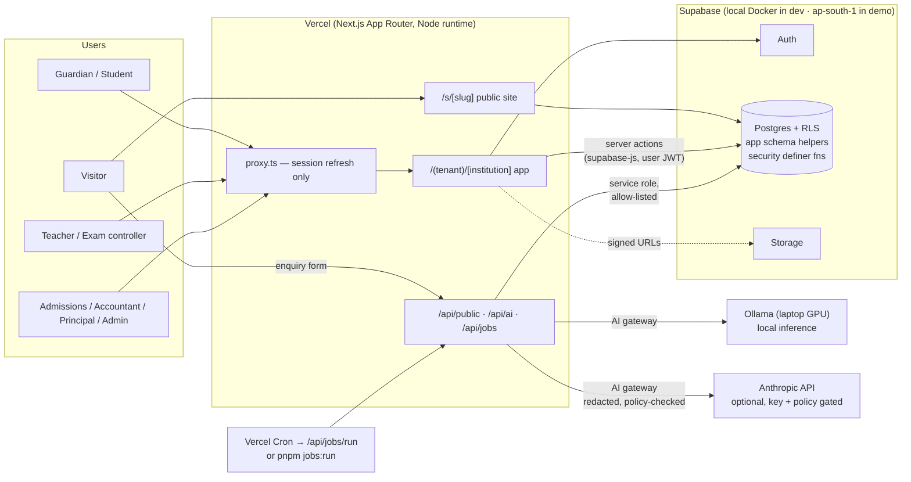
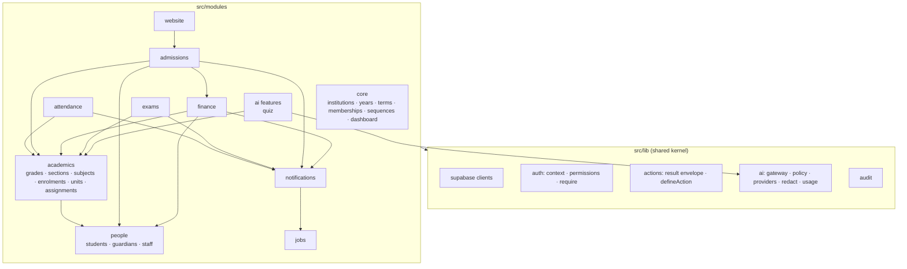
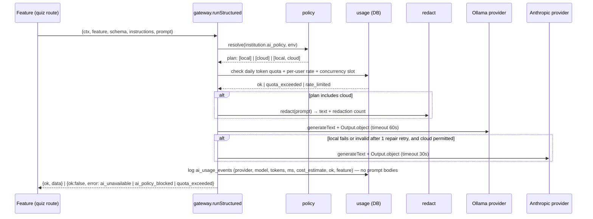
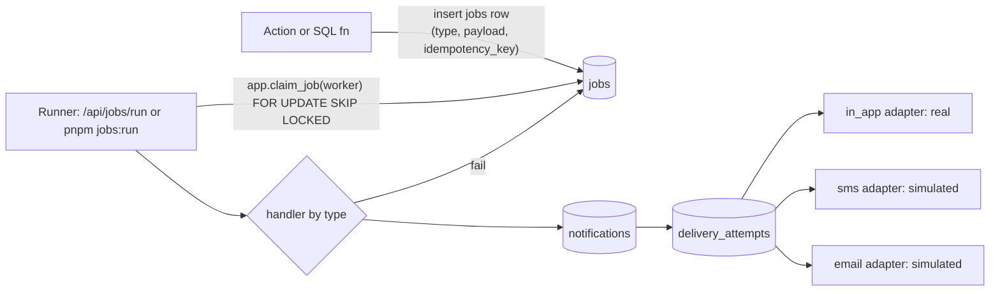

# 04 — Architecture

Authoritative decisions are ADRs in `12-decision-log.md` (D1–D24). This document shows how they fit together. Data model: `05-data-architecture.md`. Workflows: `06-workflows-and-contracts.md`. Security: `07-security-and-ai-governance.md`.

## 1. System context



## 2. Modular monolith (D1)



Allowed dependency direction: a module may import another module's `queries.ts` (reads) and call its exported actions or SQL functions (writes). It never writes to another module's tables directly and never duplicates another module's entity. `people` and `core` are leaves; `notifications` and `jobs` are sinks.

### Module layout

```
src/modules/<domain>/
  schemas.ts      Zod input schemas + inferred types (one per action)
  actions.ts      'use server' actions built with defineAction
  queries.ts      typed read functions (server-only), the module's public read API
  components/     server + client components for this domain's pages
  (sql in supabase/migrations — the module owns its numbered migration)
```

Pages under `src/app/(tenant)/[institution]/<domain>/` are thin: they call `queries.ts` and render components. No business logic in pages or components.

## 3. Request paths

| Path | Runtime | Auth | Used for |
|---|---|---|---|
| Server Actions (`actions.ts`) | Node | Cookie session → `getTenantContext` → `requirePermission` | All authenticated mutations (D7) |
| Route Handlers `/api/public/*` | Node | Anonymous; rate limited inside SQL function | Public enquiry form (D12) |
| Route Handlers `/api/ai/*` | Node | Cookie session + permission `ai.generate` | Streaming / structured AI (D9) |
| Route Handler `/api/jobs/run` | Node | `Authorization: Bearer $CRON_SECRET` | Job runner (D10) |
| `proxy.ts` | Node | Refreshes Supabase session cookies with `getClaims()`; redirects unauthenticated `(tenant)` requests to `/login` | Never authorization: Server Functions can bypass proxy matchers, so every action re-verifies |

Rendering model: `cacheComponents: false` (D21) — dynamic by default, no `'use cache'` in the demo. After mutations, actions call `revalidatePath` for the affected tenant route.

### Server action contract (D7)

```ts
// src/lib/actions/define-action.ts (shape)
export function defineAction<I, O>(opts: {
  schema: z.ZodType<I>;
  permission: Permission | ((input: I) => Permission);
  handler: (input: I, ctx: TenantContext) => Promise<O>;
}): (institutionSlug: string, raw: unknown) => Promise<ActionResult<O>>
```

`defineAction` resolves the tenant context from the slug and the session, parses input (returning `validation_failed` with `fieldErrors`), checks the permission (`forbidden`), runs the handler, and maps known `AppError`s to the envelope. Unknown errors are logged server-side with a correlation id and returned as `internal`.

## 4. Tenant resolution (D5)

`src/app/(tenant)/[institution]/layout.tsx` calls `getTenantContext(params.institution)`:

1. `supabase.auth.getClaims()` → `user_id`; no session → redirect `/login?next=…`.
2. Query `memberships` joined to `institutions` by slug for this user with `status = 'active'` (RLS already restricts to own rows).
3. No membership → `notFound()` (do not reveal that the institution exists).
4. Return `{ institution: {id, slug, name, settings, ai_policy, is_demo}, user: {id, profile}, membership: {role, staff_id, guardian_id, student_id}, permissions: Set<Permission> }`.

The context is computed once per request (React `cache()`), passed to components, and recomputed inside each server action (never trusted from the client). Navigation is derived from `permissions`, but every page re-checks with `requirePermission` because hiding is not authorization (D6).

Users with several memberships see an institution picker at `/`. The demo seeds one institution.

## 5. AI gateway (D9)



Rules enforced in code and tested (`08-testing-and-acceptance.md` C-60..66):

- `local_only`: the cloud provider module is never imported or instantiated; a missing Ollama returns `ai_unavailable` with a clear UI message, never a silent fallback.
- `cloud_allowed`: cloud preferred when `ANTHROPIC_API_KEY` is set and the global switch `AI_CLOUD_ENABLED=true`; otherwise local.
- `local_with_cloud_fallback`: local first; cloud only after local failure/timeout/invalid output, only with key + switch, only after redaction.
- Quotas from `institutions.settings.ai` (defaults: `05 §4.1`). Concurrency is a per-process semaphore (documented limitation on serverless; the DB quota is the hard limit).
- Structured outputs: `generateText` with `Output.object({ schema })` (AI SDK v7); one repair retry appends the Zod error text; the gateway returns parsed data only.
- Providers: local `ai-sdk-ollama`; cloud `@ai-sdk/anthropic`; model names and defaults are env vars (`11 §1`).
- Cost estimate uses a price table in `src/lib/ai/pricing.ts` (USD per MTok; `12-decision-log.md` Phase 0 facts) and is labeled an estimate.
- Prompt-injection posture: user-authored text is passed inside a delimited data block with the instruction to treat it as data; output is schema-constrained; a human reviews before anything is saved.

## 6. Website publishing (D12)

`websites` (one per institution) → `pages` → `page_versions` (immutable JSON blocks). Editing creates a new draft version; **publish** sets `pages.published_version_id` and `page_versions.published_at`. The public route `/s/[slug]/[[...path]]` uses the anon client; RLS exposes only `websites.is_live = true`, pages with a published version, and the published version row. Drafts are invisible to anon by construction (tested, C-80). Block renderer handles eight block types: `hero`, `rich_text`, `image`, `stats`, `notice_list`, `event_list`, `enquiry_form`, `contact`. The enquiry block posts to `/api/public/enquiry`, which calls `app.submit_public_enquiry` (rate limit + dedupe inside the function).

## 7. Jobs and notifications (D10, D11)



Job types: `src/modules/jobs/registry.ts`; run, retry and idempotency rules: `06 §W12`.

Notification adapters implement `Channel = { send(attempt): Promise<DeliveryResult> }`. Simulated adapters render the message and store it with `status = 'simulated'`; the "Message log" page shows them with a `Simulated` badge (honesty label, D-H).

## 8. Deployment modes (D18)

| Mode | App | Database/Auth/Storage | AI | Status |
|---|---|---|---|---|
| A. Managed cloud (demo) | Vercel | Hosted Supabase `ap-south-1` | Cloud optional; local shown from the laptop | Built |
| B. Hybrid | Vercel or institution server | Hosted Supabase | Local inference on institution hardware via `OLLAMA_BASE_URL` over VPN/tunnel | Documented path |
| C. Institution-controlled | App container (`next start`) on institution server | Self-hosted Supabase (Docker) | Local inference; cloud as rate-limited fallback under policy | Documented path; sizing from benchmark data (`11-operations.md` §8) |

Same schema, same migrations, same app image in all modes; only environment variables differ.

## 9. Cross-cutting conventions

- **IDs and numbers (D15):** UUID v4 PKs (`gen_random_uuid()`); human numbers from `app.next_sequence(institution_id, key)` (row-locked).
- **Time:** `timestamptz` everywhere; institution timezone `Asia/Kolkata` in settings for display and for "today" in attendance.
- **Money:** `numeric(12,2)` INR; no floats.
- **Audit (D20):** `audit(ctx, { action, entity_type, entity_id, before, after, metadata })` writes `audit_events`; SQL functions call `app.audit(...)` directly.
- **Errors:** `AppError` in `src/lib/actions/result.ts`; SQL functions `raise exception using errcode = 'P0001', message = 'code:…'` and the action layer maps them (codes: `06 §1.1`).
- **Generated types:** `src/lib/db/types.ts` from `pnpm db:types`; `Tables<'students'>` style helpers.
- **Settings JSON** (`institutions.settings`) validated by `InstitutionSettingsSchema` in `src/modules/core/schemas.ts`: grading scale, attendance statuses, fee frequencies, number formats, AI limits, academic defaults (`05-data-architecture.md` §4.1).
