# 05 — Data architecture

Single Postgres database, `institution_id` on every tenant table, RLS on every table (D3, D4). Conventions: UUID v4 PKs (`id uuid primary key default gen_random_uuid()`), `created_at timestamptz not null default now()`, `updated_at` with `app.set_updated_at()` trigger, `numeric(12,2)` for money, `timestamptz` for time, `text` + `check` constraints instead of enums (easier to extend per institution settings). Columns listed below are the essential ones; `id`, `institution_id`, timestamps are implied unless noted. Sensitivity classes (`07 §3`): pub · int · conf · restr.

## 1. ERD (essential relations)

```mermaid
erDiagram
  institutions ||--o{ campuses : has
  institutions ||--o{ academic_years : has
  academic_years ||--o{ terms : has
  institutions ||--o{ memberships : has
  profiles ||--o{ memberships : "user"
  institutions ||--o{ institution_sequences : has
  institutions ||--o{ students : has
  institutions ||--o{ guardians : has
  students ||--o{ guardian_students : ""
  guardians ||--o{ guardian_students : ""
  institutions ||--o{ staff : has
  departments ||--o{ staff : ""
  institutions ||--o{ grades : has
  grades ||--o{ class_sections : ""
  academic_years ||--o{ class_sections : ""
  staff ||--o{ class_sections : "class_teacher"
  institutions ||--o{ subjects : has
  class_sections ||--o{ subject_assignments : ""
  subjects ||--o{ subject_assignments : ""
  staff ||--o{ subject_assignments : teacher
  students ||--o{ enrolments : ""
  class_sections ||--o{ enrolments : ""
  enrolments ||--o{ enrolment_status_history : ""
  subjects ||--o{ curriculum_units : ""
  class_sections ||--o{ assignments : ""
  curriculum_units o|--o{ assignments : ""
  assignments ||--o{ assignment_submissions : ""
  class_sections ||--o{ attendance_sessions : ""
  attendance_sessions ||--o{ attendance_records : ""
  attendance_records ||--o{ attendance_corrections : ""
  institutions ||--o{ enquiries : has
  enquiries o|--o{ applications : ""
  applications ||--o{ application_decisions : ""
  applications o|--|| students : "source_application_id"
  academic_years ||--o{ fee_structures : ""
  fee_structures ||--o{ fee_components : ""
  students ||--o{ fee_assignments : ""
  fee_structures ||--o{ fee_assignments : ""
  fee_assignments ||--o{ concessions : ""
  students ||--o{ invoices : ""
  invoices ||--o{ invoice_lines : ""
  invoices ||--o{ payments : ""
  payments ||--|| receipts : ""
  payments ||--o{ ledger_entries : ""
  terms ||--o{ exams : ""
  exams ||--o{ exam_papers : ""
  exam_papers ||--o{ marks : ""
  students ||--o{ marks : ""
  exams ||--o{ results : ""
  students ||--o{ results : ""
  results ||--o{ recheck_requests : ""
  recheck_requests ||--o{ recheck_decisions : ""
  institutions ||--|| websites : has
  websites ||--o{ pages : ""
  pages ||--o{ page_versions : ""
  institutions ||--o{ notices : has
  institutions ||--o{ events : has
  institutions ||--o{ notifications : has
  notifications ||--o{ delivery_attempts : ""
  institutions ||--o{ jobs : has
  institutions ||--o{ audit_events : has
  institutions ||--o{ ai_usage_events : has
```



## 2. Data dictionary

Column notation: `name type` · `?` = nullable · `!` = unique (scoped to institution unless stated) · `→` FK. **Hist** = history/deletion semantics: *op* operational (update allowed, soft delete via status) · *imm* immutable (triggers block UPDATE/DELETE) · *ver* versioned (`version_no`, `superseded_by`) · *app* append-only.

### 2.1 core (migrations 0002, 0003)

| Table | Purpose | Essential columns | Constraints / indexes | Hist | Sens |
|---|---|---|---|---|---|
| `institutions` | Tenant root | `slug text!` (global) · `name` · `board text default 'CBSE'` · `is_demo bool default false` · `ai_policy text check in (local_only, cloud_allowed, local_with_cloud_fallback) default 'local_only'` · `settings jsonb` (§4.1) · `address jsonb?` · `status text` | unique(slug); `is_demo` partial index | op | int |
| `campuses` | Physical sites (one default) | `name` · `is_default bool` | unique(institution_id, name); one default per institution (partial unique) | op | int |
| `academic_years` | Session (Apr–Mar) | `name text` (e.g. `2026-27`) · `starts_on date` · `ends_on date` · `is_current bool` | unique(institution_id, name); one `is_current` per institution (partial unique); check ends_on > starts_on | op | int |
| `terms` | Terms within a year | `academic_year_id →` · `name` · `sequence int` · `starts_on` · `ends_on` | unique(academic_year_id, sequence); check dates inside year (trigger) | op | int |
| `profiles` | App profile per auth user | `id uuid` = `auth.users.id` · `full_name` · `phone?` · `avatar_path?` · `is_platform_admin bool default false` | PK is user id; no `institution_id` (global) | op | conf |
| `memberships` | User × institution × role | `user_id → profiles` · `role text check in (owner, principal, admin, admissions, accountant, exam_controller, teacher, student, guardian)` · `status text check in (active, invited, disabled)` · `staff_id?→` · `guardian_id?→` · `student_id?→` | unique(institution_id, user_id, role); index(user_id); check exactly one of staff/guardian/student link matches role class (trigger) | op; revision trigger → audit | conf |
| `institution_sequences` | Gap-free human numbers | `key text` (e.g. `admission_no`, `receipt_no:2026-27`) · `next_value bigint` · `pattern text` | PK(institution_id, key); accessed only via `app.next_sequence()` with `FOR UPDATE` | op | int |
| `audit_events` | Who did what | `actor_user_id?` · `action text` · `entity_type text` · `entity_id uuid?` · `before jsonb?` · `after jsonb?` · `metadata jsonb?` · `created_at` | index(institution_id, created_at desc), index(entity_type, entity_id); no `updated_at` | app (trigger blocks UPDATE/DELETE) | conf |
| `jobs` | Background work (claimed via `app.claim_job(worker_id text)`) | `institution_id?` · `type text` · `payload jsonb` · `idempotency_key text!` (global) · `status text check in (queued, running, succeeded, failed, dead)` · `attempts int` · `max_attempts int default 5` · `run_after timestamptz` · `locked_at?` · `locked_by?` · `last_error?` | unique(idempotency_key); partial index(status, run_after) where status='queued' | op | int |
| `notifications` | In-app messages | `recipient_user_id → profiles` · `type text` · `title` · `body` · `data jsonb?` · `read_at?` | index(recipient_user_id, created_at desc) | op | int |
| `delivery_attempts` | Channel deliveries | `notification_id →` · `channel text check in (in_app, sms, email)` · `status text check in (queued, sent, failed, simulated)` · `to_address text?` · `rendered_body text` · `provider text?` · `provider_ref?` · `error?` · `attempted_at` | index(notification_id) | app | conf |
| `ai_usage_events` | AI metering | `user_id?` · `feature text` · `provider text` · `model text` · `input_tokens int` · `output_tokens int` · `latency_ms int` · `cost_estimate_usd numeric(10,6)` · `ok bool` · `error_code?` · `redactions int` · `created_at` | index(institution_id, created_at); **no prompt or output text** | app | int |

### 2.2 people (migration 0004)

| Table | Purpose | Essential columns | Constraints / indexes | Hist | Sens |
|---|---|---|---|---|---|
| `students` | Student master | `admission_no text!` · `first_name` · `last_name?` · `dob date` · `gender text` · `user_id?→ profiles` (portal login) · `status text check in (active, alumni, withdrawn)` · `source_application_id uuid?!` · `photo_path?` · `details jsonb?` (category, blood group, medical notes…) | unique(institution_id, admission_no); unique(source_application_id); index(institution_id, status) | op | conf |
| `guardians` | Parent/guardian master (one per phone) | `full_name` · `phone text` · `email?` · `user_id?→ profiles` · `details jsonb?` | unique(institution_id, phone); index(user_id) | op | conf |
| `guardian_students` | Link + scope | `guardian_id →` · `student_id →` · `relationship text` (father, mother, legal_guardian, grandparent, other) · `is_primary bool` · `portal_access bool default true` | PK(guardian_id, student_id); one primary per student (partial unique) | op | conf |
| `departments` | Staff grouping | `name` | unique(institution_id, name) | op | int |
| `staff` | Staff master | `employee_no text!` · `full_name` · `designation text` · `department_id?→` · `user_id?→ profiles` · `phone?` · `email?` · `status text` · `is_teaching bool` | unique(institution_id, employee_no); index(user_id) | op | conf |

### 2.3 academics (migration 0005)

| Table | Purpose | Essential columns | Constraints / indexes | Hist | Sens |
|---|---|---|---|---|---|
| `grades` | Class ladder | `code text` (`I`…`XII`) · `display_name` · `sort_key int` · `grade_group text` | unique(institution_id, code) | op | int |
| `class_sections` | Section per year | `grade_id →` · `academic_year_id →` · `name text` (`A`) · `class_teacher_id?→ staff` · `capacity int default 40` (seed sets 45 so live enrolment into a 42-student section succeeds) | unique(grade_id, academic_year_id, name); index(class_teacher_id) | op | int |
| `subjects` | Subject master | `code text` · `name` · `kind text check in (scholastic, co_scholastic, skill, language)` | unique(institution_id, code) | op | int |
| `subject_assignments` | Who teaches what | `class_section_id →` · `subject_id →` · `teacher_id → staff` | unique(class_section_id, subject_id); index(teacher_id) | op | int |
| `enrolments` | Student in a section for a year | `student_id →` · `class_section_id →` · `academic_year_id →` · `roll_no int?` · `status text check in (active, transferred, completed, withdrawn)` · `started_on date` · `ended_on?` | partial unique(student_id, academic_year_id) where status = 'active' (a transfer closes one row and opens another); unique(class_section_id, roll_no) where roll_no not null and status = 'active'; index(class_section_id, status); note: `transferred` = intra-school section move (reserved for future, 05 §2 transfers to another section close the old row and open a new one under the same year), `completed` = year promotion/graduation (via `promote_students`), `withdrawn` = school exit (via `exit_student`, recorded in `student_lifecycle_events` with event kind `transferred_out` or `withdrawn`) | op + history table | int |
| `enrolment_status_history` | Transitions | `enrolment_id →` · `from_status?` · `to_status` · `reason?` · `changed_by?` | index(enrolment_id) | app | int |
| `curriculum_units` | Syllabus units | `subject_id →` · `grade_id →` · `title` · `description text` · `sequence int` | unique(subject_id, grade_id, sequence) | op | int |
| `assignments` | Homework / quizzes | `class_section_id →` · `subject_id →` · `curriculum_unit_id?→` · `title` · `instructions text?` · `content jsonb?` (quiz questions) · `due_at?` · `status text check in (draft, published, closed)` · `created_by → staff` · `ai_generated bool default false` | index(class_section_id, status) | op | int |
| `assignment_submissions` | P1; table only | `assignment_id →` · `student_id →` · `submitted_at` · `content jsonb?` · `score numeric?` · `feedback?` | unique(assignment_id, student_id) | op | int |

### 2.4 attendance (migration 0006)

| Table | Purpose | Essential columns | Constraints / indexes | Hist | Sens |
|---|---|---|---|---|---|
| `attendance_sessions` | One register per section per day | `class_section_id →` · `date date` · `status text check in (open, submitted)` · `marked_by?→ staff` · `submitted_at?` | unique(class_section_id, date); index(institution_id, date) | op | conf |
| `attendance_records` | One row per student | `session_id →` · `student_id →` · `status text` (validated against settings codes; default set P, A, L, HD, OL) · `note?` | unique(session_id, student_id); index(student_id, session_id) | op (corrections tracked) | conf |
| `attendance_corrections` | Change log with reason | `record_id →` · `old_status` · `new_status` · `reason text` · `corrected_by → staff` | index(record_id) | app | conf |

### 2.5 admissions (migration 0007)

| Table | Purpose | Essential columns | Constraints / indexes | Hist | Sens |
|---|---|---|---|---|---|
| `enquiries` | Leads | `child_name` · `grade_applied_id?→ grades` · `guardian_name` · `phone` · `email?` · `source text check in (website, walk_in, phone, referral, other)` · `status text check in (new, contacted, visit_scheduled, application_sent, converted, closed)` · `assigned_to?→ staff` · `notes jsonb?` · `source_ip_hash?` | index(institution_id, status); index(institution_id, phone, created_at) (dedupe); index(institution_id, source_ip_hash, created_at) (rate limit) | op | conf |
| `applications` | Formal application | `enquiry_id?→` · `applicant jsonb` (name, dob, gender, previous school) · `guardian jsonb` (name, phone, email, relationship) · `grade_applied_id → grades` · `academic_year_id →` · `status text check in (submitted, under_review, interaction_scheduled, offered, accepted, rejected, withdrawn, enrolled)` · `application_no text!` | unique(institution_id, application_no); index(status) | op | conf |
| `application_decisions` | Decision record | `application_id →` · `decision text check in (offer, reject, accept, withdraw)` · `decided_by → profiles` · `note?` | index(application_id) | app | conf |

### 2.6 finance (migration 0008)

| Table | Purpose | Essential columns | Constraints / indexes | Hist | Sens |
|---|---|---|---|---|---|
| `fee_structures` | Per year × grade | `academic_year_id →` · `grade_id →` · `name` · `is_default bool` | unique(academic_year_id, grade_id, name) | op | conf |
| `fee_components` | Heads in a structure | `fee_structure_id →` · `head text` (tuition, transport, annual_charges, admission, exam, lab_computer, activity, caution_deposit) · `amount numeric(12,2)` · `frequency text check in (one_time, annual, term, quarterly, monthly)` · `applies_to_new_only bool` | unique(fee_structure_id, head) | op | conf |
| `fee_assignments` | Student ↔ structure | `student_id →` · `fee_structure_id →` · `academic_year_id →` · `assigned_by?` | unique(student_id, academic_year_id) | op | conf |
| `concessions` | Reductions | `fee_assignment_id →` · `kind text` (sibling, staff_ward, merit, ews_rte, hardship, other) · `head text?` · `percent numeric(5,2)?` · `amount numeric(12,2)?` · `approved_by → profiles` · `reason` | check (percent is null) <> (amount is null) | op | conf |
| `invoices` | Bill per student per term | `student_id →` · `academic_year_id →` · `term_id →` · `invoice_no text!` · `status text check in (issued, part_paid, paid, cancelled)` · `subtotal` · `concession_total` · `total` · `paid_total` · `due_on date` | unique(institution_id, invoice_no); partial unique(student_id, term_id) where status <> 'cancelled'; index(status, due_on) | op (status/paid_total only; lines imm) | conf |
| `invoice_lines` | Head-wise lines | `invoice_id →` · `head` · `description` · `amount` · `concession_amount` | index(invoice_id) | imm | conf |
| `payments` | Money received | `invoice_id →` · `amount` · `mode text check in (cash, upi, cheque, neft, card)` · `reference text?` · `received_at` · `received_by → profiles` · `idempotency_key text!` | unique(idempotency_key); check amount > 0; index(invoice_id) | imm | conf |
| `receipts` | Printable proof | `payment_id →!` · `receipt_no text!` · `financial_year text` · `snapshot jsonb` (student, heads, amounts, mode) | unique(institution_id, receipt_no); unique(payment_id) | imm | conf |
| `ledger_entries` | Double entry | `payment_id?→` · `invoice_id?→` · `account text` (fees_receivable, cash, bank, fee_income, concession_expense) · `debit numeric(12,2)` · `credit numeric(12,2)` · `entry_date date` · `memo?` | check (debit = 0) <> (credit = 0); index(institution_id, entry_date) | imm | conf |
| `late_fee_rules` | Fee structures with late-fee policy | `fee_structure_id →!` · `kind text check in (flat, per_day)` · `amount numeric(12,2) > 0` · `grace_days int 0–90 default 0` · `cap numeric(12,2)?` (null for flat, required for per_day with cap ≥ amount) · `is_active bool default true` · `updated_by → profiles` | unique(fee_structure_id); check `(kind = 'flat' and cap is null) or (kind = 'per_day' and cap is not null and cap >= amount)` | op | conf |
| `invoice_instalments` | Flexible due-date payment plans | `invoice_id →` · `seq int 1–12` · `due_on date` · `amount numeric(12,2) ≥ 1.00` · `created_by → profiles` | unique(invoice_id, seq); partial unique(invoice_id) where <none> if plan (rule: one plan per invoice) | op | conf |
| `late_fee_charges` | Accrued late fees (immutable, idempotent insertion) | `invoice_id →` · `unit_seq int 0–12` · `charge_date date` · `days_late int ≥ 1` · `amount numeric(12,2) > 0` · `rule_id → late_fee_rules` · `invoice_line_id uuid not null unique →` | unique(invoice_id, unit_seq, charge_date); index(institution_id, charge_date) | imm | conf |

### 2.7 exams (migration 0009)

| Table | Purpose | Essential columns | Constraints / indexes | Hist | Sens |
|---|---|---|---|---|---|
| `exams` | An examination event | `academic_year_id →` · `term_id →` · `name` · `type text` (unit_test, half_yearly, annual) · `status text check in (draft, marks_entry, verification, published)` · `grading_scale_key text default 'default'` · `published_at?` | unique(term_id, name); index(status) | op | conf |
| `exam_papers` | Paper per section × subject | `exam_id →` · `class_section_id →` · `subject_id →` · `max_marks numeric(6,2)` · `pass_marks numeric(6,2)` · `held_on date?` | unique(exam_id, class_section_id, subject_id); check pass_marks <= max_marks | op | conf |
| `marks` | Versioned marks (RLS: exam roles; teachers only for papers of sections they teach; no guardian/student access) | `exam_paper_id →` · `student_id →` · `marks_obtained numeric(6,2)?` · `is_absent bool` · `version_no int` · `superseded_by uuid?→ marks` · `source text check in (entry, recheck)` · `entered_by → profiles` | unique(exam_paper_id, student_id, version_no); one current (partial unique where superseded_by is null); check marks ≤ max (trigger); check (is_absent) or marks not null | ver (imm rows) | conf |
| `results` | Immutable published snapshot (RLS: exam roles and admin; teachers via `app.teaches_section`; guardians/students own-scope) | `exam_id →` · `student_id →` · `snapshot jsonb` (per subject marks, max, grade; attendance %) · `total` · `max_total` · `percentage numeric(5,2)` · `grade text` · `version_no int` · `superseded_by uuid?→ results` · `published_at` | unique(exam_id, student_id, version_no); one current partial unique | ver (imm rows) | conf (pre-publication: no rows exist) |
| `recheck_requests` | State machine | `result_id →` · `exam_paper_id →` · `requested_by → profiles` · `reason text` · `status text check in (submitted, under_review, approved, rejected, applied)` | one open request per (result_id, exam_paper_id) (partial unique where status in submitted/under_review) | op + decisions | conf |
| `recheck_decisions` | Decision record | `request_id →` · `decided_by → profiles` · `decision text check in (approve, reject)` · `new_marks numeric(6,2)?` · `note` · `applied_marks_id?→ marks` · `applied_result_id?→ results` | index(request_id) | app | conf |
| `answer_sheets` | P1 scanned scripts | `exam_paper_id →` · `student_id →` · `storage_path` · `uploaded_by` | unique(exam_paper_id, student_id) | op | conf |

### 2.8 website (migration 0010)

| Table | Purpose | Essential columns | Constraints / indexes | Hist | Sens |
|---|---|---|---|---|---|
| `websites` | One site per institution | `institution_id !` · `is_live bool` · `theme jsonb` · `nav jsonb` | unique(institution_id) | op | pub when live |
| `pages` | Routable pages | `website_id →` · `slug text` (`home` = `/`) · `title` · `published_version_id uuid?→ page_versions` | unique(website_id, slug) | op | pub when published |
| `page_versions` | Immutable content versions | `page_id →` · `version_no int` · `blocks jsonb` (array of typed blocks) · `created_by → profiles` · `published_at?` | unique(page_id, version_no) | imm (publish stamps `published_at` via function) | int until published |
| `notices` | Circulars | `title` · `body` · `publish_at` · `expires_at?` · `is_public bool` · `audience jsonb?` | index(institution_id, publish_at desc) | op | pub/int |
| `events` | Calendar | `title` · `starts_at` · `ends_at?` · `location?` · `is_public bool` | index(institution_id, starts_at) | op | pub/int |

### 2.9 operations (migration 0075)

| Table | Purpose | Essential columns | Constraints / indexes | Hist | Sens |
|---|---|---|---|---|---|
| `assets` | Physical inventory (furniture, electrical, IT, lab, sports, plumbing, vehicles, other) | `name 1–80` · `category text check in (furniture, electrical, it, lab, sports, plumbing, vehicle, other)` · `asset_tag? 1–40` · `room_id?→ rooms` · `location? 1–80` · `status text default 'in_use' check in (in_use, under_repair, retired)` | unique(institution_id, asset_tag); index(institution_id, status) | op (retire only) | int |
| `maintenance_requests` | Work orders raised by staff (never deleted) | `asset_id?→ assets` · `location? 1–80` · `issue 1–500` · `priority text default 'medium' check in (low, medium, high)` · `status text default 'open' check in (open, in_progress, done)` · `raised_by → profiles` (forced to current user on INSERT) · `raised_at timestamptz` · `assignee_staff_id?→ staff` (when status = in_progress) · `assigned_at?` (stamped by trigger) · `closed_at?` · `closed_by?→ profiles` · `resolution_note? ≤ 500` | check (asset_id is not null or location is not null); unique(request raised_by) immutable; `assigned_at`/`closed_at`/`closed_by` stamped by trigger only; done is terminal; in_progress→open forbidden | imm (delete blocked) | conf |
| `transport_vehicles` | Fleet (capacity 1–100) | `registration_no 1–20` · `capacity int` · `driver_name 1–80` (PII stays out; no phone) · `status text default 'active' check in (active, off_road)` | unique(institution_id, registration_no); index(institution_id) | op | int |
| `transport_routes` | Routes with assignment of stops and students | `name 1–60` · `vehicle_id?→ transport_vehicles` (null = no cap) · `status text default 'on_time' check in (on_time, delayed, off_road)` (set by staff; never computed) | unique(institution_id, name); index(institution_id) | op | int |
| `transport_stops` | Waypoints on a route (seq 1–50 per route) | `route_id →` · `seq int` · `name 1–80` · `pickup_time time` · `map_x, map_y smallint 0–100` (schematic position, not GPS) | unique(route_id, seq); unique(id, route_id) as composite-FK target for assignments; index(route_id) | op | int |
| `transport_assignments` | Current assignment per student (upsert on student_id) | `student_id →!` (one per student) · `route_id →` · `stop_id →` · `assigned_by → profiles` · `FK (stop_id, route_id) → transport_stops (id, route_id)` (stop bound to its route) | unique(student_id); check vehicle capacity before INSERT/UPDATE OF route_id (trigger); index(route_id), (stop_id) | op (change = upsert; unassign = delete) | int |
| `academic_calendar_events` | School calendar (whole-school only; no per-grade scope, debt) | `academic_year_id →` · `kind text check in (holiday, exam_week, ptm, event)` · `title 1–120` · `description? ≤ 1000` · `starts_on, ends_on date` · `audience text default 'all' check in (all, staff)` · `created_by → profiles` · `check (ends_on >= starts_on)` · `check (ends_on - starts_on <= 92)` · `check (kind <> 'holiday' or audience = 'all')` | index(institution_id, kind, starts_on, ends_on); event dates must fall within the academic year (trigger) | op (delete allowed) | int |

### 2.10 lifecycle (migration 0076)

| Table | Purpose | Essential columns | Constraints / indexes | Hist | Sens |
|---|---|---|---|---|---|
| `student_lifecycle_events` | Year transitions and exits (append-only) | `student_id →` · `kind text check in (promoted, graduated, transferred_out, withdrawn)` · `batch_id uuid?` (shared per promote call) · `from_enrolment_id?→ enrolments` · `to_enrolment_id?→ enrolments` · `effective_on date` · `reason text?` (≤ 500) · `tc_no text?` (transfer certificate) · `tc_snapshot jsonb?` (student/grade/section/year/guardian/dues/conduct snapshot) · `created_by → profiles` · `created_at`/`updated_at` | partial unique(institution_id, tc_no) where tc_no is not null; index(student_id, created_at); checks: `(kind in ('transferred_out','withdrawn')) = (tc_no is not null and tc_snapshot is not null)`, `(kind = 'promoted') = (to_enrolment_id is not null)` | app (imm rows) | conf |

### 2.11 reports (migration 0077)

| Table | Purpose | Essential columns | Constraints / indexes | Hist | Sens |
|---|---|---|---|---|---|
| `scheduled_reports` | Batch report configurations and schedules | `name text` (1–80, unique per institution) · `source text check in (attendance.daily, finance.defaulters)` · `params jsonb not null default '{}'` (validated against source's schema; ≤ 1000 bytes) · `cron text` (≤ 100, cron subset parser: `^([0-9]\|[1-5][0-9]) ([0-9]\|1[0-9]\|2[0-3]) (\*\|L) (\*\|L) (\*\|L)$` with `L` = list/range in 1–31/1–12/0–6; DOM+DOW restriction check) · `recipient_roles text[]` (1–5, subset of source's allowed roles; distinct) · `status text check in (active, paused)` default `active` · `next_run_at timestamptz?` (computed by `app.cron_next_fire` on INSERT/cron/status change; active with no fire → trigger error) · `created_by → profiles` not null · `created_at`/`updated_at` + `set_updated_at` trigger | unique(institution_id, name); partial index on next_run_at where status='active'; check `jsonb_typeof(params)='object'` | op (pause instead of delete; no UPDATE on identity columns) | int |

### 2.12 library (migration 0086)

| Table | Purpose | Essential columns | Constraints / indexes | Hist | Sens |
|---|---|---|---|---|---|
| `library_books` | Book catalogue entries | `title text` (1–200, Unicode) · `author text` (1–120) · `isbn text?` normalized (10/13 digits, no hyphens/spaces, X upper-case); `check (isbn ~ '^([0-9]{9}[0-9X]\|[0-9]{13})$')` | unique(institution_id, isbn) where isbn is not null; no hard delete | op | int |
| `library_copies` | Physical copies with accession numbers | `book_id →` · `accession_no text` (1–30, upper-case, `check (accession_no ~ '^[A-Z0-9/-]+$')`) · `status text check in (active, withdrawn)` default `active` | unique(institution_id, accession_no); index(book_id); no hard delete (withdraw instead) | op | int |
| `library_loans` | Issue-renew-return state machine | `copy_id →` · `student_id → students?` · `staff_id → staff?` · `check (num_nonnulls(student_id, staff_id) = 1)` · `issued_on date` · `due_on date ≥ issued_on` · `renew_count smallint 0–2 default 0` · `returned_on? date ≥ issued_on` · `fine_amount numeric(12,2) ≥ 0 default 0` · `fine_waived bool default false` · `fine_invoice_line_id?→ invoice_lines` · `issued_by?→ profiles` · `returned_by?→ profiles` | partial unique(copy_id) where returned_on is null (one open loan per copy); index(institution_id, due_on) where returned_on is null; (student_id) where student_id is not null; (staff_id) where staff_id is not null; written only by RPCs (no write policies) | imm (versioning not used; fine values settled at return) | conf |
### 2.12 insights (migration 0092)

| `insights` | Detected signals for action | `signal text check in (…11 keys)` · `detector_version int ≥ 1` · `dedupe_key text (1–200)` · `domain text check in (attendance, academics, finance, admissions, staff, operations)` · `kind text check in (diagnostic, descriptive)` · `severity text check in (watch, warning, critical, info)` · `title text (1–120)` · `pattern text (1–300)` · `evidence jsonb` (array of 1–8 elements) · `sources text[]` (≤ 8, default `'{}'`) · `date_from date` · `date_to date ≥ date_from` · `confidence numeric(3,2)` (0 to 1, clamped) · `factors jsonb` (array ≤ 5, default `'[]'`) · `reviewer_role text check in (owner, principal, admin, admissions, accountant, exam_controller)` · `recommended_actions text[]` (≤ 3, default `'{}'`) · `approval_required bool default false` · `status text default 'new' check in (new, reviewing, actioned, resolved, dismissed)` · `entity_type text? check in (section, student, staff, route, fee_structure, department)` with check `(entity_type is null) = (entity_id is null)` · `entity_id uuid?` · `entity_label text? (≤ 60)` with check `entity_label is null when entity_type in ('student','staff')` · `class_section_id → class_sections?` (section scope for teacher RLS) · `explanation jsonb?` (`{what, why, next_steps}`, ≤ 500 chars each) · `explained_at timestamptz?` · `explained_by → profiles?` · `explanation_provider text? check in (local, cloud)` · `explanation_model text? (≤ 100)` · `reviewer_id → profiles?` · `decided_by → profiles?` · `decided_at timestamptz?` · `decision_note text? (≤ 500)` · `created_at`/`updated_at` + `set_updated_at` trigger | unique(institution_id, dedupe_key); partial unique(institution_id, signal, entity_type, entity_id) where status in ('new','reviewing','actioned'); index(institution_id, status, created_at desc); index(class_section_id) | imm (service-role and RPC definers only; no INSERT/UPDATE/DELETE policy) | conf |
| `insight_actions` | Actions recorded against insights | `insight_id → insights not null` · `supersedes_id → insight_actions?` with partial unique where supersedes_id is not null (one successor per row) · `action text (1–200)` · `owner text (1–80)` · `rationale text (1–500)` · `expected_outcome text (1–300)` · `actual_outcome text? (≤ 500)` · `decided_at timestamptz not null default now()` · `measured_at timestamptz?` · `status text check in (planned, done, measured)` with check `status <> 'measured' or (actual_outcome is not null and measured_at is not null)` · `created_by → profiles not null` | index(insight_id) | app (inherit from insights; no INSERT/UPDATE/DELETE policy) | conf |
| `briefings` | Daily intelligence summaries (table only, M25 writes/reads) | `role text check in (owner, principal, admin, admissions, accountant, exam_controller, teacher)` · `brief_date date` · `headline text (1–200)` · `items jsonb` (array ≤ 10) · `sources jsonb` (array ≤ 20, each `{query, params}`) · `provider text? check in (local, cloud)` (null = rules only; M25 maps to `generated_by`) · `created_at`/`updated_at` + `set_updated_at` trigger | unique(institution_id, role, brief_date) | op | int |
### 2.12 visitors (migration 0090)

| `visitor_entries` | Front-desk visitor log (DPDP-compliant: no full ID, type + last 4 only; 180-day retention) | `full_name 1–80` · `phone 1–10 (6-9......)` · `purpose 1–120` · `host_staff_id?→ staff` · `meeting_with? 1–80` · `id_type? check in (aadhaar, driving_licence, voter_id, pan, passport, other)` · `id_last4? (4 chars, [0-9A-Z])` · `checked_in_at timestamptz` (forced to now()) · `checked_in_by → profiles` (forced to current user) · `checked_out_at?` · `checked_out_by?→ profiles` | check (host_staff_id or meeting_with); check ((id_type is null) = (id_last4 is null)); check (checked_out_at is null or checked_out_at >= checked_in_at); index(institution_id, checked_in_at desc) | imm (check-out stamps only; delete allowed 180 days after check-in for DPDP retention) | conf |
| `pickup_persons` | Authorized persons to collect a student (removed hard-delete) | `student_id →` · `full_name 1–80` · `relation check in (father, mother, grandparent, uncle, aunt, sibling, driver, other)` · `phone 1–10 (6-9......)` · `created_by → profiles` | unique(student_id, phone); no UPDATE policy (remove + add instead) | op (hard delete only) | conf |
| `gate_passes` | Student early-leave permission slips (immutable collection; one open per student) | `student_id →` · `reason 1–200` · `guardian_id?→ guardians` · `pickup_person_id?→ pickup_persons` (on delete set null) · `collector_name 1–80` (snapshot) · `collector_relation text` (snapshot) · `status check in (pending, approved, rejected, cancelled, exited)` default pending · `requested_by → profiles` (forced to current user for non-admin) · `requested_at timestamptz` (forced to now()) · `decided_by?→ profiles` (stamped on status change) · `decided_at?` (stamped) · `exited_at?` · `exit_marked_by?→ profiles` | unique(student_id) where status in (pending, approved); index(institution_id, requested_at desc); check exactly one of guardian_id/pickup_person_id; no DELETE policy | imm (status transitions: pending→{approved,rejected,cancelled}, approved→{cancelled,exited}, others terminal) | conf |

### 2.13 workflows (migration 0096)

| `workflows` | Graph automation — deterministic routing, approval gates, notifications, reports, agent tasks | `name text` (1–80, unique per institution) · `version int default 1` (`check >= 1`; increments on graph change) · `status text default 'draft' check in (draft, active, paused, disabled)` · `trigger_type text check in (schedule, event, manual)` · `trigger_config text ≤ 100` (cron for schedule, event key for event, empty for manual) · `nodes jsonb` (array 2–30, length ≤ 30000 bytes) · `edges jsonb` (array 1–60, length ≤ 10000 bytes) · `next_run_at timestamptz?` (set to next fire time on active schedule; recomputed by sweep) · `created_by → profiles not null` · `created_at`/`updated_at` + `set_updated_at` trigger | unique(institution_id, name); partial index(next_run_at) where status='active' and trigger_type='schedule'; index(institution_id, trigger_type, trigger_config) where status='active'; checks: cron syntax, event key in allowed set, manual with empty config only | op (no delete — disable instead; service role reaps, graphs not versioned separately) | int |
| `workflow_runs` | Run history and state machine for automation branches | `workflow_id → workflows (composite FK with institution_id)` · `workflow_version int not null` (snapshot of the workflow's version at run start) · `engine_version text? ≤ 20` (e.g. `workflows_v1`) · `graph jsonb not null` (snapshot: `{nodes, edges}` from the workflow) · `trigger_kind text check in (schedule, event, manual)` · `trigger_key text` (1–200, unique per workflow; dedupes runs within a window) · `entity_id uuid?` (event subject) · `requested_by → profiles?` (manual runs) · `status text default 'running' check in (running, awaiting_approval, done, failed)` · `started_at timestamptz not null default now()` · `finished_at timestamptz?` · `steps jsonb default '[]'` (array ≤ 100 steps with `{node_id, status, at, note}`) · `cursor_node_id text? ≤ 40` (approval wait point) · `pending_decision text? check in (approved, rejected)` · `last_value int?` (condition result, used in messages) · `decided_by → profiles?` · `decided_at timestamptz?` · `decision_note text? ≤ 500` · `created_at`/`updated_at` + `set_updated_at` trigger | unique(id, institution_id); unique(workflow_id, trigger_key); index(institution_id, created_at desc); index(workflow_id, created_at desc); partial index(institution_id) where status='awaiting_approval'; partial index(updated_at) where status='running'; checks: `(status in (done,failed)) = (finished_at is not null)`, `status='awaiting_approval' → cursor_node_id not null` | imm (reaper marks running runs failed after 6h; no update of terminal rows) | int |

## 3. Ownership matrix

| Module | Owns | Reads from |
|---|---|---|
| core | institutions, campuses, academic_years, terms, profiles, memberships, institution_sequences, audit_events, jobs, notifications, delivery_attempts, ai_usage_events | — |
| people | students, guardians, guardian_students, staff, departments | core |
| academics | grades, class_sections, subjects, subject_assignments, enrolments, enrolment_status_history, curriculum_units, assignments, assignment_submissions | people |
| question-bank | question_bank | academics, people |
| attendance | attendance_sessions, attendance_records, attendance_corrections | academics, people |
| admissions | enquiries, applications, application_decisions | people, academics, finance (via `finance.generate_invoice`) |
| finance | fee_structures, fee_components, fee_assignments, concessions, invoices, invoice_lines, payments, receipts, ledger_entries | people, academics |
| fee-plans | late_fee_rules, invoice_instalments, late_fee_charges | finance |
| exams | exams, exam_papers, marks, results, recheck_requests, recheck_decisions, answer_sheets | academics, people, attendance (attendance % in snapshot) |
| exams | exams, exam_papers (+ `unit_ids` column added in M20), marks, results, recheck_requests, recheck_decisions, answer_sheets | academics, people, attendance (attendance % in snapshot) |
| mastery | mastery_snapshots, insight_actions rows (kind = 'intervention') | exams, academics, attendance, people |
| exam-seating | exam_seating_plans, exam_seats | exams, academics, people, timetable |
| certificates | certificates | people, academics, documents, lifecycle |
| facilities | assets, maintenance_requests | people |
| transport | transport_vehicles, transport_routes, transport_stops, transport_assignments | people |
| calendar | academic_calendar_events | academics |
| lifecycle | student_lifecycle_events | people, academics |
| reports | scheduled_reports, documents (report entity) | attendance (for `attendance.daily` source), finance (for `finance.defaulters` source); via RPC invokers only, no TS query registration |
| insights | insights, insight_actions, briefings | academics, attendance, finance, admissions (via RPC sources only; writes only by the job runner and definers; M25 reads `briefings` to compose summaries, writes via `src/modules/insights/briefings.ts` in-request) |
| visitors | visitor_entries, pickup_persons, gate_passes | people, academics |
| ptm | ptm_events, ptm_event_sections, ptm_slots, ptm_bookings, surveys, survey_audiences, survey_respondents, survey_responses | academics (via calendar event date), people |
| website | websites, pages, page_versions, notices, events | admissions (writes via `app.submit_public_enquiry`) |
| library | library_books, library_copies, library_loans | finance (writes via `app.add_invoice_charge`); people (borrows via students/staff) |
| workflows | workflows, workflow_runs | agents (queues agent runs; M22 adds `workflow_run_id` FK to `agent_runs`) |

Reserved names, not created: `payroll_*`, `inventory_*`, `modules`, `plans`, `subscriptions`, `entitlements`, `usage_events`, `workflow_definitions`, `timetable_runs`, `devices`, `consents`, `retention_policies`.

## 4. Configurable data points

### 4.1 `institutions.settings` (validated by `InstitutionSettingsSchema`)

```jsonc
{
  "locale": { "timezone": "Asia/Kolkata", "currency": "INR" },
  "academic": { "section_names": ["A","B","C","D","E","F"], "max_section_size": 40,
    "grade_groups": { "primary": ["I","II","III","IV","V"], "middle": ["VI","VII","VIII"], "secondary": ["IX","X"], "senior_secondary": ["XI","XII"] } },
  "attendance": { "mode": "daily", "correction_window_days": 3,
    "statuses": [ {"code":"P","label":"Present","counts_present":1,"in_denominator":true},
                  {"code":"A","label":"Absent","counts_present":0,"in_denominator":true,"notify_guardian":true},
                  {"code":"L","label":"Late","counts_present":1,"in_denominator":true},
                  {"code":"HD","label":"Half day","counts_present":0.5,"in_denominator":true},
                  {"code":"OL","label":"On leave","counts_present":0,"in_denominator":true} ],
    "alert_thresholds": { "warn": 80, "critical": 75 } },
  "exams": { "pass_percentage": 33, "types": ["unit_test","half_yearly","annual"],
    "grading_scales": { "default": [ {"min":91,"max":100,"grade":"A1","points":10}, {"min":81,"max":90,"grade":"A2","points":9},
      {"min":71,"max":80,"grade":"B1","points":8}, {"min":61,"max":70,"grade":"B2","points":7}, {"min":51,"max":60,"grade":"C1","points":6},
      {"min":41,"max":50,"grade":"C2","points":5}, {"min":33,"max":40,"grade":"D","points":4}, {"min":21,"max":32,"grade":"E1","points":0,"fail":true},
      {"min":0,"max":20,"grade":"E2","points":0,"fail":true} ] },
    "recheck_window_days": 7 },
  "finance": { "financial_year_start_month": 4, "default_due_day": 10,
    "late_fee": { "grace_days": 10, "type": "flat_monthly", "amount": 200 }, "payment_modes": ["cash","upi","cheque","neft","card"] },
  "numbering": { "admission_no": "ADM/{YYYY}/{SEQ:5}", "employee_no": "EMP/{SEQ:4}", "application_no": "APP/{YYYY}/{SEQ:5}",
    "invoice_no": "INV/{FY}/{SEQ:6}", "receipt_no": "RCT/{FY}/{SEQ:6}" },
  "admissions": { "screening_allowed_from_grade": "VI", "stages": ["new","contacted","visit_scheduled","application_sent","converted","closed"] },
  "ai": { "daily_token_quota": 200000, "per_user_per_minute": 10, "max_concurrent_local": 2, "max_concurrent_cloud": 4 },
  "communication": { "languages": ["en","hi"], "sms_sender": "SJCDEM" }
}
```

Fixed schema, configurable values: status codes are validated against settings at write time (trigger reads `settings`), grading is computed by `app.grade_for(institution_id, scale_key, percentage)`, number formats are rendered by `app.next_sequence()` from the pattern (`{FY}` = `2026-27`, `{YYYY}`, `{SEQ:n}` zero-padded).

## 5. RLS strategy (D4)

- Helper functions live in schema `app` (not exposed by the Data API; `config.toml` keeps `schemas = ["public","storage","graphql_public"]`), declared `stable security definer set search_path = ''`, and use `(select auth.uid())` so the planner caches the value.
- `app.current_user_id()` · `app.is_platform_admin()` · `app.member_institutions() setof uuid` · `app.is_member(inst)` · `app.has_role(inst, roles text[])` · `app.staff_roles() text[]` (= owner, principal, admin, admissions, accountant, exam_controller, teacher) · `app.finance_roles()` (= owner, principal, admin, accountant) · `app.exam_roles()` (= owner, principal, admin, exam_controller) · `app.staff_id(inst)` · `app.guardian_student_ids(inst) setof uuid` · `app.own_student_id(inst)` · `app.teaches_section(inst, section_id)` (class teacher or subject assignment).
- Policy classes (each table's migration states which class it uses; the generated security suite asserts the expectation table in `tests/security/rls-expectations.ts`, which covers every membership role plus `anon` for class P tables):
  - **S** staff-readable: SELECT `app.has_role(institution_id, app.staff_roles())`; writes by named role sets.
  - **S+G** staff-readable plus guardian/student own-scope: adds SELECT where `student_id in (select app.guardian_student_ids(institution_id))` or `= app.own_student_id(institution_id)`.
  - **C** confidential: SELECT by `app.finance_roles()` or `app.exam_roles()`; guardian own-scope where stated (invoices, payments, receipts, results).
  - **T** teacher-scoped writes: INSERT/UPDATE only where `app.teaches_section(institution_id, class_section_id)` or exam/admin roles (attendance, marks).
  - **A** audit/platform: SELECT owner/principal/admin; no INSERT/UPDATE/DELETE policies (functions only).
  - **P** public: anon SELECT with published/live predicates (websites, pages, page_versions, notices, events).
  - **O** own rows: `notifications` SELECT/UPDATE(read_at) where `recipient_user_id = app.current_user_id()`; `profiles` own row; `memberships` own rows SELECT.
- Every `institution_id` and every policy-filtered column is indexed.
- Service role bypasses RLS; its use is allow-listed (`07 §4`).

## 6. History and deletion

| Class | Tables | Rule |
|---|---|---|
| Operational | masters, enrolments, sessions, enquiries, applications, invoices (status fields), pages, settings | UPDATE allowed; "delete" = status change; hard delete only by demo reset |
| Immutable | invoice_lines, payments, receipts, ledger_entries, page_versions, delivery_attempts | `app.block_mutation()` trigger raises on UPDATE/DELETE; sole exception: `app.publish_page` sets `page_versions.published_at` once under `set local app.allow_publish = 'on'` |
| Versioned | marks, results | New row with `version_no + 1`; old row gets `superseded_by`; nothing else changes; trigger allows only `superseded_by` to be set once |
| Append-only | audit_events, attendance_corrections, enrolment_status_history, application_decisions, recheck_decisions, ai_usage_events | Trigger blocks UPDATE/DELETE |
| Revision-audited | marks, payments, results, memberships | Row-level trigger inserts `audit_events` with before/after |

Demo reset (`D19`): deletes rows of institutions with `is_demo = true` in reverse dependency order, inside a transaction, only when `DEMO_RESET_ALLOWED=true`, using `app.demo_reset(institution_id)` which refuses non-demo institutions. Immutability triggers are bypassed only inside this function (`set local app.allow_reset = 'on'`).

## 7. Migration order (reserved; one owner each)

| File | Contents | Owner task |
|---|---|---|
| `20261028000001_foundation.sql` | extensions (`pgcrypto`), schema `app`, RLS helper fns, `set_updated_at`, `block_mutation`, `next_sequence`, `grade_for`, dynamic `demo_reset` (D19) | T-003 |
| `20261028000002_core.sql` | institutions, campuses, academic_years, terms, profiles (+ auth trigger), memberships, institution_sequences + RLS | T-004 |
| `20261028000003_platform.sql` | audit_events + `app.audit`, jobs (+ `app.enqueue_job`, `app.claim_job`), notifications, delivery_attempts, ai_usage_events + RLS; attaches the membership revision-audit trigger to `memberships` (needs `audit_events`) | T-005 |
| `20261028000004_people.sql` | students, guardians, guardian_students, departments, staff + RLS (S+G) | T-010 |
| `20261028000005_academics.sql` | grades … assignment_submissions + RLS | T-011 |
| `20261028000006_attendance.sql` | attendance tables + RLS (T) | T-014 |
| `20261028000007_admissions.sql` | enquiries, applications, decisions + RLS + `app.submit_public_enquiry` | T-026 |
| `20261028000008_finance.sql` | finance tables + immutability + RLS (C) + `app.generate_invoice`, `app.record_payment`, and `app.enrol_applicant` (needs both admissions and finance tables; signature from `06 §W4`) | T-030 |
| `20261028000009_exams.sql` | exam tables + versioning triggers + RLS + `publish_exam_results`, `apply_recheck_decision` | T-017 |
| `20261028000010_website.sql` | website tables + public RLS (P) + `publish_page` | T-023 |

Rule: a merged migration is never edited. Fixes go in a new file numbered from `20261028000012` onward, reserved in `10-backlog-index.md` by the lead before the agent starts.

## 8. Seed design (D19)

- `scripts/seed/index.ts` runs sections in order with a seeded PRNG (`mulberry32(20261028)`); every run produces identical ids (UUID v5 from `(section, natural key)`), names, and numbers.
- Sections (one file each, one lane owner), in order: `core` (institution `st-josephs-demo`, campus, year `2026-27` with Term 1 2026-04-01…09-30 and Term 2 2026-10-01…2027-03-31, users, memberships, sequences) → `people` (100 teaching staff + 6 office staff, 3,024 students, ≈2,400 guardians with 1–2 children) → `academics` (12 grades × 6 sections = 72 with `capacity = 45`, class teachers, subjects by grade group, subject assignments, enrolments with roll numbers, 4 curriculum units per subject per grade) → `homework` (owner decision 2026-11-07: 3 published assignments per section of grades VI, VIII, X — one past-due graded, one due this week with partial submissions, one due next week with none — plus a 4th quiz-type assignment with an `assignment_answer_keys` row for the 3 named sections) → `attendance` (60 school days between 2026-07-01 and 2026-10-31 for every section, ≈181k records, 6% absence; batched inserts first, a SQL bulk function in a reserved fix migration only if `db:reset` exceeds 3 minutes) → `admissions` (40 enquiries across stages, 8 applications, 2 accepted-not-enrolled) → `finance` (structure per grade, assignments with ≈8% concessions, Term 1 + Term 2 invoices, ≈70% paid with receipts and ledger) → `exams` (two exams, §8.1) → `website` (home, about, admissions, contact pages published; 5 notices; 4 events dated November–December 2026) → `mastery` (M20 gap insights, snapshots) → `workflows` (M23 workflow runs) → `fabric` (insights, agent runs, forecasts, seeded demo data via engine calls).
- Demo logins (all `is_demo`, password from `SEED_DEMO_PASSWORD`, default documented in `11-operations.md` §3): principal, admin, admissions, accountant, exam controller, 3 teachers (class teachers of VI-A, VIII-B, X-A), 2 guardians (one with two children), 1 student.
- Fixed dates: the seed uses fixed 2026 dates (not `now()`), so a reset always yields the same history; the live demo (mid/late November 2026) adds today's attendance session, one enrolment, one payment, one exam paper's marks, one publish, and one recheck on top.

### 8.1 Named demo entities (stable natural keys; every journey and the demo script reference these)

| Handle | Entity | Details |
|---|---|---|
| `VI-A`, `VIII-B`, `X-A` | class sections | class teachers `teacher.vi-a`, `teacher.viii-b`, `teacher.x-a`; 42 students each |
| `guardian.one` | guardian | Priya Sharma, phone `9800000001`; children **Aarav Sharma** (VI-A, roll 7, admission `ADM/2024/00412`) and **Ananya Sharma** (X-A, roll 12, admission `ADM/2020/00133`) |
| `guardian.two` | guardian | Rohit Mehta, phone `9800000002`; child **Ishaan Mehta** (VIII-B, roll 3) |
| `student.one` | student login | Ananya Sharma (X-A) |
| `APP-live-1` | application, `accepted` | Riya Verma for grade I, new guardian Sunita Verma `9800000101` → enrolled live in step 5 (section I-C has room) |
| `APP-live-2` | application, `accepted` | Kabir Mehta for grade VI, guardian phone `9800000002` → enrolling live shows guardian reuse: `guardian.two` gains a second child |
| `ENQ-*` | 40 enquiries | 12 new, 10 contacted, 6 visit_scheduled, 5 application_sent, 4 converted, 3 closed; sources website/walk_in/phone/referral |
| `INV-T2-Aarav` | invoice | Aarav Sharma, Term 2, issued 2026-10-01, due 2026-10-10, **unpaid** → payment recorded live in step 7 |
| `HY-2026` | exam `Half-Yearly 2026` | type `half_yearly`, Term 1, papers for all 72 sections, **published 2026-10-05**, results for 3,024 students; recheck requests: one `applied` (Ishaan Mehta, Science, 61 → 64), one `under_review` (a X-D student, English) |
| `PT2-X` | exam `Periodic Test 2 (Grade X)` | type `unit_test`, Term 2, status `marks_entry`, papers for X-A…X-F × subjects (max 40, pass 13), all marks entered **except X-A Mathematics** → entered, verified, and published live in steps 9–10; Ananya's result is the live recheck target in steps 11–12 |
| `UNIT-X-MATH-3` | curriculum unit | Grade X Mathematics unit 3 "Quadratic Equations" → AI quiz source in step 8 (teacher `teacher.x-a` also teaches X-A Mathematics) |
| X-A Mathematics | curriculum coverage | Units 1–2 covered, unit 3 planned, not covered (M10 seed) |
| attendance | | Aarav 92%, Ananya 96%, Ishaan 88% over the 60 seeded days; today's VI-A session is marked live with Aarav absent so `guardian.one` receives the absence notification |
| `INS-REVIEWING` | insight (M19, seeded `fabric` section) | signal = one of M19's 11 keys, domain = `attendance`, status = `reviewing` after principal `decide_insight(id, 'review')` |
| `INS-ACTIONED` | insight action (M19, seeded `fabric` section) | insight in domain finance/operations/staff/admissions, status = `done` (supersedes a planned action) after principal `record_insight_action(…)` twice |
| `INS-DISMISSED` | insight (M19, seeded `fabric` section) | status = `dismissed` after principal `decide_insight(id, 'dismiss', …)` |
| `PLAN-VI-A-ACTIVE` | intervention plan (M20, seeded `fabric` section) | **full-scale-only** — VI-A section's first `proposed` plan set to `active` via `ctx.admin` |
| `FC-ATT-SCHOOL` | forecast (M21, seeded `fabric` section) | `attendance:school` series with 3 horizons and backtests |
| `FC-ATT-VI-A` | forecast (M21, seeded `fabric` section) | **full-scale-only** — VI-A section attendance forecast with 3 horizons and backtests |
| `RUN-ATT-DONE` | agent run (M22, seeded `fabric` section) | attendance agent, status = `done`, log marker "Seeded demo run (no model call)" |
| `RUN-COM-FAILED` | agent run (M22, seeded `fabric` section) | communication agent, status = `failed`, log marker "Seeded demo run (no model call)" |
| `RUN-ADM-REJECTED` | agent run (M22, seeded `fabric` section) | admissions agent, status = `rejected`, log marker "Seeded demo run (no model call)", has one `admissions.enquiry.note` proposal (skipped) |
| `RUN-FIN-APPROVAL` | agent run (M22, seeded `fabric` section) | finance agent, status = `awaiting_approval`, log marker "Seeded demo run (no model call)", has one `finance.reminders.send` proposal (proposed) → approving runs the real action |
| notifications (X05 seed) | announcement | Section announcement "Annual Day on 21 November" → `guardian.one` and `guardian.two`; `guardian.two` has opted out of WhatsApp/announcement (preference row created) |
| notifications (X05 seed) | attendance_absence | Aarav's absence for 2026-08-08 in Hindi → `guardian.one` |
| homework (seeded `homework` section) | assignments | every section of grades VI, VIII, X: English/Mathematics/Science homework (unit 1 past-due & graded, unit 2 due this week with partial submissions, unit 3 due next week with none); VI-A/VIII-B/X-A also get a 4th Mathematics quiz (unit 4, `assignment_answer_keys` row, no submissions) |
| homework (seeded `homework` section) | assignment_submissions | per section: roll 1–38 graded (scores 60–99, feedback) on the past-due item, roll 1–15 submitted (ungraded) on the due-this-week item; `student.one`/Ananya (roll 12) and Aarav (roll 7) are in both ranges |
| notifications (seeded `homework`/`notifications` sections) | results_published, diary_entry, fee_reminder, workflow_alert, announcement | `student.one` gets announcement + results_published + diary_entry (≥3 total); `guardian.one` gets results_published (Ananya) + fee_reminder (`INV-T2-Aarav`); `guardian.two` gets a PTM-slot `workflow_alert`; 2 of these are marked read |
| `CERT-*` | certificates | 3 seeded: bonafide for Aarav, character for Ananya, transfer certificate for Ishaan (HTML print, serial numbers assigned); student photo = `documents` kind `photo`, 20–50 KB JPEG/PNG |

### 8.2 Count assertions after seed

students 3,024 · guardians ≈2,400 (exact value printed by the seed and asserted on reruns) · staff 106 · class_sections 72 · enrolments 3,024 active · subject_assignments ≥ 72 × 6 · curriculum_units = subjects per grade × 4 · attendance_sessions 4,320 · enquiries 40 · applications 8 · invoices 6,048 · payments ≈4,234 (70%) · exams 2 · results 3,024 (HY-2026) · recheck_requests 2 · pages 4 published · notices 5 · events 4 · assignments = (sections in grades VI+VIII+X) × 3 + 3 (full scale: 57) · assignment_submissions = (sections in grades VI+VIII+X) × 53 (full scale: 954) · assignment_answer_keys = 3 · notifications ≥ 9 (not asserted by count; §8.1 above lists the fixed set).
- Inserts via service-role client in 1,000-row batches; target `db:reset` under ~2 minutes (measured in T-016, not asserted). `SEED_SCALE=small` (CI only) seeds 2 sections per grade and still produces every named entity in §8.1.
- Seed never calls application actions; it writes rows directly but through the same constraints and triggers (immutability triggers are active).

## 9. Integrity tests (representative; full list `08 §3`)

- Every tenant table: cross-tenant SELECT/INSERT/UPDATE/DELETE denied for each role (generated).
- `next_sequence` concurrency: 50 parallel calls produce 50 distinct consecutive numbers.
- `enrol_applicant` twice with the same application → one student, same ids, second call returns existing.
- `record_payment` twice with the same idempotency key → one payment, one receipt, ledger balanced (Σdebit = Σcredit per payment).
- Payment UPDATE/DELETE raises; receipt numbers gap-free per financial year.
- Marks: inserting version 2 sets `superseded_by` on version 1; two current versions impossible; marks > max rejected.
- `publish_exam_results` refuses when any enrolled student lacks a current mark or absent flag; publishes exactly one result per enrolled student; totals equal Σ current marks.
- `apply_recheck_decision(approve)` creates marks v2, results v2, leaves v1 intact, audit rows present, notification job queued.
- Anon sees only published page versions; draft content string never appears in the public HTML.
- `demo_reset` on a non-demo institution raises; on the demo institution leaves zero rows for that institution and untouched rows for another.
