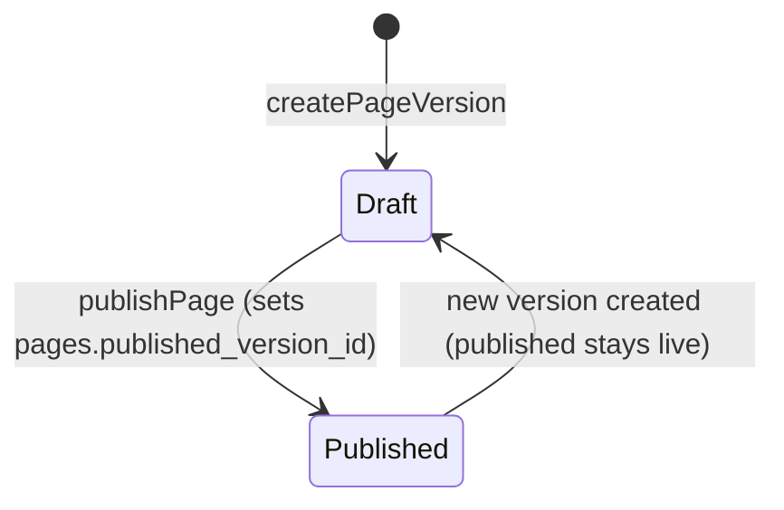
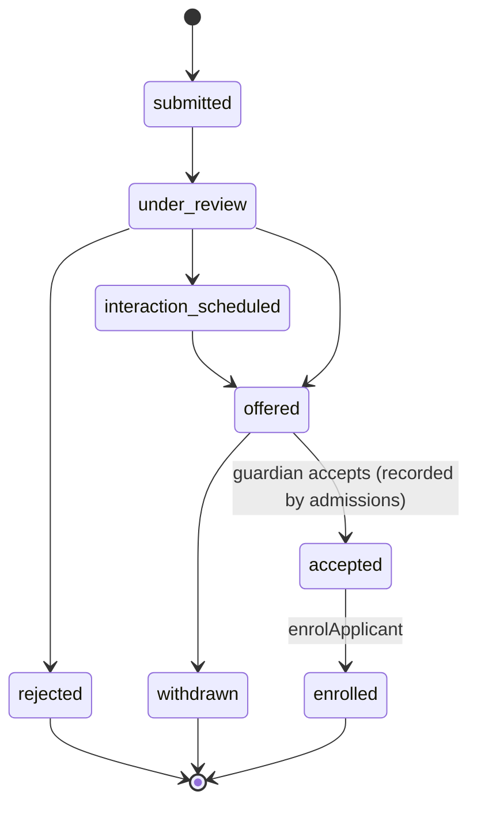
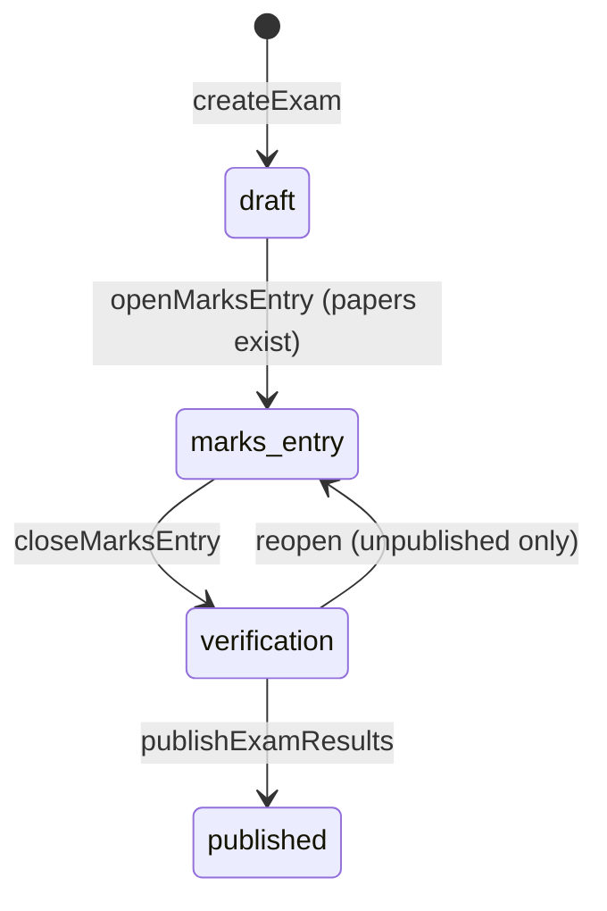
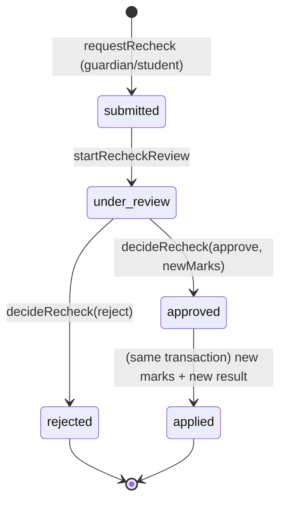
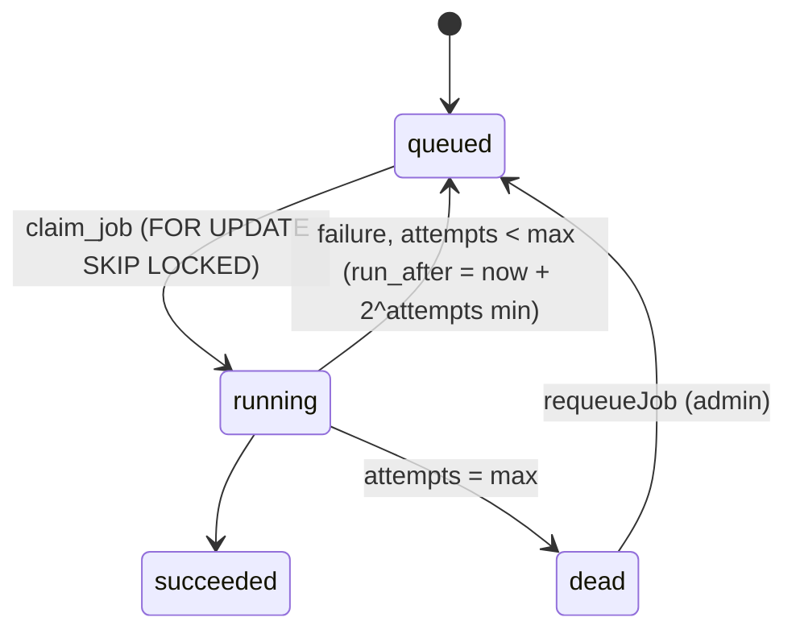

# 06 — Workflows and contracts

Thirteen workflows, each with trigger, preconditions, actor + permission, inputs (Zod), states, validation, side effects, transaction boundary, notifications, failures, duplicate behavior, audit, user feedback, and tests. Permissions are defined in `07 §2`; tables in `05 §2`; acceptance cases (C-nn) and journeys (J-nn) in `08`.

## 1. Shared contracts

### 1.1 Result envelope (D7)

```ts
type ActionResult<T> = { ok: true; data: T } | { ok: false; error: { code: ErrorCode; message: string; fieldErrors?: Record<string, string[]> } };
type ErrorCode =
  | 'unauthenticated' | 'forbidden' | 'not_found' | 'validation_failed' | 'conflict' | 'invalid_state'
  | 'rate_limited' | 'quota_exceeded' | 'ai_unavailable' | 'ai_policy_blocked' | 'ai_invalid_output'
  | 'dependency_failed' | 'internal';
```

SQL functions signal errors with `raise exception 'code:invalid_state' using detail = '<message>'`; the action layer maps `code:` prefixes to `ErrorCode`, everything else to `internal` (logged with a correlation id).

### 1.2 Action signature

Every action: `(institutionSlug: string, input: unknown) => Promise<ActionResult<T>>` created by `defineAction({ schema, permission, handler })` (`04 §3`). Handlers receive `(input, ctx)` where `ctx: TenantContext`. Idempotent actions accept an optional `idempotencyKey: z.string().uuid()`.

### 1.3 Common Zod primitives (`src/lib/schemas/common.ts`)

`uuid` · `money = z.number().nonnegative().multipleOf(0.01)` · `isoDate = z.string().date()` · `phoneIN = z.string().regex(/^[6-9]\d{9}$/)` · `shortText = z.string().trim().min(1).max(200)` · `longText = z.string().trim().max(5000)`.

## 2. Workflows

### W1 — Preconfigured demo tenant bootstrap

- **Trigger:** `pnpm seed` (or `pnpm db:reset`, which runs it). Self-service signup is planned (F-IDN-07); a stub `/signup` page shows "Contact us" (honesty label).
- **Preconditions:** local or hosted Supabase reachable with service role; `DEMO_RESET_ALLOWED=true` for any run against an existing demo tenant.
- **Actor:** operator (platform admin); no end-user permission.
- **Steps:** create auth users (admin API, `email_confirm: true`) → profiles → institution (`is_demo = true`, settings §4.1) → sequences → seed sections in order (`05 §8`).
- **Validation:** settings pass `InstitutionSettingsSchema`; every FK resolves; counts asserted at the end (students 3,024; sections 72; staff 106; invoices 6,048; results 3,024).
- **Failure:** any section failure aborts; rerun is safe because ids are deterministic (UUID v5) and inserts use `on conflict do nothing` for masters.
- **Audit:** one `audit_events` row `seed.completed` with counts.
- **Tests:** C-04 (reset guard), seed count assertions, `db:reset` wall time recorded.

### W2 — Student/guardian CSV import (P1; planned)

Contract only. `importStudentsCsv({ file, academicYearId, dryRun })`, permission `student.write`. Parses rows with Zod, detects duplicates by (admission_no) and (guardian phone + child name + dob), returns a preview `{ create, update, duplicates, errors }`; commit runs in one transaction per 500 rows via `app.import_students(jsonb)`. Not built in the demo; the seed covers data volume.

### W3 — Website publish and public enquiry capture



- **Edit/publish:** actions `savePageVersion({ pageId, blocks })` → inserts `page_versions` v+1 (never updates); `publishPage({ pageId, versionId })` → `app.publish_page` sets `published_version_id`, stamps `published_at`, audits `website.page.published`. Permissions `website.edit`, `website.publish`.
- **Public enquiry:** `POST /api/public/enquiry` with `{ slug, childName, gradeCode, guardianName, phone, email?, message?, website: '' (honeypot) }` → Zod → `app.submit_public_enquiry(slug, payload, ip_hash)`.
- **Inside the function:** institution by slug must be live; rate limit: ≥5 enquiries from the same `ip_hash` in 60 min → `code:rate_limited`; honeypot filled → return success without inserting (spam); duplicate: same (institution, phone, lower(child_name)) within 24 h → return existing id with `duplicate: true`; else insert `enquiries` (`source = 'website'`, status `new`) and enqueue job `notify.enquiry_received` (idempotency key `enquiry:<id>`).
- **Response:** `{ ok: true, data: { reference: 'ENQ-…' } }` always generic (no field-level leaks); errors `validation_failed`, `rate_limited`, `not_found` (unknown slug).
- **Tests:** C-80 (drafts invisible), C-81 (rate limit), C-82 (dedupe), C-83 (honeypot), J-01, J-02.

### W4 — Admission application → decision → enrolment



- **Enquiry pipeline:** `updateEnquiryStatus({ enquiryId, status, note? })` (`admissions.enquiry.write`), transitions validated against `settings.admissions.stages` order (backwards moves allowed except from `converted`). `convertEnquiryToApplication({ enquiryId, applicant, guardian, gradeId, academicYearId })` creates `applications` (number from `application_no` sequence), sets enquiry `converted`.
- **Decision:** `decideApplication({ applicationId, decision: 'offer'|'reject'|'accept'|'withdraw', note })`, permission `admissions.application.decide`; inserts `application_decisions`, updates status per diagram; invalid transition → `invalid_state`.
- **Enrolment:** `enrolApplicant({ applicationId, classSectionId, feeStructureId, rollNo? })`, permission `admissions.enrol` → `app.enrol_applicant(...)` single transaction:
  1. lock application `for update`; status must be `accepted` (or `enrolled` → return existing student, `alreadyEnrolled: true`);
  2. `admission_no = app.next_sequence(inst, 'admission_no')`; insert `students` with `source_application_id`;
  3. guardian: select by (inst, phone) else insert; insert `guardian_students` (`is_primary = true`, relationship from application);
  4. section capacity check (`capacity` vs active enrolments → `code:conflict` if full); insert `enrolments` (`active`, roll_no = given or max+1) + history row;
  5. insert `fee_assignments`; call `app.generate_invoice(student_id, current_term_id)`;
  6. application → `enrolled`; audit `admissions.enrolled` with ids; enqueue `notify.enrolment_welcome`.
- **Idempotency:** unique `students.source_application_id`; a retry after step 2 returns the existing student (the function checks before inserting). Concurrent double-click is serialized by the row lock.
- **Feedback:** success toast with admission number and links to the student profile and invoice.
- **Tests:** C-20 (idempotent), C-21 (guardian reuse by phone), C-22 (capacity), C-23 (state guard), J-03..J-05.

### W5 — Attendance session → absence → correction → notification

- **Open/mark:** page `/attendance` for the teacher's sections for `today` (institution timezone). `markAttendance({ classSectionId, date, records: [{ studentId, status, note? }] })`, permission `attendance.mark` + RLS class **T** (class teacher or admin). Upserts `attendance_sessions` (unique per section/date) and `attendance_records` (unique per session/student). Status codes validated against settings.
- **Submit:** `submitAttendance({ sessionId })` → status `submitted`, `submitted_at`; for each record whose status has `notify_guardian: true`, enqueue one job `notify.attendance_absence` (idempotency key `absence:<record_id>`). Resubmission is idempotent (same keys).
- **Correction:** `correctAttendance({ recordId, newStatus, reason })`, permission `attendance.correct`; allowed for the class teacher within `correction_window_days`, for admin/principal any time; inserts `attendance_corrections`, updates record, audits `attendance.corrected`; if the new status is non-notifying and an absence notification exists, a follow-up notification "attendance updated" is queued.
- **Failures:** past-dated sessions beyond 7 days require `attendance.correct`; future dates → `validation_failed`.
- **Tests:** C-15, C-16 (teacher of another section forbidden), J-06.

### W6 — Assignment creation and AI quiz generation

- **Create:** `createAssignment({ classSectionId, subjectId, curriculumUnitId?, title, instructions?, dueAt?, content? })`, permission `assignment.manage` + teaches section; status `draft`. `publishAssignment({ assignmentId })` → `published`; guardians/students of that section can read.
- **AI quiz:** `POST /api/ai/quiz` `{ institutionSlug, curriculumUnitId, questionCount: 5..15, difficulty: 'easy'|'medium'|'hard' }`, permission `ai.generate`. Builds the prompt from `curriculum_units.title/description` + grade + subject only (no student data). Calls `gateway.runStructured({ feature: 'quiz_generation', schema: QuizSchema })`. Returns the quiz JSON for review; nothing is stored except `ai_usage_events`.
- **Review and save:** teacher edits questions client-side, then `createAssignment({ …, content: quiz, aiGenerated: true })`. UI labels "AI draft — review before publishing".
- **Failures:** `ai_unavailable` → "Local AI is offline; try again or write the quiz manually"; `ai_policy_blocked`, `quota_exceeded`, `rate_limited` shown verbatim with the policy name; invalid output after one repair retry → `ai_invalid_output`.
- **Tests:** C-60..C-66 (gateway), J-08, unit test for `QuizSchema` (exactly N questions, 4 unique options, answer ∈ options).

### W7 — Exam setup → marks entry → verification → publish



- **Setup:** `createExam({ termId, name, type, gradingScaleKey })`, `createExamPapers({ examId, papers: [{ classSectionId, subjectId, maxMarks, passMarks, heldOn? }] })`, permission `exam.manage`.
- **Marks entry:** `enterMarks({ examPaperId, marks: [{ studentId, marksObtained?, isAbsent }] })`, permission `exam.marks.enter` + (teacher assigned to that section/subject or exam roles). Each save inserts a new `marks` version per changed student and supersedes the previous current row (never updates). Trigger checks `0 ≤ marks ≤ max_marks`.
- **Verification:** `verifyExam({ examId })` returns `{ missing: [...], outOfRange: [...], summary }`; computed by `app.exam_verification(exam_id)`; UI blocks publish until `missing` is empty.
- **Publish:** `publishExamResults({ examId })`, permission `exam.result.publish` → `app.publish_exam_results(exam_id)` in one transaction: re-run verification (raise `code:invalid_state` if failing) → for each enrolled student in the exam's sections compute snapshot (per subject: marks, max, pass, grade via `app.grade_for`), total, percentage, grade, attendance % for the term → insert `results` v1 → exam `published`, `published_at` → audit `exam.published` → enqueue `notify.results_published` per student (idempotency `result:<result_id>`).
- **Duplicates:** publishing twice → `invalid_state` (already published). Re-publication is never allowed; corrections go through W8.
- **Tests:** C-40 (verification blocks), C-41 (snapshot equals Σ marks; one result per student), C-43 (marks versioning), J-09, J-10.

### W8 — Recheck request → review → decision → correction → re-snapshot → notify



- **Request:** `requestRecheck({ resultId, examPaperId, reason })`, permission `exam.recheck.request`; RLS ensures the result belongs to the requester's child/self; window = `published_at + recheck_window_days`; one open request per paper (`conflict`).
- **Review:** `startRecheckReview({ requestId })`, permission `exam.recheck.review` (exam roles).
- **Decision:** `decideRecheck({ requestId, decision, newMarks?, note })`, permission `exam.recheck.decide` → `app.apply_recheck_decision(...)`: insert `recheck_decisions`; if approve: insert `marks` v+1 (`source = 'recheck'`), supersede current; recompute that student's result → insert `results` v+1, supersede current; request `applied`; audit `exam.recheck.applied` with old/new marks; enqueue `notify.recheck_decided`. If reject: request `rejected`, audit, notify. Approve without `newMarks` → `validation_failed`.
- **Invariants:** original marks and results rows are untouched; the report card shows the current version with a "Corrected on …" note and the version history to exam roles.
- **Tests:** C-42, C-44 (guardian cannot request for another child), J-11, J-12.

### W9 — Fee structure → assignment → invoice → payment → receipt → ledger

- **Structure:** `upsertFeeStructure({ academicYearId, gradeId, name, components: [{ head, amount, frequency, appliesToNewOnly }] })`, permission `finance.structure.manage`.
- **Assignment:** `assignFeeStructure({ studentId, feeStructureId, concessions?: [...] })`, permission `finance.structure.manage`; concessions need `approved_by` = caller.
- **Invoice generation:** `generateTermInvoices({ termId, gradeIds? })`, permission `finance.invoice.generate` → enqueues job `finance.generate_term_invoices` (idempotency `invoices:<term_id>:<grade_id>`); the handler calls `app.generate_invoice(student_id, term_id)` per active enrolment. The function: skips if an invoice exists for (student, term); sums components due in that term (`annual`/`one_time` in Term 1 only; `term` every term; `monthly`/`quarterly` prorated into the term), applies concessions, allocates `invoice_no` (FY sequence), inserts invoice + lines; ledger: Dr `fees_receivable` / Cr `fee_income` (and Dr `concession_expense` for concessions).
- **Payment:** `recordPayment({ invoiceId, amount, mode, reference?, receivedAt, idempotencyKey })`, permission `finance.payment.record` → `app.record_payment(...)`: lock invoice; amount ≤ outstanding (`validation_failed` otherwise); insert `payments`; `receipt_no` from FY sequence; insert `receipts` with snapshot; ledger Dr `cash`/`bank` (by mode) / Cr `fees_receivable`; invoice `paid_total` += amount, status `part_paid`/`paid`; audit `finance.payment.recorded`.
- **Idempotency:** `payments.idempotency_key` unique; the function returns the existing payment/receipt when the key repeats.
- **Feedback:** receipt page (printable) with "Simulated SMS sent" badge if a receipt notification is configured (P1).
- **Tests:** C-50..C-53, unit tests for proration and concession math, J-07 (guardian view).

### W10 — AI request pipeline

Order inside `gateway.runStructured`: authenticate (ctx) → `requirePermission('ai.generate')` → policy resolve → quota (daily tokens, from `ai_usage_events` sum for today in institution timezone) → per-user rate (count last 60 s) → concurrency slot → provider selection → redaction (cloud only) → call with timeout → Zod validation (+1 repair retry) → usage log → return. Any failure logs a usage event with `ok = false` and `error_code`. Inputs validated by the feature's Zod schema before the gateway is called; outputs by the feature's output schema inside the gateway. Tests C-60..C-64.

### W11 — Local inference unavailable

- `local_only`: gateway returns `ai_unavailable` with message "Local AI engine is not reachable (policy: local only)". No cloud module is loaded (test asserts the Anthropic provider factory is never called — C-62).
- `local_with_cloud_fallback`: on connection error, timeout (60 s), or `ai_invalid_output` after retry → if `ANTHROPIC_API_KEY` and `AI_CLOUD_ENABLED=true` → redact → cloud call → usage event `provider = 'anthropic', fallback = true`; else `ai_unavailable`.
- `cloud_allowed`: cloud first when configured; local when not; failure of the chosen provider → `ai_unavailable` (no silent second attempt unless policy is fallback).
- UI shows the provider used ("Generated locally" / "Generated in cloud (redacted)") — honesty label. Test C-63.

### W12 — Job execution



- Enqueue: `app.enqueue_job(institution_id, type, payload, idempotency_key)` → `on conflict (idempotency_key) do nothing`.
- Runner (`/api/jobs/run` with `CRON_SECRET`, or `pnpm jobs:run`): loop ≤ 50 jobs / 50 s: claim → dispatch by `type` to `src/modules/jobs/handlers/<type>.ts` → mark result. Stale `running` rows older than 10 min are reclaimed (crash recovery).
- Handlers are idempotent (notifications keyed by `(type, entity_id, recipient)` unique index on `notifications.data->>'key'`).
- Admin page `/jobs` lists failed/dead jobs with error and a requeue button (`job.manage`). Tests C-70..C-72.

### W13 — Demo reset

- `pnpm demo:reset` (CLI) or `/settings/demo` button (permission `demo.reset`, platform admin + `is_demo` institution only).
- Preconditions: `DEMO_RESET_ALLOWED=true`; institution `is_demo = true`; confirmation phrase in UI.
- Steps: `app.demo_reset(institution_id)` deletes in reverse dependency order within one transaction with `set local app.allow_reset = 'on'` (immutability triggers consult this), then the seed re-runs sections. Auth users are kept (same ids) so demo logins never change.
- Audit: `demo.reset` event in the fresh audit log with duration and counts.
- Tests: C-04 (non-demo refused; env guard), E2E smoke after reset (J-00).

## 3. Notification types and templates

| Type | Recipients | Channels | Template (EN; HI variant in settings) |
|---|---|---|---|
| `attendance_absence` | primary guardian | in_app, sms (sim) | "Dear Parent, {student} ({class}) is marked absent today {date}. Contact the class teacher if unplanned. -{school}" |
| `results_published` | guardians of student | in_app, sms (sim) | "Report card of {student} for {exam} is now available in the parent portal. -{school}" |
| `recheck_decided` | requester | in_app, sms (sim) | "Recheck for {student}, {subject}: {decision}. Updated marks: {marks}. -{school}" |
| `enquiry_received` | admissions role members | in_app | "New enquiry: {child} for {grade} from {guardian}." |
| `enrolment_welcome` | primary guardian | in_app, email (sim) | "Welcome! {student} is enrolled in {class}. Admission no {admission_no}." |

## 4. Audit action catalog

`seed.completed` · `demo.reset` · `membership.changed` · `website.page.published` · `admissions.enquiry.status` · `admissions.decision` · `admissions.enrolled` · `attendance.submitted` · `attendance.corrected` · `assignment.published` · `exam.marks.entered` · `exam.published` · `exam.recheck.requested` · `exam.recheck.applied` · `exam.recheck.rejected` · `finance.invoice.generated` · `finance.payment.recorded` · `ai.request` (metadata only). Every entry carries `actor_user_id`, entity ids, and before/after where a row changed.
