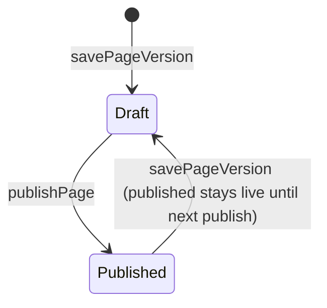
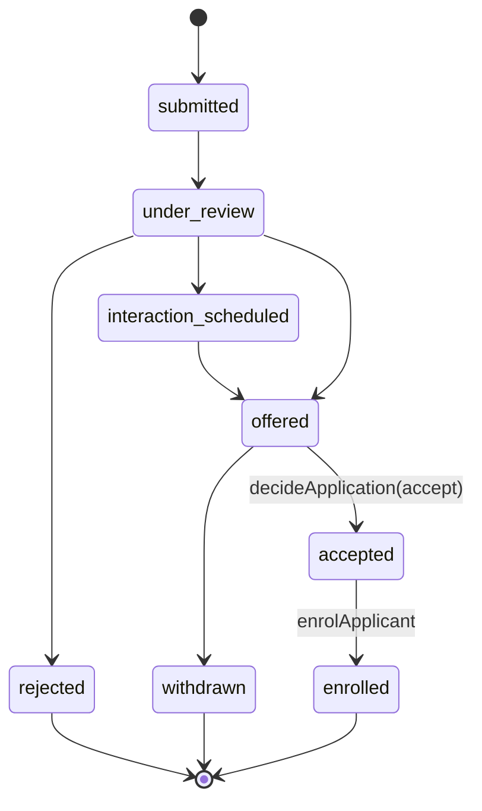
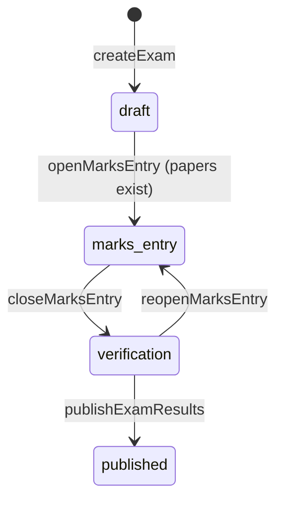
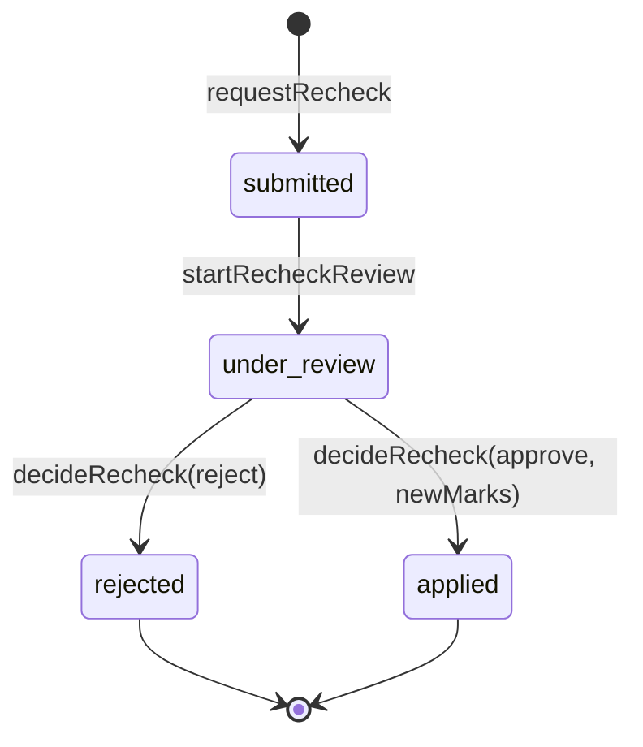
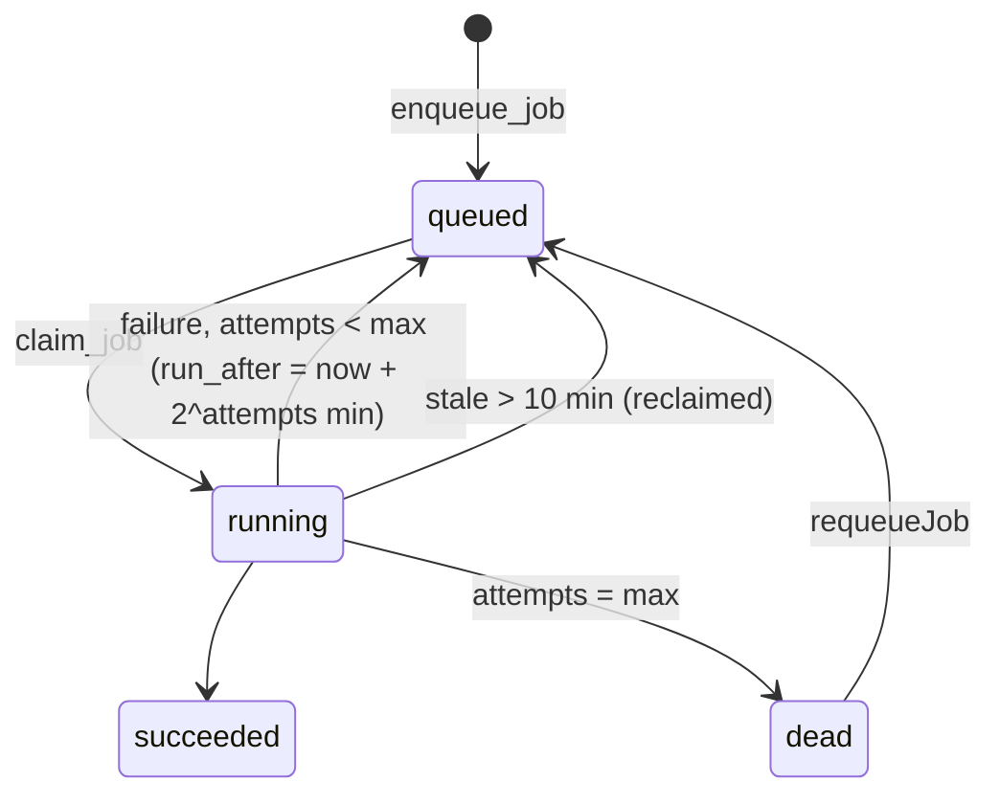

# 06 — Workflows and contracts

Thirteen workflows. Each carries the same fields: trigger · preconditions · actor and permission · inputs (Zod) · states · validation · side effects · DB operations and transaction boundary · notifications · approvals · failure and retry · duplicate submission · audit · user feedback · tests. Permissions: `07 §2`. Tables: `05 §2`. Named demo entities: `05 §8.1`. Acceptance ids (C-nn, J-nn): `08`.

## 1. Shared contracts

### 1.1 Result envelope (D7)

```ts
type ActionResult<T> = { ok: true; data: T } | { ok: false; error: { code: ErrorCode; message: string; fieldErrors?: Record<string, string[]> } };
type ErrorCode =
  | 'unauthenticated' | 'forbidden' | 'not_found' | 'validation_failed' | 'conflict' | 'invalid_state'
  | 'rate_limited' | 'quota_exceeded' | 'ai_unavailable' | 'ai_policy_blocked' | 'ai_invalid_output'
  | 'dependency_failed' | 'internal';
```

SQL functions signal errors with `raise exception 'code:invalid_state' using detail = '<message>'`; the action layer maps `code:` prefixes to `ErrorCode` and everything else to `internal` (logged with a correlation id, never shown raw). `not_found` is returned for rows outside the caller's scope so that existence is never revealed.

### 1.2 Action signature and registry

Every action: `(institutionSlug: string, input: unknown) => Promise<ActionResult<T>>`, created by `defineAction({ name, schema, permission, handler })` (`04 §3`) and exported from the module's `actions.ts`. `name` is the audit action string; `defineAction` registers the action in `src/lib/actions/registry.ts` so the security suite can call every action as every role (C-03). Handlers receive `(input, ctx)`; `ctx: TenantContext` is recomputed from the session, never trusted from the client. Idempotent actions accept `idempotencyKey: z.string().uuid()`.

### 1.3 Common Zod primitives (`src/lib/schemas/common.ts`)

`uuid` · `money = z.number().nonnegative().multipleOf(0.01)` · `isoDate = z.string().date()` · `phoneIN = z.string().regex(/^[6-9]\d{9}$/)` · `shortText = z.string().trim().min(1).max(200)` · `longText = z.string().trim().max(5000)` · all object schemas use `.strict()`.

### 1.4 Transaction rule

A workflow step that touches more than one table in a way that must not partially succeed is a `security definer` SQL function (one transaction). Everything else is a single-statement action. Actions never open multi-statement transactions from TypeScript.

### 1.5 Retry rule

Actions are not retried automatically; the UI offers "Try again" and idempotency keys make repeats safe. Jobs retry per W12. AI calls get one repair retry per W10.

## 2. Workflows

### W1 — Preconfigured demo tenant bootstrap

- **Trigger:** `pnpm seed`; also the tail of `pnpm db:reset` and `pnpm demo:reset`. Self-service signup is planned (F-IDN-07); `/signup` shows "Contact us" with the planned label.
- **Preconditions:** Supabase reachable; `SUPABASE_SECRET_KEY`; `SERVICE_ROLE_CALLER=seed`; `DEMO_RESET_ALLOWED=true` when the demo tenant already has rows.
- **Actor / permission:** operator at the CLI; no end-user permission.
- **Inputs:** none; constants in `scripts/seed/config.ts` (PRNG seed 20261028, counts from `05 §8`).
- **States:** `empty → seeding(section n) → seeded`; a failed section leaves `seeding`, and rerun resumes from the first incomplete section (each section checks its own count sentinel).
- **Validation:** settings pass `InstitutionSettingsSchema`; every FK resolves; final count assertions (`05 §8.2`).
- **Side effects:** auth users via the admin API (`email_confirm: true`), profiles, institution, sequences, all sections.
- **DB / transaction:** per section, batches of 1,000 rows through the service-role client; masters use `on conflict do nothing` with deterministic ids.
- **Notifications:** none (seed writes historical notifications directly, marked read).
- **Approvals:** none.
- **Failure / retry:** abort on first error; rerun is safe (deterministic ids). Non-demo institutions are never touched.
- **Duplicates:** impossible by deterministic UUID v5 ids.
- **Audit:** one `seed.completed` event with counts and duration.
- **Feedback:** CLI prints counts, duration, and the demo login list (no passwords).
- **Tests:** C-04, seed count assertions, `db:reset` wall time in the T-013 report.

### W2 — Student/guardian CSV import (planned, contract only)

`importStudentsCsv({ file, academicYearId, dryRun })`, permission `student.write`. Zod-parses rows (admission_no?, names, dob, gender, grade, section, guardian name/phone/relationship); duplicate detection by `admission_no` and by (guardian phone + child name + dob); `dryRun` returns `{ create, update, duplicates, errors }`; commit calls `app.import_students(jsonb)` in 500-row transactions; audit `people.imported`. Not built in the demo; the seed covers data volume (F-STU-05).

### W3 — Website publish and public enquiry capture



- **Trigger:** editor saves or publishes (`/website`); visitor submits the enquiry block.
- **Preconditions:** `websites` row exists (seeded); `is_live = true` for public rendering.
- **Actor / permission:** `website.edit` for `savePageVersion({ pageId: uuid, blocks: BlockSchema[] })`; `website.publish` for `publishPage({ pageId: uuid, versionId: uuid })`; visitor (anon) for `POST /api/public/enquiry`.
- **Inputs (enquiry):** `{ slug: shortText, childName: shortText, gradeCode: z.enum(grade codes), guardianName: shortText, phone: phoneIN, email: z.string().email().optional(), message: longText.optional(), website: z.literal('') }` (last field is the honeypot).
- **States:** page versions as in the diagram; enquiry starts at `new` (W4 continues).
- **Validation:** blocks validated per block type (`04 §6`); a version can only be published once and only for its own page.
- **Side effects:** publish stamps `page_versions.published_at`, sets `pages.published_version_id`; enquiry inserts `enquiries`.
- **DB / transaction:** `app.publish_page(page_id, version_id)` (single statement + audit); `app.submit_public_enquiry(slug, payload jsonb, ip_hash text)` (rate limit, honeypot, dedupe, insert, enqueue — one transaction).
- **Notifications:** job `notify.enquiry_received` (key `enquiry:<id>`) to members with role `admissions`.
- **Approvals:** publish requires `website.publish` (admissions can edit but not publish).
- **Failure / retry:** rate limit ≥ 5 submissions per `ip_hash` per 60 min → `rate_limited`; unknown or offline slug → `not_found`; validation → `validation_failed`. The visitor may retry after the stated wait.
- **Duplicates:** same (institution, phone, lower(child_name)) within 24 h returns the existing reference with `duplicate: true` and no new row. Honeypot filled → success response, nothing stored.
- **Audit:** `website.page.published` (actor, page, version); enquiry insert carries `source = 'website'` and `source_ip_hash` (no audit row for anon).
- **Feedback:** "Thank you, reference ENQ-…; the admissions office will call you" (same message for duplicates).
- **Tests:** C-80 drafts invisible, C-81 rate limit, C-82 dedupe, C-83 honeypot, J-01, J-02.

### W4 — Admission application → decision → enrolment



- **Trigger:** admissions officer works the pipeline (`/admissions`).
- **Preconditions:** enquiry exists (W3 or manual); for enrolment: application `accepted`, a class section for the applied grade in the current year with free capacity, a fee structure for that grade.
- **Actor / permission:** `admissions.enquiry.write` → `updateEnquiryStatus({ enquiryId, status: z.enum(settings stages), note?: longText })` and `convertEnquiryToApplication({ enquiryId, applicant: { firstName, lastName?, dob: isoDate, gender, previousSchool? }, guardian: { fullName, phone: phoneIN, email?, relationship }, gradeId, academicYearId })`; `admissions.application.decide` → `decideApplication({ applicationId, decision: z.enum(['offer','reject','accept','withdraw']), note?: longText })`; `admissions.enrol` → `enrolApplicant({ applicationId, classSectionId, feeStructureId, rollNo?: z.number().int().positive() })`.
- **States:** enquiry stages from settings (backward moves allowed except out of `converted`); application per diagram.
- **Validation:** transitions checked against the diagram (`invalid_state`); applicant age vs grade cut-off produces a warning, not a block (configurable later); section must belong to the applied grade and current year.
- **Side effects:** application number from `application_no` sequence on convert; decisions appended; enrolment creates student, guardian link, enrolment, fee assignment, first invoice (W9).
- **DB / transaction:** `app.enrol_applicant(application_id, class_section_id, fee_structure_id, roll_no)` performs, in one transaction: (1) lock application `for update`; if `enrolled` return existing `{ studentId, admissionNo, alreadyEnrolled: true }`; if not `accepted` → `code:invalid_state`; (2) `admission_no = app.next_sequence(inst, 'admission_no')`; insert `students` with `source_application_id`; (3) guardian by (inst, phone) else insert; insert `guardian_students` (primary); (4) capacity check → `code:conflict`; insert `enrolments` (active, roll_no given or max+1) + history row; (5) insert `fee_assignments`; `app.generate_invoice(student_id, current_term_id)`; (6) application → `enrolled`; `app.audit('admissions.enrolled')`; `app.enqueue_job('notify.enrolment_welcome', key 'enrol:<application_id>')`.
- **Notifications:** `enrolment_welcome` to the primary guardian (in-app + simulated email). A guardian who has no portal login yet receives nothing visible until a login is provisioned (DBT-12).
- **Approvals:** `accept` is recorded by admissions on the guardian's behalf; `offer`/`reject` need `admissions.application.decide` (principal or admissions).
- **Failure / retry:** any step failure rolls back everything; the UI shows the code and keeps the dialog open; repeating is safe.
- **Duplicates:** `students.source_application_id` unique; double-click serialized by the row lock; the second call returns the existing student.
- **Audit:** `admissions.enquiry.status`, `admissions.decision` (with decision + note), `admissions.enrolled` (student, guardian, enrolment, invoice ids).
- **Feedback:** toast with admission number and links to the student profile and the invoice; the application card shows "Enrolled".
- **Tests:** C-20 idempotent, C-21 guardian reuse, C-22 capacity, C-23 state guard, J-03, J-04, J-05.

### W5 — Attendance session → absence → correction → notification

- **Trigger:** class teacher opens `/attendance` for today (institution timezone); later a correction request.
- **Preconditions:** teacher is class teacher of the section (or has admin roles); date is today or within the past 7 days for admins; session not yet submitted for marking, submitted for corrections.
- **Actor / permission:** `attendance.mark` → `markAttendance({ classSectionId, date: isoDate, records: z.array({ studentId, status: z.enum(settings codes), note?: shortText }).min(1) })` and `submitAttendance({ sessionId })`; `attendance.correct` → `correctAttendance({ recordId, newStatus, reason: shortText })`.
- **States:** session `open → submitted`; record status values from settings; corrections append.
- **Validation:** status codes from `settings.attendance.statuses`; every student in `records` must have an active enrolment in the section; future dates → `validation_failed`; teacher corrections only within `correction_window_days`.
- **Side effects:** upsert session (unique per section/date) and records (unique per session/student); corrections insert `attendance_corrections` and update the record; dashboard counters are live queries.
- **DB / transaction:** `markAttendance` = one upsert statement for the session and one bulk upsert for records (RLS **T**); `submitAttendance` = status update + per-absence `app.enqueue_job` in one SQL function `app.submit_attendance(session_id)`; `correctAttendance` = `app.correct_attendance(record_id, new_status, reason)` (insert + update + audit + optional job).
- **Notifications:** `attendance_absence` to the primary guardian for each record whose status has `notify_guardian: true` (in-app + simulated SMS), key `absence:<record_id>`; a correction from a notifying to a non-notifying status enqueues `attendance_updated` with key `absence-corrected:<correction_id>`.
- **Approvals:** none in the demo; corrections after the window need admin roles (acts as approval).
- **Failure / retry:** resubmitting a submitted session is a no-op success; job failures retry per W12.
- **Duplicates:** idempotent upserts and job keys.
- **Audit:** `attendance.submitted` (session, counts), `attendance.corrected` (old/new, reason).
- **Feedback:** "Attendance submitted — 2 absences, guardians notified (SMS simulated)".
- **Tests:** C-15, C-16, J-06.

### W6 — Assignment creation and AI quiz generation

- **Trigger:** teacher opens a curriculum unit and clicks "Generate quiz", or creates an assignment manually.
- **Preconditions:** teacher teaches the section/subject; AI policy permits a provider (W10).
- **Actor / permission:** `ai.generate` → `POST /api/ai/quiz` `{ institutionSlug, curriculumUnitId: uuid, questionCount: z.number().int().min(5).max(15), difficulty: z.enum(['easy','medium','hard']) }`; `assignment.manage` → `createAssignment({ classSectionId, subjectId, curriculumUnitId?, title: shortText, instructions?: longText, dueAt?: z.string().datetime(), content?: QuizSchema, aiGenerated: z.boolean().default(false) })`, `publishAssignment({ assignmentId })`.
- **States:** assignment `draft → published → closed`.
- **Validation:** `QuizSchema = { questions: z.array({ id, stem: shortText, options: z.tuple([s,s,s,s]), answer: z.enum(['A','B','C','D']), explanation?: shortText }).length(n) }` with unique options; the prompt is built only from unit title/description, grade, subject, difficulty (no student data).
- **Side effects:** AI call logs `ai_usage_events`; nothing else is stored until the teacher saves.
- **DB / transaction:** single inserts/updates under RLS (`assignments` scoped by `app.teaches_section`).
- **Notifications:** none in the demo (assignment visibility in the portal is the notification).
- **Approvals:** the teacher's review is the approval; the UI blocks saving without opening the review step.
- **Failure / retry:** `ai_unavailable` → "Local AI engine is offline; retry or write the quiz manually"; `ai_policy_blocked`, `quota_exceeded`, `rate_limited` shown with the policy name; `ai_invalid_output` after one repair retry → "Could not produce a valid quiz; try fewer questions".
- **Duplicates:** repeated generation is allowed (each logged); saving twice creates two drafts by design.
- **Audit:** `ai.request` (metadata only) via the usage log; `assignment.published`.
- **Feedback:** provider badge "Generated locally" / "Generated in cloud (redacted)"; "AI draft — review before publishing".
- **Tests:** C-60..C-66, unit tests for `QuizSchema`, J-08.

### W7 — Exam setup → marks entry → verification → publish



- **Trigger:** exam controller sets up an exam; teachers enter marks; controller verifies and publishes.
- **Preconditions:** term exists; sections and subject assignments exist; for publish, verification is clean.
- **Actor / permission:** `exam.manage` → `createExam({ termId, name: shortText, type: z.enum(settings types), gradingScaleKey: z.string().default('default') })`, `createExamPapers({ examId, papers: z.array({ classSectionId, subjectId, maxMarks: money, passMarks: money, heldOn?: isoDate }).min(1) })`, `openMarksEntry`, `closeMarksEntry`, `reopenMarksEntry({ examId })`; `exam.marks.enter` → `enterMarks({ examPaperId, marks: z.array({ studentId, marksObtained?: money, isAbsent: z.boolean() }).min(1) })`; `exam.result.publish` → `publishExamResults({ examId })`.
- **States:** per diagram; `published` is terminal (corrections via W8).
- **Validation:** `passMarks ≤ maxMarks`; `0 ≤ marksObtained ≤ maxMarks` (trigger); absent rows carry null marks; marks only for students enrolled in the paper's section; teacher may enter only for papers of sections/subjects assigned to them.
- **Side effects:** each save inserts new `marks` versions for changed students and supersedes the previous current row; verification computes `{ missing, outOfRange, summary }`.
- **DB / transaction:** `enterMarks` → `app.enter_marks(exam_paper_id, jsonb)` (insert versions + supersede in one transaction); `app.exam_verification(exam_id)` read-only; `app.publish_exam_results(exam_id)` in one transaction: re-verify (`code:invalid_state` on failure) → per enrolled student in the exam's sections compute snapshot (per subject marks/max/pass/grade via `app.grade_for`, totals, percentage, overall grade, term attendance %) → insert `results` v1 → exam `published`, `published_at` → audit → enqueue `notify.results_published` per student (key `result:<result_id>`).
- **Notifications:** `results_published` to all guardians of each student (in-app + simulated SMS).
- **Approvals:** publishing is restricted to `exam.result.publish` (owner, principal, exam controller); teachers cannot publish.
- **Failure / retry:** publish with missing marks → `invalid_state` listing the papers; the controller fixes and retries. Publish is atomic.
- **Duplicates:** publishing twice → `invalid_state` (already published); saving identical marks creates no new version (compared before insert).
- **Audit:** `exam.marks.entered` (paper, count, version range), `exam.published` (exam, result count).
- **Feedback:** verification panel with per-paper missing counts; publish confirmation "3,024 results published; guardians notified".
- **Tests:** C-40, C-41, C-43, J-09, J-10. Demo data: `Periodic Test 2 (Grade X)` sits in `marks_entry` with one paper (X-A Mathematics) unmarked (`05 §8.1`).

### W8 — Recheck request → review → decision → correction → re-snapshot → notify



- **Trigger:** guardian or student opens the report card and requests a recheck for one subject.
- **Preconditions:** result is current and published within `recheck_window_days`; no open request for that paper.
- **Actor / permission:** `exam.recheck.request` → `requestRecheck({ resultId, examPaperId, reason: longText.min(10) })`; `exam.recheck.review` → `startRecheckReview({ requestId })`; `exam.recheck.decide` → `decideRecheck({ requestId, decision: z.enum(['approve','reject']), newMarks?: money, note: longText })`.
- **States:** per diagram (`approved` exists only transiently inside the transaction; the row lands in `applied`).
- **Validation:** RLS ensures the result belongs to the requester's child/self; `approve` requires `newMarks` within `[0, maxMarks]`; `newMarks` equal to current marks → `validation_failed`.
- **Side effects:** approve inserts `marks` v+1 (`source = 'recheck'`), recomputes the student's result and inserts `results` v+1; originals preserved with `superseded_by`.
- **DB / transaction:** `app.apply_recheck_decision(request_id, decision, new_marks, note)`: insert `recheck_decisions`; if approve: new marks version, new results version, request `applied`; if reject: request `rejected`; audit; enqueue notification. One transaction.
- **Notifications:** `recheck_decided` to the requester (in-app + simulated SMS).
- **Approvals:** the decision itself is the approval; only exam roles may decide; the deciding user is recorded.
- **Failure / retry:** decisions are final; a wrong decision is corrected by a new recheck cycle (controller may create a request on behalf with `exam.recheck.review`).
- **Duplicates:** one open request per (result, paper) (partial unique) → `conflict`.
- **Audit:** `exam.recheck.requested`, `exam.recheck.applied` (old/new marks, versions), `exam.recheck.rejected`.
- **Feedback:** report card shows "Corrected on <date> after recheck" with current values; exam roles see version history.
- **Tests:** C-42, C-44, J-11, J-12.

### W9 — Fee structure → assignment → invoice → payment → receipt → ledger

- **Trigger:** accountant configures structures (`/finance`), generates term invoices, records payments at the counter.
- **Preconditions:** academic year, terms, grades exist; students enrolled; `invoice_no`/`receipt_no` sequences exist for the financial year.
- **Actor / permission:** `finance.structure.manage` → `upsertFeeStructure({ academicYearId, gradeId, name: shortText, components: z.array({ head: z.enum(heads), amount: money, frequency: z.enum(['one_time','annual','term','quarterly','monthly']), appliesToNewOnly: z.boolean() }).min(1) })`, `assignFeeStructure({ studentId, feeStructureId, concessions?: z.array({ kind, head?, percent?, amount?, reason: shortText }) })`; `finance.invoice.generate` → `generateTermInvoices({ termId, gradeIds?: uuid[] })`; `finance.payment.record` → `recordPayment({ invoiceId, amount: money.positive(), mode: z.enum(settings modes), reference?: shortText, receivedAt: z.string().datetime(), idempotencyKey: uuid })`.
- **States:** invoice `issued → part_paid → paid` (and `cancelled`, admin only, P1); payments and receipts have no states.
- **Validation:** concession has percent xor amount; payment amount ≤ outstanding; mode in settings; `receivedAt` not in the future.
- **Side effects:** invoice generation creates invoices + lines + ledger (Dr `fees_receivable` / Cr `fee_income`, Dr `concession_expense` for concessions); payment creates payment + receipt (number from `receipt_no:<FY>`) + ledger (Dr `cash` for cash, Dr `bank` otherwise / Cr `fees_receivable`) and updates `paid_total`/status.
- **DB / transaction:** `app.generate_invoice(student_id, term_id)` (idempotent on (student, term); `annual`/`one_time` in Term 1 only or at first invoice for new admissions; `term` each term; `monthly` × 6 and `quarterly` × 2 per term) and `app.record_payment(...)`, both single transactions; `generateTermInvoices` enqueues `finance.generate_term_invoices` (key `invoices:<term_id>:<grade_id|all>`) whose handler loops enrolments and calls the function per student.
- **Notifications:** none on payment (fee receipt SMS is P1); overdue reminders via `fee_reminder` (W9a).
- **Approvals:** concessions record `approved_by` = caller with `finance.structure.manage`; no separate approval step in the demo.
- **Failure / retry:** job failures retry per W12 and are idempotent per student; a failed payment leaves nothing behind; the cashier retries with the same `idempotencyKey` (generated when the dialog opens).
- **Duplicates:** `payments.idempotency_key` unique → the function returns the existing payment and receipt.
- **Audit:** `finance.invoice.generated`, `finance.payment.recorded` (amount, mode, receipt no).
- **Feedback:** printable receipt page; invoice shows outstanding; dashboard collection tile updates.
- **Tests:** C-50..C-54, unit tests for proration and concession math, J-07 (guardian view; demo records a payment for Aarav Sharma's Term 2 invoice live, `05 §8.1`).

### W9a — Payment void/refund/bounce → fee reminders → online intent → webhook (M12)

- **Trigger:** owner/principal voids a wrong or bounced payment from the receipt page; accountant sends overdue reminders for a term; a guardian (or the counter) starts an online payment for an invoice; Razorpay posts the capture to the webhook.
- **Actor / permission:** `finance.payment.void` (owner, principal; module `finance_plus`) → `finance.payment.void({ paymentId, kind: z.enum(['void','refund','cheque_bounce']), reason: 5–500 chars, idempotencyKey })`; `finance.reminder.send` (owner, principal, accountant; module `finance_plus`) → `finance.reminders.send({ termId })`; `finance.payment.online` (owner, principal, accountant, guardian of the student; module `online_payments`) → `finance.payment.createIntent({ invoiceId, amount: money ≥ 1.00, idempotencyKey })`; `finance.structure.manage` → query `finance.collectionReport({ academicYearId?, termId?, groupBy: term|grade|mode })`, CSV via `?format=csv`. The webhook `POST /api/public/payments/razorpay` is not an action.
- **States:** reversal = a new `payment_reversals` row (full payment amount, never partial), `payments`/`receipts` untouched; invoice `paid_total -= amount`, status `issued` when it reaches 0 else `part_paid`; `online_payment_intents` `created → paid | unreconciled` only inside `record_online_payment` (`unreconciled` = captured but the invoice was paid/closed since the intent: provider payment id kept, no payment row; DBT-70), abandoned intents stay `created`.
- **Validation:** payment not in the caller's institution → `not_found`; already reversed under another key, or an idempotency key reused for another payment/invoice → `conflict`; invoice `cancelled` → `invalid_state`; `cheque_bounce` on a non-cheque payment, reason length, amount outside `1.00 ≤ amount ≤ outstanding`, bad order id → `validation_failed`; module disabled → `forbidden`; Razorpay non-2xx/malformed/10 s timeout → `dependency_failed`.
- **Side effects:** all three reversal kinds post the same entries — Dr `fees_receivable` / Cr `cash` (cash) or `bank` (other modes), memo `<kind> receipt <no>`, `entry_date` = today in the institution timezone; refund records money going back and the fee falling due again (waiving the fee is invoice cancellation, not here); no Razorpay refund API call. Reminders: `enqueue_fee_reminders` enqueues one `finance.fee_reminder` job per term per day; the handler pages overdue `issued`/`part_paid` invoices (`due_on < as_of`, outstanding > 0) in pages of 500, notifies the primary guardian with an active membership (`fee_reminder`, `entityId` = `<invoice_id>:<as_of>`), logs a `fee_reminders` row `on conflict do nothing`. Online: test mode (`RAZORPAY_KEY_ID` starts `rzp_test_` + secret set) creates a Razorpay order and returns `{ intentId, mode: 'test', orderId, amountPaise, keyId }` for checkout; otherwise `mode: 'simulated'` with a `sim_order_` id, no checkout, nothing captured. The webhook verifies the signature before parsing, handles `payment.captured`/`order.paid` (captured, INR), and `record_online_payment` records the payment via `app.record_payment` (mode `upi`/`card`/else `neft`, reference `razorpay <pay_id>`, idempotency `razorpay:<pay_id>`).
- **DB / transaction:** `public.void_payment`, `public.enqueue_fee_reminders`, `public.create_payment_intent`, `public.record_online_payment` (`07 §4`), each one transaction; aggregates `ledger_totals`, `term_collection_totals`, `finance_collection_report` run in SQL (security invoker).
- **Notifications:** `fee_reminder` (§3) — in_app real; sms/email per the existing channel predicate (simulated unless the M17 key is set). No "pay online" text in the template.
- **Failure / retry:** a void that fails leaves nothing behind; retry with the same `idempotencyKey` returns the same reversal. Reminder job: idempotent per invoice/recipient/day, so a timed-out run resumes on retry (W12); no chunked continuation. Webhook: replay of the same payment id → 200 `duplicate: true`; invoice paid/closed between intent and capture → 200 `{ unreconciled: true }` (replay → `duplicate: true`), nothing booked; forged/missing signature → 400 with nothing written; `online_payments` disabled for the intent's institution → 200 `ignored: "module_disabled"` and Razorpay does not retry (test mode only).
- **Duplicates:** `payment_reversals (institution_id, idempotency_key)` unique and `payment_id` unique; `fee_reminders (invoice_id, recipient_user_id, reminder_date)` unique; `online_payment_intents (institution_id, idempotency_key)`, `provider_order_id`, `provider_payment_id`, `payment_id` unique.
- **Audit:** `finance.payment.voided` (kind, amount, receipt no, before/after `paid_total` + status; never `reason`), `finance.reminders.enqueued`, `finance.payment.intent_created` (amount, provider), `finance.payment.recorded` with actor null (system) for webhook payments, `finance.payment.unreconciled` (order id, provider payment id, amount, reason code) for captures that could not be booked.
- **Feedback:** receipt page shows the reversal (`getReceipt().reversal`); collection report reflects `reversed`; createIntent result carries `mode` so the UI shows `<LimitedBadge>` "test mode" or `<SimulatedBadge>` without env access.
- **Tests:** `tests/db/finance-void.test.ts`, `fee-reminders.test.ts`, `finance-collection-report.test.ts`, `online-payment-intent.test.ts`, `razorpay-webhook.test.ts`, `finance-aggregates.test.ts`, `finance-plus-rls.test.ts`, `online-payments-rls.test.ts`; HTTP acceptance `finance-completion-acceptance.test.ts`.

### W10 — AI request pipeline

- **Trigger:** any feature calling `gateway.runStructured({ ctx, feature, schema, instructions, prompt, maxOutputTokens })`.
- **Preconditions:** authenticated tenant context; `ai.generate`.
- **Order:** permission → policy plan (`04 §5`) → daily token quota (sum of `ai_usage_events` today in the institution timezone vs `settings.ai.daily_token_quota`) → per-user rate (requests in the last 60 s vs `per_user_per_minute`) → concurrency slot (per-process semaphore) → provider call with timeout (local 60 s, cloud 30 s) → Zod validation → one repair retry (append the Zod error text) → usage log → return.
- **Inputs:** validated by the feature's input schema before the gateway; outputs by `schema` inside the gateway.
- **Side effects:** exactly one `ai_usage_events` row per attempt (provider, model, tokens, latency, cost estimate, ok/error, redactions) — never prompt or output text.
- **Failure / retry:** quota → `quota_exceeded`; rate → `rate_limited`; policy → `ai_policy_blocked`; provider error/timeout → W11; invalid after retry → `ai_invalid_output`.
- **Audit:** usage log is the audit (`ai.request`).
- **Tests:** C-60 plan resolution, C-61 cloud only with key + switch, C-62 `local_only` never loads cloud, C-63 fallback without key → `ai_unavailable`, C-64 quota and rate, C-65 local structured output smoke (skipped if Ollama absent), C-66 injection fixture produces schema-valid output.

### W11 — Local inference unavailable

- `local_only`: connection error or timeout → `ai_unavailable` ("Local AI engine is not reachable; policy: local only"). The cloud module is never imported.
- `local_with_cloud_fallback`: local failure, timeout, or invalid output after retry → if `ANTHROPIC_API_KEY` set and `AI_CLOUD_ENABLED=true` → redact → cloud → usage row with `fallback = true`; else `ai_unavailable`.
- `cloud_allowed`: cloud when configured, else local; the chosen provider's failure → `ai_unavailable` (no second attempt unless policy is fallback).
- Feedback always names the provider used or the policy that blocked; nothing silent. Tests C-62, C-63.

### W12 — Job execution



- **Trigger:** Vercel Cron every 5 minutes → `POST /api/jobs/run` (header `Authorization: Bearer $CRON_SECRET`); locally `pnpm jobs:run`.
- **Enqueue:** `app.enqueue_job(institution_id, type, payload, idempotency_key)` with `on conflict (idempotency_key) do nothing`; callable from SQL functions and from the job handlers themselves.
- **Claim:** `app.claim_job(worker_id text)` → `UPDATE … WHERE id = (SELECT id FROM jobs WHERE status = 'queued' AND run_after <= now() ORDER BY created_at FOR UPDATE SKIP LOCKED LIMIT 1)`.
- **Run:** ≤ 50 jobs or 50 s per invocation; dispatch by `type` to `src/modules/jobs/handlers/<type>.ts`; handlers are idempotent (notifications keyed by `(type, entity, recipient)` via a unique index on `notifications.data->>'key'`).
- **Failure / retry:** exponential backoff, `max_attempts = 5`, then `dead` with `last_error`; `/jobs` page (`job.manage`) lists failed/dead and offers requeue.
- **Audit:** none per job (the jobs row is the record); requeue is audited (`job.requeued`).
- **Tests:** C-70, C-71, C-72.

### W13 — Demo reset

- **Trigger:** `pnpm demo:reset` or the `/settings/demo` button (platform admin only, `demo.reset`, institution `is_demo`).
- **Preconditions:** `DEMO_RESET_ALLOWED=true`; confirmation phrase in the UI ("RESET DEMO").
- **DB / transaction:** `app.demo_reset(institution_id)`: refuses non-demo; `set local app.allow_reset = 'on'`; deletes tenant rows in FK-topological order (discovered at runtime, D19); auth users and profiles are kept so logins never change; then the seed re-runs.
- **Failure / retry:** any failure rolls back the delete; rerun is safe.
- **Audit:** `demo.reset` in the fresh audit log (duration, counts).
- **Feedback:** counts page; CLI summary.
- **Tests:** C-04, J-00 after reset.

## 3. Notification types and templates

| Type | Recipients | Channels | Template (EN; HI variant in settings) |
|---|---|---|---|
| `attendance_absence` | primary guardian | in_app, sms (sim), whatsapp (MSG91 when configured, else sim) | "Dear Parent, {student} ({class}) is marked absent today {date}. Contact the class teacher if unplanned. -{school}" |
| `attendance_updated` | primary guardian | in_app | "Attendance for {student} on {date} was corrected to {status}. -{school}" |
| `results_published` | guardians of student | in_app, sms (sim), whatsapp (MSG91 when configured, else sim) | "Report card of {student} for {exam} is now available in the parent portal. -{school}" |
| `recheck_decided` | requester | in_app, sms (sim), whatsapp (MSG91 when configured, else sim) | "Recheck for {student}, {subject}: {decision}. Updated marks: {marks}. -{school}" |
| `enquiry_received` | members with role admissions | in_app | "New enquiry: {child} for {grade} from {guardian}." |
| `enrolment_welcome` | primary guardian | in_app, email (Resend when `RESEND_API_KEY` set, else sim) | "Welcome! {student} is enrolled in {class}. Admission no {admission_no}." |
| `fee_reminder` (category `finance`, M12) | primary guardian with an active membership | in_app, sms (sim), email (Resend when key set, else sim), whatsapp (MSG91 when configured, else sim) | "Fee reminder: {amount} is due for {student} (invoice {invoice_no}, due {due_on}). Please pay at the school office. -{school}" — `amount` pre-formatted (`₹12,345.00`); HI: "शुल्क अनुस्मारक: {student} के लिए {amount} बकाया है (चालान {invoice_no}, देय तिथि {due_on})। कृपया विद्यालय कार्यालय में भुगतान करें। -{school}" |

## 4. Audit action catalog

`seed.completed` · `demo.reset` · `membership.changed` · `website.page.published` · `admissions.enquiry.status` · `admissions.decision` · `admissions.enrolled` · `attendance.submitted` · `attendance.corrected` · `assignment.published` · `exam.marks.entered` · `exam.published` · `exam.recheck.requested` · `exam.recheck.applied` · `exam.recheck.rejected` · `finance.invoice.generated` · `finance.payment.recorded` · `finance.payment.voided` (M12; never carries the free-text `reason`) · `finance.reminders.enqueued` (M12) · `finance.payment.intent_created` (M12; amount, provider) · `finance.invoice.charge_added` (X03; head, amount when library fines added) · `library.loan.issued` (X03; loan_id, copy_id, borrower_kind, due_on) · `library.loan.renewed` (X03; loan_id, due_on, renew_count) · `library.loan.returned` (X03; loan_id, days_late, fine_amount, fine_waived, invoice_id) · `job.requeued` · `ai.request` (metadata only). Every entry carries `actor_user_id`, entity ids, and before/after where a row changed.

## 5. Approval summary

| Decision | Who approves | Mechanism |
|---|---|---|
| Publish website page | `website.publish` role | Separate permission from edit |
| Offer / reject application | principal or admissions | `decideApplication` with note |
| Enrolment | admissions roles | `enrolApplicant`; transaction |
| Attendance correction after window | admin roles | Permission acts as approval |
| Save AI-generated content | the teacher | Mandatory review step |
| Publish results | exam controller / principal | `exam.result.publish` |
| Recheck decision | exam controller / principal | `decideRecheck` recorded with user |
| Concession | finance roles | `approved_by` on the row |
| Demo reset | platform admin | env flag + confirmation phrase |

## 7. Job types

Job execution, handler signature, retry and idempotency: see §W12. The dispatch table of job types is `src/modules/jobs/registry.ts`; payload types are in `src/modules/jobs/types.ts`.

`finance.fee_reminder` (M12, `src/modules/jobs/handlers/finance.fee_reminder.ts`): payload `{ term_id, as_of }` built in SQL by `public.enqueue_fee_reminders`; idempotency key `fee_reminders:<term_id>:<as_of>` (one run per term per day); the handler re-reads overdue invoices at run time and never trusts payload fields beyond those two; one job per term, no chunked continuation (DBT-69). Daily scheduling is M23 (workflows), not M12.

**`report.generate`** (M15, module `scheduled_reports`): payload `{scheduled_report_id uuid, fire_at timestamptz}`, built by `public.enqueue_due_reports()` sweep. Reads schedule (missing/paused → no-op), re-parses params with source schema, calls `runReportSource(institution_id, source, params, fire_at)` to fetch allowlisted rows via RPC invoker, converts to CSV (`rowsToCsvText`), uploads to `tenant-docs` at deterministic path, inserts/upserts `documents` row (entity_type `report`, mime `text/csv`), notifies recipient-role members of that schedule. Idempotent: same path, document, and notification key on replay. Cron subset evaluates in institution timezone (05 §4.1); cadence = runner cadence (default 5 min). Shortcut 10 MB / 20 000-row cap; later sources need a migration + `app.report_source_roles` case.

**`insights.detect`** (M19, module `insights`): payload `{as_of: "YYYY-MM-DD"}`, built in SQL by `public.enqueue_insight_detection()` per institution per local day (nightly sweep). Runs 8 detectors in order, each calling a source RPC with `.range()` paging, passing rows to a pure `detect*()` function, capping 20 per signal, writing to `insights` via `public.record_insights` (idempotent by dedupe_key, skips invalid sections). If any detector fails, catches and logs it, continues others, then throws `detectors failed: <keys>` for runner retry. Handler defined at `src/modules/jobs/handlers/insights.detect.ts`; manifest `JOB_MODULES.insights.detect = "insights"`. Insight state machine: `new|reviewing|actioned` can move to `resolved|dismissed`; reviewed rows can move `reviewing→reviewing` (reassign), or any open status plus `resolved` can have actions recorded; approval_required rows need owner/principal to resolve/dismiss; teachers can view taught-section insights but cannot review. AI explanation: structured `{what, why, next_steps}` (≤ 500 chars each) written via `public.set_insight_explanation`, audited without the text.
**`forecast.run`** (M21, module `forecasts`): payload `{ as_of: "YYYY-MM-DD" }` (local date) built by `public.enqueue_due_forecasts()` sweep. Handler calls `public.forecast_fee_series` and `public.forecast_attendance_series` as service role, builds periods and targets with `src/modules/forecasts/series.ts`, runs the engine (`src/modules/forecasts/engine.ts`), upserts forecasts and backtests, then deletes stale rows (earlier `as_of` for that institution). Idempotency key `forecast.run:<institution_id>:<as_of>` (one run per institution per local day). Replace semantics: second call on same `as_of` produces identical rows; older `as_of` replayed writes nothing (no backfill). Shortcut: baseline model (deterministic TS, no LLM); MAPE confidence; no student-level forecasts by design.

**`workflow.run`** (M23, module `workflows`): payload `{run_id uuid}` built in SQL by `app.create_workflow_run`, with idempotency keys `workflow.run:<id>:start` (initial trigger) and `workflow.run:<id>:<node_id>` (approval resumption). Handler reads the run, parses its graph snapshot, resumes from the cursor node if pending approval (with decision and last value), or starts from the trigger. Calls `runWorkflow(graph, start, ports)` engine with ports that invoke SQL metrics, emit notifications, upsert report/finance-reminder/agent-run jobs (built from verified rows, never caller-supplied), and record steps. Updates run status/steps/cursor/decision. Idempotent: same graph parsed, same ports called; re-run from any checkpoint (job retry = restart from trigger or approval cursor). Witness: condition evidence includes metric value + threshold + result (e.g. `finance.overdue_invoices = 12 (gte 1): true`), never confidence. Cadence: runner claims within 5 min; manual run immediate.

### Events (M23) — 3 closed keys, emitted after the originating job's domain checks, before its recipient early-return

| Event | Module | Emitter | Entity subject |
|---|---|---|---|
| `attendance.absences_submitted` | attendance | `notify.attendance_absence` after `notify_guardian` check | attendance session (one run per session, many absence jobs dedupe by session) |
| `results.published` | exams | `notify.results_published` after exam status check | exam (one run per exam) |
| `enquiry.received` | admissions | `notify.enquiry_received` after enquiry insert → no-op | enquiry (one run per new enquiry) |

Each emitted run triggers every active `workflows` row of the institution with matching `trigger_type='event'` and `trigger_config` in the event key (deterministic, no listener registration). A module disabled at emit time → no runs emitted; job dropped by MOD → emits nothing (feature off = trigger off).

### Workflow run state machine (M23)

| From | To | Trigger | Notes |
|---|---|---|---|
| `running` | `awaiting_approval` | engine hits an approval node | `cursor_node_id` set; `finished_at` remains null; waiting for `workflow.run.decide` |
| `awaiting_approval` | `running` | decision approved or rejected | `pending_decision` set; new `workflow.run` job enqueued with node-keyed key to resume; `decided_by`, `decided_at`, `decision_note` stamped |
| `running` | `done` | engine finishes all paths | `finished_at` set; `cursor_node_id` null |
| `running` | `failed` | engine step throws or graph invalid | `finished_at` set; `cursor_node_id` null; `_run` pseudo-step appended; reaper marks 6h-old `running` runs `failed` too (no progress) |
| `awaiting_approval` | `done` | reaper or manual fix (rare) | — |
| terminal | — | — | `done` and `failed` never change; `finished_at` immutable (guard enforces) |

### Metrics (M23) — 6 SQL counts, stable invoker `public.workflow_metric(institution, key, entity_id, as_of)`

| Key | Module | Event | Count |
|---|---|---|---|
| `attendance.session_absences` | attendance | `absences_submitted` | records of session `entity_id` with notify-code status |
| `attendance.repeat_absentees` | attendance | `absences_submitted` | students absent (notify-code) in all 3 of the session's section's most recent submitted daily sessions (period sessions ignored; < 3 → 0) |
| `assignments.missing_due_tomorrow` | academics | — | pairs (published assignment due tomorrow locally, active enrolment) minus `assignment_submissions` rows |
| `exams.papers_next_7_days` | exams | — | exam papers `held_on` in [tomorrow, +7 days] whose exam is not `published` |
| `finance.overdue_invoices` | finance | — | invoices `issued|part_paid`, due before today locally, with remaining balance > 0 |
| `admissions.stale_enquiries` | admissions | — | enquiries `new` created > 48 hours ago |

Condition nodes evaluate as: `v = metric(key, entity_id)`, then branch on `v <op> threshold`. Unknown metric or subject-metric with null entity → `code:validation_failed`. Foreign entity → 0. Module off → condition `skipped` (no branch choice, takes `false`).
