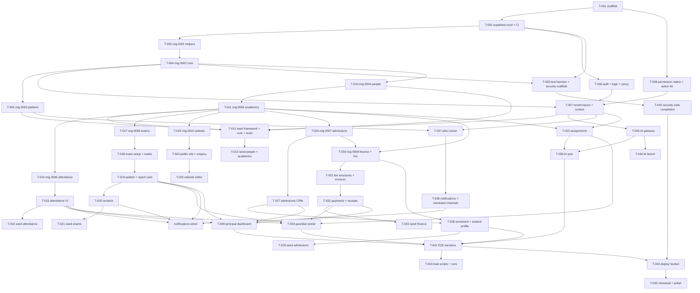

# 10 — Backlog index

45 task packets in `tasks/T-0NN-<slug>.md`. **CP** = on the critical path. **Par** = may run in parallel with other packets of the same day (disjoint files). Day = planned day (`09 §2`). Deps must be merged before start.

## 1. DAG

(`T039N` is not a packet; it marks that notification types are wired inside T-015/T-019/T-020 once T-038 exists.)

## 2. Index

| ID | Title | Lane | Day | Deps | Par | CP | Migration |
|---|---|---|---|---|---|---|---|
| T-001 | Scaffold Next.js app, Tailwind, shadcn, lint, Vitest, Playwright | Lead | 1 | — | — | ✓ | — |
| T-002 | Supabase local dev + env + type generation + CI workflow | Lead | 1 | T-001 | — | ✓ | — |
| T-003 | Migration 0001: `app` schema helpers, triggers, sequences, grading, demo reset | Lead | 2 | T-002 | ✓ | ✓ | 0001 |
| T-004 | Migration 0002: core tables + RLS | Lead | 2 | T-003 | — | ✓ | 0002 |
| T-005 | Migration 0003: audit, jobs, notifications, AI usage + RLS | Lead | 3 | T-004 | ✓ | — | 0003 |
| T-006 | Auth: Supabase SSR clients, proxy, login/logout, demo login hints | B | 2 | T-002 | ✓ | ✓ | — |
| T-007 | Tenant layout, `getTenantContext`, nav shell, institution picker | B | 3 | T-004, T-006, T-008 | ✓ | ✓ | — |
| T-008 | Permission matrix, `requirePermission`, result envelope, `defineAction` | D | 2 | T-001 | ✓ | ✓ | — |
| T-009 | Test harness: per-role clients, action caller, generated RLS suite, CI wiring | D | 3 | T-002, T-004 | ✓ | ✓ | — |
| T-010 | Migration 0004: people + RLS (S+G) | B | 4 | T-004 | ✓ | ✓ | 0004 |
| T-011 | Migration 0005: academics + RLS | A | 4 | T-010 | — | ✓ | 0005 |
| T-012 | Seed framework, PRNG, core section, `demo:reset` CLI + guards | Lead | 5 | T-005, T-007, T-010, T-011 | ✓ | ✓ | — |
| T-013 | Seed people + academics (3,024 students, 72 sections, 106 staff) | Lead | 6 | T-012 | — | ✓ | — |
| T-014 | Migration 0006: attendance + RLS (T) | A | 5 | T-011 | ✓ | — | 0006 |
| T-015 | Attendance marking, submit, corrections, absence jobs | A | 6–7 | T-014, T-013 | ✓ | — | — |
| T-016 | Seed attendance (60 days) | A | 7 | T-015 | ✓ | — | — |
| T-017 | Migration 0009: exams tables, versioning, publish/recheck functions | A | 8 | T-011 | ✓ | ✓ | 0009 |
| T-018 | Exam setup, marks entry, verification UI | A | 9 | T-017, T-013 | ✓ | ✓ | — |
| T-019 | Publish results, report card, results notifications | A | 10 | T-018 | ✓ | ✓ | — |
| T-020 | Recheck request/review/decision workflow | A | 11–12 | T-019 | ✓ | ✓ | — |
| T-021 | Seed exams (published half-yearly, rechecks) | A | 12 | T-017, T-013 | ✓ | — | — |
| T-022 | Assignments module (create, publish, views) | D | 9 | T-011, T-007, T-013 | ✓ | — | — |
| T-023 | Migration 0010: website + public RLS + `publish_page` | B | 5 | T-011 | ✓ | — | 0010 |
| T-024 | Public site renderer, blocks, notices/events, enquiry route, `website.ts` seed section | B | 6–7 | T-023, T-026 | ✓ | — | — |
| T-025 | Website editor (block forms, versions, publish) | B | 8 | T-024 | ✓ | — | — |
| T-026 | Migration 0007: admissions + RLS + `submit_public_enquiry` | B | 5 | T-011 | ✓ | ✓ | 0007 |
| T-027 | Admissions CRM: pipeline, convert, decisions | B | 9–10 | T-026, T-013 | ✓ | ✓ | — |
| T-028 | Enrolment action + UI + student profile page | B | 11–12 | T-027, T-030, T-031 | ✓ | ✓ | — |
| T-029 | Seed admissions (40 leads, applications) | B | 12 | T-026, T-013 | ✓ | — | — |
| T-030 | Migration 0008: finance + immutability + `generate_invoice`, `record_payment`, `enrol_applicant` | C | 5–6 | T-026, T-011 | ✓ | ✓ | 0008 |
| T-031 | Fee structures, assignments, term invoice generation (job) | C | 7–8 | T-030, T-013, T-037* | ✓ | — | — |
| T-032 | Payments, receipts (print), ledger view, guardian fee components | C | 9–10 | T-031 | ✓ | — | — |
| T-033 | Seed finance (structures, invoices ≈70% paid) | C | 10 | T-030, T-013 | ✓ | — | — |
| T-034 | Guardian portal shell composing lane components | C | 11–12 | T-015, T-022, T-032, T-019 | ✓ | ✓ | — |
| T-035 | AI gateway, policy, quota, redaction, providers, usage log | D | 5–6 | T-007, T-005 | ✓ | — | — |
| T-036 | AI quiz route, review UI, save as assignment | D | 10–11 | T-035, T-022 | ✓ | — | — |
| T-037 | Jobs runner (route + CLI), handlers skeleton, requeue page | D | 7 | T-005, T-007 | ✓ | — | — |
| T-038 | Notifications inbox, adapters, simulated SMS/email, message log (completes J-06's message-log assertion) | D | 8 | T-037 | ✓ | — | — |
| T-039 | Principal dashboard (KPIs + Recharts) | D | 12–13 | T-015, T-019, T-027, T-032 | ✓ | — | — |
| T-040 | AI benchmark script (P1) | D | 13 | T-035 | ✓ | — | — |
| T-041 | E2E demo narrative (J-00…J-13; J-07 spec comes from T-034) | C | 13–14 | T-028, T-034, T-036, T-039 | — | ✓ | — |
| T-042 | Security suite completion + review fixes | Lead | 17 (scaffold Day 9) | T-009, all migrations | — | ✓ | — |
| T-043 | Load scripts + Day 15/17 runs | C | 14–15, 17 | T-041 | ✓ | — | — |
| T-044 | Deploy: hosted Supabase + Vercel, backup/restore once | Lead | 18 | T-041, T-042 | — | ✓ | — |
| T-045 | Rehearsal, polish, honesty-label audit | Lead | 19 | T-044 | — | ✓ | — |

\* T-031's bulk job handler needs T-037; the synchronous per-student path does not. Build the action first, wire the job when T-037 merges.

## 3. Reserved migration numbers beyond the plan

`20261028000011` – `20261028000019`: fixes, reserved by the lead on request (record here: number · owner · purpose).

- `20261028000011` · T-012 · service_role lacked `usage on schema app` (0001 only granted it to `authenticated`/`anon`); any trigger on an app-schema-calling function (e.g. `validate_membership_link`) fails for service_role without it. Found while seeding memberships via the admin client.
- `20261028000012` · T-037 · `app.claim_job`/`app.complete_job` (0003) live in the `app` schema, not exposed over PostgREST — the web `/api/jobs/run` route can't call them via `supabase-js`. Adds `public.jobs_claim`/`public.jobs_complete` security-definer wrappers, `execute` revoked from public/anon/authenticated and granted only to `service_role`, so the route never needs a direct superuser Postgres connection.
- `20261028000013` · lead (D27) · `public.record_audit_event` wrapper so `src/lib/audit.ts` can reach `app.audit()` (not exposed over PostgREST); no packet created the TS audit helper that T-015/T-027 assume.
- `20261028000014` · T-015 (lead ruling, overrides the packet's "must not modify migrations") · `public.submit_attendance`/`public.correct_attendance` security-definer RPCs (06 §W5); closes 0006's direct-write bypasses on `attendance_sessions`/`attendance_records`/`attendance_corrections` that let a caller skip the correction window, the submit audit, or reopen a submitted session.
- `20261028000015` · T-024 (lead ruling, DBT-11) · `public.get_public_site(p_slug text)` security-definer RPC; the public site renderer needs anon slug→institution lookup but `institutions` must not get an anon SELECT policy (would expose `settings`/`ai_policy`). Returns only `institution_id, institution_name, website_id, theme, nav`, one row, only when the website `is_live`; zero rows for an unknown or offline slug. `execute` revoked from `public`, granted to `anon, authenticated`.
- `20261028000016` · T-027 (lead ruling, overrides the packet's "must not modify migrations") · `public.decide_application`/`public.convert_enquiry`/`public.add_enquiry_note` security-definer RPCs (06 §W4); `app.guard_application_decision` (BEFORE UPDATE on `applications`, blocks a direct write into offered/accepted/rejected/withdrawn) and `app.guard_enquiry_mutation` (BEFORE UPDATE on `enquiries`, blocks a direct write of `status` into `converted` or of `notes`) close the same class of bypass 0014 closed for attendance — both bypassed only by `service_role`/`session_user='postgres'` or the owning RPC's own transaction-local GUC. Also fixes a found bug: 0007's `enquiries_insert`/`enquiries_update` WITH CHECK scoped `assigned_to` with a bare `exists (select ... from public.staff ...)`, which is itself subject to `staff`'s own RLS (0004 `staff_select` excludes the admissions role) — so the admissions role, the only real caller of `assignEnquiry`, got `42501` on every attempt. Fixed by dropping/recreating both policies to call a new `app.staff_in_institution()` (security definer, bypasses `staff` RLS) instead, same drop/recreate shape 0014 used on 0006.
- `20261028000017` · T-031 phase 2 (follow-up from the T-031 completion report) · `public.enqueue_term_invoices(p_institution_id, p_term_id, p_grade_id default null)` security-definer RPC; the sync, per-student `public.generate_invoice` loop (0008) has no deadline-safe way to cover a whole school in one request, so a whole-institution "all grades" run now enqueues `finance.generate_term_invoices` (via `app.enqueue_job`, 0003) instead. Role-checked inline (no `app.*` twin — same single-function shape as `public.jobs_requeue`, 0012) against `app.finance_write_roles()` (owner/principal/accountant; admin excluded, same as `generate_invoice`/`record_payment`); proves the term and (if given) grade belong to `p_institution_id` before building the job payload from those proven rows; idempotency key `invoices:<term_id>:<grade_id|all>` (term ids are globally unique, so no institution-id prefix needed); audits `finance.invoice.generate_term.enqueued`. `execute` revoked from `public`/`anon`, granted to `authenticated`. Wired from `generateTermInvoices` (src/modules/finance/actions.ts): a specific grade still uses the synchronous path, "All grades" now calls this RPC.
- `20261028000018` · T-018 (lead ruling) · `public.enter_marks(p_institution_id, p_paper_id, p_rows)` single-transaction marks-entry RPC (06 §W7; T-017's own follow-up debt — a two-call RLS flow can never perform a supersede, since the deferred one-current-row check only fires at commit); `public.exam_verification(p_institution_id, p_exam_id)` wrapper (T-017 built `app.exam_verification` with no `public.*` wrapper, since no UI called it yet); `public.open_marks_entry`/`public.close_marks_entry`/`public.reopen_marks_entry` (06 §W7's draft->marks_entry->verification->marks_entry edges) plus `app.guard_exam_status` (BEFORE UPDATE on `exams`, same class of direct-write bypass 0014/0016 closed for attendance/admissions — 0009's `exams_update` RLS policy let `exam.manage` set `status` to anything directly, including `published` with no results snapshot, or backwards out of `published`); `create or replace`s `app.publish_exam_results` (0009, unmodified otherwise) to set the same transition GUC before its own status UPDATE. All bypassed only by `service_role`/`session_user='postgres'` or the owning RPC's own transaction-local GUC.
- `20261028000019` · T-028 (lead ruling, phase 2) · drops/recreates `fee_structures_select` (0008) to also allow `admissions` SELECT — 07 §2.2 grants `admissions.enrol` to owner/principal/admin/admissions, but that RLS policy was `app.finance_roles()` (owner/principal/admin/accountant), so the admissions role (the real J-05 demo persona) saw zero rows in EnrolDialog's fee-structure picker. Read-only: insert/update stay `finance_roles()`-only, and `fee_components`/`invoices`/`invoice_lines` are untouched (EnrolDialog never reads `fee_components`; `finance.read` still excludes admissions by design).
- `20261028000020` · P-01 (lead, not in original backlog — RLS performance, blocks the demo) · `count(*)` on the seeded demo tenant (4,320 `attendance_sessions`, 181,440 `attendance_records`) took up to 25.5s (sessions) and >30s/PostgREST-timeout (records) for teacher/guardian/admissions, because every policy called a `SECURITY DEFINER` helper (`app.has_role`/`app.teaches_section`/`app.guardian_student_ids`/`app.own_student_id`/`app.teacher_sees_guardian`) with a per-row argument, re-running its membership lookup once per row scanned. Adds five row-independent helpers (`app.my_institution_ids`, `app.my_taught_section_ids`, `app.my_taught_section_subjects`, `app.my_student_ids`, `app.my_student_section_ids` — all `returns setof uuid`/`table`, not the `uuid[]` the packet first specified: `uuid[]` doesn't satisfy Postgres's `col = ANY(subquery)` form, 42883) and rewrites the SELECT policies (plus attendance's INSERT/UPDATE) on `attendance_sessions`/`attendance_records`/`attendance_corrections`, `students`/`guardians`/`guardian_students`, `class_sections`/`subject_assignments`/`enrolments`/`enrolment_status_history`/`assignments`, `marks`/`results`, `invoices`/`invoice_lines`/`payments`/`receipts`/`ledger_entries`, `notifications`/`audit_events`/`jobs`/`delivery_attempts`/`ai_usage_events` to compare row columns against a cached `(select app.my_*_ids())` array instead of calling a helper per row — same role sets, same `with check` clauses, same scope joins throughout. One correctness/perf fix found during verification: `attendance_records_select`'s teacher branch must NOT correlate the inner `attendance_sessions` subquery to the outer row's `institution_id` (EXPLAIN ANALYZE showed a 181,440-loop re-scan, ~80s) — dropped that correlation (safe: a `class_section_id`/`session_id` uuid can only ever belong to one institution, same reasoning the `my_*_ids()` arrays already rely on); kept for the low-volume INSERT/UPDATE policies and `attendance_corrections_insert`'s check, where it's free. Added indexes: `attendance_records(session_id)`, `attendance_sessions(class_section_id)`, `guardian_students(guardian_id)`, `invoices(student_id)`. `curriculum_units`/`fee_assignments`/`concessions`/`recheck_requests`/`exam_papers` have the same per-row-helper shape but are small tables not in the packet's list — left unrewritten, flagged as debt below. New helpers added to `07 §4`'s SQL definer row.
- `20261028000021` · T-032 phase 2 (follow-up from the T-032 completion report) · `create or replace app.record_payment` (0008) — every existing check (amount > 0, idempotent replay fast-path, outstanding-balance validation, received_at not in the future, financial-year math, ledger entries, invoice status transition, audit) is unchanged; the only addition is capturing the receipt's display fields (school name, student name, admission no, class/section, invoice no, term name, receipt no) into `receipts.snapshot` at payment time, alongside the amount/mode/reference/received_at/heads it already stored. `public.record_payment`'s signature and role gate (`app.finance_write_roles()`) are untouched. `ReceiptView` now renders every field from the snapshot only (previously the school name was a live `ctx.institution.name` prop) — the receipt is fully frozen at payment time, so a later student rename or institution rename cannot change an already-printed receipt.

- `20261028000022` · T-020 (lead ruling, Batch B — overrides the packet's "must not modify migrations") · `app.request_recheck`/`public.request_recheck` and `app.start_recheck_review`/`public.start_recheck_review` security-definer RPCs (06 §W8); `app.guard_recheck_request_status` (BEFORE UPDATE on `recheck_requests`, enforces the full `submitted→under_review→{approved,rejected,applied}` transition table since `app.apply_recheck_decision`, 0009, is unedited and has no GUC to set for its own transitions). Drops 0009's `recheck_requests_insert` RLS policy — a guardian/student could previously INSERT directly over PostgREST with no window check, no reason-length check, and only the DB's partial unique index (surfacing as an opaque `internal` error, not `conflict`) protecting the one-open-request rule. `app.request_recheck` now enforces all three plus ownership before the insert; no replacement INSERT policy exists, so a direct PostgREST insert always gets a plain permission error.
- `20261028000023` · T-036 phase 2 / DBT-21 (lead ruling) · new `assignment_answer_keys` table (one row per assignment, `answers jsonb`) moves quiz answers/explanations out of `assignments.content`, which a guardian/student JWT could read directly over PostgREST (`assignments_select`, 0005, is staff-wide read for managers but also grants the enrolled student/guardian their own section's published assignments — `content` included answers and explanations in full). RLS limited to `assignment.manage`: owner, principal, and the teacher scope from `app.my_taught_section_subjects` (P-01 initPlan style, `col = any((select ...))`, not a per-row helper call). `assignments.content` keeps questions/options/stems only going forward; existing rows are left as-is (no backfill migration — DBT-21's own scope is new writes).

## 4. Review requirements

Mandatory `security-reviewer` + lead review before merge: T-003, T-004, T-005, T-006, T-007, T-008, T-009, T-010, T-011, T-012, T-014, T-017, T-023, T-026, T-030, T-035, T-036, T-037, T-042, T-044. `code-reviewer` for the rest.

## 5. Interfaces fixed before dependent packets start

| Interface | Defined by | Consumed by | Shape (authoritative text) |
|---|---|---|---|
| `TenantContext`, `getTenantContext(slug)` | T-007 | every lane | `04 §4` |
| `ActionResult`, `ErrorCode`, `AppError`, `defineAction`, action registry | T-008 | every lane | `06 §1` |
| `Permission` union and `ROLE_PERMISSIONS` | T-008 | every lane, T-042 | `07 §2` |
| `app.*` helper and function signatures | T-003, T-005 | all migrations | `05 §5`, `06 §W12` |
| `tests/helpers/roles.ts` (`createTestInstitution`, `clientAs`), `rls-expectations.ts` entry shape | T-009 | every migration packet | `08 §1` |
| `SeedContext` and section `run(ctx)` contract, `SEED_SCALE` | T-012 | T-013, T-016, T-021, T-024, T-029, T-033 | `05 §8` |
| `app.enqueue_job(institution_id, type, payload, idempotency_key)` | T-005 | T-015, T-019, T-020, T-024, T-030, T-031 | `06 §W12` |
| Job handler signature `(job, services) => Promise<void>` and registry | T-037 | T-031, T-038 | `06 §W12` |
| `Channel` adapter interface, notification job types | T-038 | T-015, T-019, T-020 (wired after T-038 merges) | `04 §7`, `06 §3` |
| `gateway.runStructured(...)` | T-035 | T-036, T-040 | `04 §5` |
| Portal component exports: `StudentAttendanceSummary`, `StudentInvoices`, `ReceiptView`, `ReportCard`, `StudentAssignments` | T-015, T-032, T-019, T-022 | T-034, T-028 | `09 §4` (guardian portal zone) |
| `<SimulatedBadge />`, `<LimitedBadge />` in `src/components/honesty.tsx` | T-007 | every lane | `CLAUDE.md` rule 7 |
| `src/lib/nav.ts` item shape `{ href, label, icon, permission }` | T-007 | every lane (one line each) | `09 §4` |
