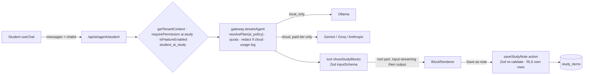

# 14 — Generative UI plan

Status: **proposal, 2026-10-30, not approved.** No packet scope change; nothing here is built until the owner reviews it. Decisions that need an ADR are listed in GU-01 and go into `12-decision-log.md` only after approval. Sources are in §11. Installed versions were read from `node_modules`, not from blog posts: `ai` 7.0.155, `@ai-sdk/react` 4.0.160, `@ai-sdk/google` 4.0.107, `@ai-sdk/groq` 4.0.72, `@ai-sdk/anthropic` 4.0.90, React 19.3.0, Next 16.4.3, Zod 4.6.7, Recharts 3.10.1.

Owner asks this plan answers (verbatim, 2026-10-30):

1. "we will add the caveman skill with the caveman dialect dropped, and the teach me like I am 5, and the anatomy skill, these I want default on for the students when they go to study and also they should be able to organise and save there chats if hey want and make there own personalised otes in there own personalised style like how exactly do they want the notes and the charts and mindmaps using html or threejs or any other best and cheapest way to make interactive mindmaps and the other things and also, you must also research about generative UI its something new and is gonna expload, create a plan for its implementation, use opus for plannibg and mix of sonnet + haikyu for execution"
2. "the AI agent capabilities are too constricted, expand them a little more, for the teachers as well and also remember, make each and every feature configurable, like we should have a control over what feature we want to give to which customer"

## 1. What generative UI is (October 2026)

Generative UI means the model drives real, interactive interface, not only text. There are three levels, from cheapest and safest to most expensive and riskiest. **L1, tool result → known component:** the model calls a tool and the client renders that tool's typed output with a component you wrote. This is the AI SDK's own definition ("Generative UI is the process of connecting the results of a tool call to a React component"). In `ai` 7 it is done with typed `tool-*` message parts in `useChat`. `@ai-sdk/rsc`'s `streamUI` is "experimental", and the SDK docs say they "do not recommend using it for stable production environments". **L2, the model composes from a closed catalog:** the model emits a declarative JSON spec that may use only components you registered with schemas. Vercel's `json-render` (Apache-2.0, 0.21.x), Google's A2UI v0.9, Tambo, CopilotKit and Thesys OpenUI all work this way. The common security argument is "AI can only use components in your catalog". **L3, the model writes code:** the model outputs HTML/CSS/JS (or SVG) and the client renders it in a sandbox. Gemini 3 "dynamic view", Claude artifacts and the NousResearch "Anatomy" skill work this way. MCP Apps (stable 2026-01-26, supported in Claude, ChatGPT and VS Code) standardises sandboxed-iframe HTML UIs that come from tool servers.

The hype is L3. Google's own research found L3 output preferred by raters "followed closely" behind human-expert sites. The same paper says it "can sometimes take a minute or more", and its evaluation "did not take into account generation speed". The production consensus that budget products can afford is L1 plus L2: a vetted component catalog, a schema-validated model spec, and streaming partial render.

## 2. What this codebase already has vs. what is new

| Already built (D28–D30, commit `6c1cb6e`) | Gap |
|---|---|
| `useChat` + `streamText` + `toUIMessageStreamResponse`; typed `tool-*` parts; `isToolUIPart` (`TeacherAgentChat.tsx`) | none, this is the right base (L1) |
| `generateQuiz` / `draftResultRemark` output renders `QuizReviewEditor` / `RemarkDraftEditor` inline; saving goes through existing actions (rule 6 intact) | Output is matched with duck-typed guards (`draft === true && "curriculumUnitId" in output`). Should be per-tool Zod output schemas plus `InferUITools` types. |
| 5 lookup tools (student, unit, attendance, results, assignments) | Their structured output is **discarded visually**: only a status line renders, and the model retells the numbers as prose. This is a hallucination surface and wastes the data already fetched. |
| Per-tool `if` chain in `MessageParts` | Does not scale past ~3 tools. A `tool name → renderer` map is the next step. |
| — | No `input-streaming` partial render. No layout composition (L2). No persistence (chat lost on reload). No `toModelOutput` data minimization. The installed SDK has all four. |
| Teacher route bypasses `gateway.ts` (D28, owner-approved, teacher only) | A student route must **not** copy this. Rule 6 applies, and minors' data needs `ai_policy` (`local_only` must stay local). |
| Entitlements: `isFeatureEnabled` + `institutions.settings.features` (D30); one hardcoded toggle action `setTeacherAgentEnabled` | Missing key means **enabled**, and the toggle is gated by `institution.settings.manage`, so the school grants its own plan. Both conflict with ask 2 (see §7). |
| Student portal: own-grade `curriculum_units` already readable under RLS (`0005` policy) | No student AI permission; students hold no `ai.generate`. F-AI-08 "Student tutoring" is planned Phase 3/P3. |

New scope is therefore: one shared block catalog (L2, closed), a student study assistant and notebook, a gateway streaming entry point, richer teacher rendering and tools, and an entitlement catalog.

## 3. Architecture decision: build on AI SDK v7, closed in-house catalog

**Recommendation:** no generative-UI framework. Keep `ai` 7 + `@ai-sdk/react` (already installed and in production use here). Add one closed, Zod-validated block catalog under `src/modules/ai/blocks/`: a discriminated union on `kind` and a single renderer. The model emits blocks through an ordinary tool, so every block arrives as a typed tool part. It streams partially (`input-streaming`), is validated by the tool's `inputSchema`, and is re-validated server-side before any save. This is json-render's and A2UI's idea, sized to about 7 block types with no expression language.

Why not a framework (one line each; full list in §9):

| Option | What it is | Cost / hosting | Verdict |
|---|---|---|---|
| json-render (Vercel Labs) | L2, Zod catalog, flat element tree, `SpecStream`, `$state/$cond/$computed`, 36 shadcn components | Apache-2.0, free; peers `react ^19.2.3`, `zod ^4` fit | Closest fit. Not now: pre-1.0 (0.21.3), and its expression and actions layer exceeds need. Nested specs are hard for the 4B local model. Revisit §10. |
| A2UI v0.9 (Google) | Declarative cross-agent UI protocol, React renderer | Open spec | Not now: we own both ends; no interop need. |
| CopilotKit | AG-UI protocol + own runtime + gen-UI | MIT SDK; pricing page: production needs Pay-as-you-go $49/mo (10k interactions) or Annual | Reject: a second agent runtime beside AI SDK, plus a recurring fee. |
| Tambo | Zod-registered components, own backend | MIT, self-host via Docker; **Tambo Cloud stops 2026-10-31** | Reject: own backend; vendor risk already realised. |
| Thesys C1 / OpenUI Cloud + Crayon | Hosted gen-UI API | Free 3K calls; $49/mo 25K; $499/mo 500K; plus $0.001–0.002/call; LLM tokens billed on top; self-host only on custom Scale tier | Reject: per-call fee on top of tokens, and a vendor in minors' data path. |
| assistant-ui | MIT React chat UI, AI SDK adapter, tool UIs | Library free; optional cloud $50/mo | Not now: `useChat` UI already works. Revisit if thread-list or branching UX is wanted. |
| `@ai-sdk/rsc` `streamUI` | Server-streamed React components | Free | Reject: experimental, SDK says not for production. |
| `experimental_MCPAppRenderer` (in installed `@ai-sdk/react`) | Renders MCP Apps HTML in a double-sandboxed iframe | Free | Not now: no third-party MCP apps in scope. |

Cost reality (per study turn that produces notes + a mindmap; assume ≈2.5k input + ≈1.5k output tokens incl. tool schemas; prices from Google/Groq pricing pages, Oct 2026):

| Path | $/turn | 1,000 students × 3 turns × 200 days (600k turns/yr) |
|---|---|---|
| Gemini 2.5 Flash-Lite paid ($0.10/$0.40 per MTok) | ≈ $0.00085 | ≈ $510/yr |
| Groq `openai/gpt-oss-120b` paid ($0.15/$0.60) | ≈ $0.0013 | ≈ $780/yr |
| Gemini 3.1 Flash-Lite paid ($0.25/$1.50) | ≈ $0.0029 | ≈ $1,740/yr |
| Local Ollama on school hardware (`local_only`) | $0 marginal | hardware only (`11 §8` sizing) |
| L3 model-written HTML page (≈15k output tokens on 3.1 Flash-Lite) | ≈ $0.023+, ~1 min | ≈ $13,800+/yr |
| + Thesys OpenUI Cloud fee | +$0.001–0.002 | +$600–1,200/yr plus tier fee |

Free tiers are demo-only. Gemini free tier: "Content used to improve our products", so it is not usable for minors' free text (L2-02 rule). Groq free tier allows 200K tokens/day on gpt-oss-120b, about 50 turns per day for a whole school. The current default `settings.ai.daily_token_quota` (200,000, institution-wide, `05 §4.1`) covers about 50 student turns per day per school. Student features need a per-user cap (GU-05).

## 4. Mindmaps, charts, 3D: rendering decision

**Recommendation:** the model never emits markup. It emits a Zod-validated JSON node list, and our own React component renders it.

- **Mindmaps:** inline **SVG** with a zero-dependency layout. Leaves take sequential rows in depth-first order; a parent sits at the midpoint of its children; radial is the same rows mapped to angle and depth mapped to radius. Interactions: collapse/expand, tap a node, "Explain this node" (sends a chat turn in the student's style), zoom via `viewBox`, pan via native scroll, download SVG/PNG by serialising the SVG. The same data also renders as a `
` outline view (accessible, printable).
- **Charts:** the already-installed Recharts (D16), so no new dependency.

The "parts" variant of the mindmap block is the cheap form of the Anatomy skill (see below).

| Option | Size (gzip, bundlephobia) | Cost to run | Fit for budget school SaaS | Verdict |
|---|---|---|---|---|
| Own SVG + CSS (+ Recharts, installed) | ~0 new KB | model emits ~1–2k tokens of JSON | Works on 2–4 GB Android, prints, offline-friendly, accessible | **Adopt** |
| `d3-hierarchy` 3.1.2 (MIT) | 5.6 KB | same | Better tidy-tree layout | Upgrade only if own layout looks wrong |
| `markmap-view` 0.18.12 (MIT) | 24 KB + d3 deps | same | Animated zoom/collapse; renders node `content` as HTML, so input must be escaped | Upgrade path for animation |
| `@xyflow/react` 12.12.0 (MIT) | 60 KB | same | Drag/connect editing | Only if students must hand-edit concept maps |
| Mermaid 12.2.0 (MIT) as model output | 170 KB + cytoscape for mindmap ("experimental" per Mermaid) | model writes syntax; parse failures | Heavy, innerHTML SVG | Reject |
| Three.js 0.187.0 (MIT) | 186 KB core, before R3F and assets | L3 code generation or curated assets | GPU and battery on low-end phones; no CBSE topic needs 3D that a labelled 2D SVG cannot show | Reject for v1 |
| Model-written HTML/SVG (L3) | n/a | 10–100× tokens, ~1 min | Needs sandboxed iframe + CSP + content safety for minors | Reject for v1 |

**The three student skills are prompt presets, not Claude Code skills.** Gemini, Groq and qwen do not load `SKILL.md` files. Each "skill" becomes a versioned instruction fragment that the student can switch on or off, all three on by default (ask 1):

- **Caveman, dialect dropped:** terse and answer-first, filler cut, normal grammar.
- **Teach me like I am 5:** plain words and one everyday analogy per idea.
- **Anatomy:** we read "the anatomy skill" as NousResearch's MIT "Anatomy" agent skill. It builds interactive isometric SVG machines with a Node/Chrome verify loop: 40–150 parts per figure, frontier-model authoring work, not a per-request runtime.
  - **Default on, cheap form:** an "explain it as a machine of parts" preset, rendered as a `mindmap` block with `variant: parts`. Tap a part to see its job and what it connects to.
  - **Later (§10), curated library:** real Anatomy figures, generated offline once per CBSE topic by the platform team, reviewed, stored as static sanitized SVG and shared by every tenant. The cost is then one-time per topic, not per student.
  - **Rejected:** per-student on-demand Anatomy figures.
  - **Owner to confirm** this reading in GU-01.

**Personal style** is a closed schema saved per student. It sets defaults; the student can override them in chat ("make it radial with emojis"):

| Field | Values | Default |
|---|---|---|
| skills | terse, eli5, anatomy | all on |
| notes.density / notes.format | brief, standard, detailed / bullets, qa, paragraphs | standard / bullets |
| language | from `settings.communication.languages` (en, hi) + mixed | en |
| visual.theme | plain, colourful, high-contrast, print | colourful |
| mindmap.layout | tree, radial, outline, parts | tree |
| emoji | bool | false |
| myStyle (free text ≤ 300) | passed as a delimited data block (`04 §5` injection posture) | empty |

**Block catalog (shared by the student and teacher chats).** Caps follow DBT-27 (no string field above 500 characters, because Ollama crashes on long `maxLength`) and use flat lists rather than recursive trees, because recursion is fragile across Gemini, Groq and Ollama structured output.

| kind | Fields (caps) | Renderer |
|---|---|---|
| notes | ≤ 10 sections {heading ≤ 120, bullets ≤ 12 × ≤ 300, example? ≤ 500} | HTML/CSS, print CSS |
| mindmap | ≤ 60 nodes {id, parentId \| null, label ≤ 80, detail? ≤ 300}, depth ≤ 4, variant tree/radial/outline/parts | own SVG + `
` |
| chart | type bar/line/pie/area, ≤ 4 series × ≤ 50 points, unit; teacher: `dataRef {toolCallId, field}` instead of literal numbers | Recharts |
| flashcards | ≤ 20 {front ≤ 200, back ≤ 300} | CSS flip |
| practice | ≤ 10 MCQ, same shape as `QuizContentSchema`; never saved to assignments | own |
| table | ≤ 6 columns × ≤ 40 rows, cells ≤ 120; teacher: `dataRef` | HTML table |
| callout | tone info/tip/warning, text ≤ 300 | own |

No block field is ever rendered with `dangerouslySetInnerHTML`. Text is plain text in structured fields; there is no markdown and no HTML. Blocks load via `next/dynamic` only on AI pages.

## 5. Target features (`03` format)

Columns as in `03 §1`. Demo is `planned` for every row; the target after build is `limited`.

**A. Student study assistant, personalised notes, mindmaps, saved chats.** Skill selection (F-AI-08) is a separate, smaller piece than block rendering (F-AI-10). They combine because the student's saved style feeds both the instructions (skills, density, language) and the renderer (theme, layout).

| ID | Feature | Value | Phase | Demo | Pri | Deps | Owner | Sens | Accept |
|---|---|---|---|---|---|---|---|---|---|
| F-AI-08 | (existing row, pulled forward from Phase 3/P3 and re-scoped) Student study chat with default-on skill presets (terse, ELI5, anatomy-by-parts) and own-grade unit lookup | Learning in the student's own voice | 2 | planned | P2 | F-AI-01, GU-05 | ai | conf (minors' free text) | J-14, C-67 |
| F-AI-10 | Generative UI block catalog + renderer (§4), shared | Interactive notes and visuals at near-zero render cost | 2 | planned | P2 | F-AI-01 | ai | int | C-69 |
| F-AI-11 | Study notebook: save chat on demand, rename, folder, pin, delete; "Make notes" turns a chat into blocks in the saved style; edit before save; print | Retention, revision | 2 | planned | P2 | F-AI-08, F-AI-10 | ai | conf | J-14, C-68 |

**B. Teacher agent v2.**

| ID | Feature | Value | Phase | Demo | Pri | Deps | Owner | Sens | Accept |
|---|---|---|---|---|---|---|---|---|---|
| F-AI-12 | Teacher agent v2: typed renderer for every tool (lookups render as tables/charts, not prose); class-insight tools; data-bound composed views | Fewer misread numbers; class-level questions | 2 | planned | P2 | D28–D30, F-AI-10 | ai | conf | J-15, C-73, C-74 |
| F-AI-07 | (existing row, partial) Lesson-plan draft (curriculum only) and guardian-message draft (copy only, never sent) in the agent | Teacher time saved | 2 | planned | P2 | F-AI-12 | ai | int / conf | J-15 |
| F-PLT-02 | (existing row, slice) Closed feature catalog with per-key defaults; platform-admin-only toggle | "We control which customer gets what" | 2 (slice) | planned | P1 | D30 | core | conf | C-75 |

Proposed test ids, all free in `07 §6` and `08`:

- **C-67:** `local_only` student turn never calls a cloud factory; a cloud plan without the paid-tier attestation returns `ai_policy_blocked`.
- **C-68:** `study_items` / `study_preferences` are own-rows only, for every role, cross-institution included.
- **C-69:** unknown block `kind` or an oversize field is rejected in the tool and in the save action.
- **C-73:** a chart or table whose `dataRef` does not resolve renders "data unavailable", never model numbers.
- **C-74:** a class-insight tool's model-facing output (`toModelOutput`) contains no student names.
- **C-75:** a feature toggle by a non-platform-admin returns `forbidden`.
- **J-14:** `student.one` studies Quadratic Equations, gets a mindmap, saves it to a folder.
- **J-15:** `teacher.x-a` asks for X-A's attendance and results, gets a chart, and drafts a guardian message.

## 6. Task-packet breakdown with model tiering

Packet ids are plan-local (`GU-nn`); the lead assigns `T-0NN` numbers and migration numbers (from `20261028000049`) on approval, per `10`.

Model tiers:

- **Opus:** architecture judgment, security-sensitive design, review gates.
- **Sonnet:** multi-file implementation.
- **Haiku:** single-file or transcription-level work against an approved spec.

Every packet follows CLAUDE.md's pre-code protocol and completion report. "Review" names the reviewer agents, plus the lead.

### Shared foundation

- **GU-01: Decisions and ADR drafts.** Opus · 0.5 d · deps none · review: owner.
  - Drafts D31 (closed block catalog, §3–4), D32 (student AI data class: minors' free text goes to local or paid-tier cloud only, never a free tier; extends L2-02), D33 (feature catalog with per-key defaults and platform-only toggling, superseding D30's default rule for new keys only), D34 (D28 extension: class-level aggregates to cloud, names withheld via `toModelOutput`).
  - Gets owner answers on:
    - a paid Gemini or Groq key, or local-only, for students;
    - the "anatomy" reading in §4;
    - final preset wording;
    - whether guardians or teachers may ever read student chats (default: no);
    - retention and hard-delete of student content (default: student may hard-delete; demo reset clears);
    - per-student daily token cap;
    - whether `teacher_ai_agent` toggling moves to platform admin.
  - Specs the `streamAgent` signature and the `dataRef` binding rule for GU-05 and GU-17.
- **GU-02: Entitlement catalog v2.** Sonnet · 1 d · deps GU-01 · review: security-reviewer + Opus.
  - `src/lib/auth/entitlements.ts`: closed `FEATURE_CATALOG` (key → default, parent key); `isFeatureEnabled` returns the stored flag, else the catalog default; an unknown key is a type error.
  - `InstitutionSettingsSchema.features` keyed by the closed set.
  - Generic `setFeatureEnabled({ key, enabled })` replaces `setTeacherAgentEnabled`, and is gated to `is_platform_admin` through a new `security definer` `public.set_institution_feature` (migration; `07 §4` row in the same PR, because a platform admin is not a tenant member).
  - Platform toggle list UI.
  - Tests: unit (defaults, parent gating), db (C-75, audit row).
- **GU-03: Block catalog core.** Sonnet · 1 d · deps GU-01 · review: react-reviewer.
  - `src/modules/ai/blocks/schemas.ts` (union, caps §4), `BlockRenderer.tsx`, and the notes, table, callout, flashcards and practice components. Light, dark and print styles. No `dangerouslySetInnerHTML`.
  - Tests: `tests/unit/ai-blocks-schema.test.ts` (C-69).
- **GU-04: Mindmap and chart blocks.** Sonnet · 1 d · deps GU-03 · review: react-reviewer + a11y-architect.
  - `MindmapBlock` (pure layout function for tree/radial/parts, collapse, outline view, SVG/PNG download, keyboard focus).
  - `ChartBlock` (Recharts; source label "AI-generated numbers" vs "From school records").
  - Tests: `tests/unit/mindmap-layout.test.ts` (no overlaps on fixtures, 60-node cap, orphan `parentId` dropped).
- **GU-05: Gateway streaming entry point.** Sonnet · 1.5 d · deps GU-01 · review: security-reviewer + Opus.
  - `streamAgent` in `src/lib/ai/gateway.ts`: caller-named permission, `resolvePlan` unchanged, quota/rate/concurrency/usage the same as `runStructured`, redaction when the plan has cloud, fallback only before the first token.
  - Cloud provider chosen by env (`AI_CLOUD_PROVIDER` = anthropic, google or groq). `dataClass: "student_personal"` requires `AI_CLOUD_PAID_TIER=true` (operator attestation), else `ai_policy_blocked`.
  - Per-user daily token cap for `student_*` features in `settings.ai` (needs the core schema; coordinate with GU-02 on that file).
  - Tests: C-62/C-63 variants and C-67 (provider factory spy).

### Feature A: student

- **GU-06: Student skill presets.** Haiku · 0.25 d · deps GU-01 (approved wording) · review: lead.
  - `src/modules/ai/prompts/student-skills.ts`: three preset constants and `composeStudentInstructions(skills, style)`, with `myStyle` wrapped in the data-block delimiter.
  - Tests: `tests/unit/student-skills.test.ts` (each toggle on/off, delimiter present, no student fields possible).
- **GU-07: Migration: study tables.** Sonnet · 0.75 d · deps GU-01 · review: database-reviewer + Opus.
  - `study_items` {institution_id, user_id, kind chat/note, title ≤ 120, folder ≤ 60, pinned, content jsonb with a `pg_column_size` cap ≈ 256 KB, source_chat_id?}.
  - `study_preferences` {(institution_id, user_id) pk, skills, style jsonb}.
  - RLS class O: own rows, `app.is_member`, hard delete allowed for the owner. `updated_at` trigger. `rls-expectations.ts` entries. `pnpm db:types`.
  - Tests: `tests/db/study-items.test.ts` (C-68, every role, cross-tenant).
- **GU-08: Student study route and chat.** Sonnet · 1.5 d · deps GU-03, GU-04, GU-05, GU-06 · review: security-reviewer.
  - Add `ai.study` (student only) to `permissions.ts` and `07 §2.2`, with the C-03 snapshot.
  - `src/app/api/ai/agent/student/route.ts`: same body/Origin guards as the teacher route; `validateUIMessages` with tools; gates `student_ai_study`; `student_ai_visuals` off removes the block tool via `activeTools`.
  - `src/modules/ai/agent/student-tools.ts`: `findMyCurriculumUnit` (existing RLS) and `showStudyBlocks` (validated echo).
  - `/portal/study` page and a `StudyChat` client component that renders blocks during `input-streaming`, plus skill chips and the honesty banner (§8).
  - Tests: db route test with a mocked gateway (forbidden for guardian/teacher, entitlement off gives `ai_unavailable`).
- **GU-09: Notebook.** Sonnet · 1.5 d · deps GU-07, GU-08 · review: security-reviewer.
  - "Save chat" stores the message snapshot; reopening seeds `useChat({ messages })`. "Make notes" sends a canned turn; "Save as note" lets the student edit text fields, then re-validates blocks server-side.
  - Actions `saveStudyItem` / `rename` / `move` / `pin` / `delete`, with a per-user item cap.
  - `/portal/study/notebook` with folders and title search; note view with print CSS. Gate `student_ai_notebook`.
  - Tests: db action tests (cap, re-validation rejects forged blocks).
- **GU-10: Style preferences.** Sonnet · 0.75 d · deps GU-07, GU-04 · review: lead.
  - `/portal/study/style` form over the closed style schema, with a live preview on sample blocks. Saved to `study_preferences`; read by the route (instructions) and the renderer (theme, layout).
  - Tests: schema unit test; db upsert own-row.
- **GU-11: Seed and J-14.** Sonnet · 1 d · deps GU-09, GU-10 · review: lead.
  - Seed for `student.one`: one saved chat, one note with a mindmap in folder "Maths", style defaults. Add the row to `05 §8.1` (rule 11). Enable the three student keys for `st-josephs-demo` only.
  - `e2e/j14-student-study.spec.ts` against a mock model (`ai/test`), so no network.
- **GU-12: Security review gate A.** Opus · 0.5 d · deps GU-08…GU-11 · review: owner.
  - Covers: minors' data path, policy routing, RLS, injection through `myStyle` and saved notes re-fed as context, XSS in the renderer, content-safety prompt and provider safety settings, quota starvation of teachers. Output: fix list and debt rows.

### Feature B: teacher

- **GU-13: Typed tool-renderer registry.** Sonnet · 1 d · deps GU-03, GU-04 · review: react-reviewer.
  - Add `outputSchema` to each tool in `teacher-tools.ts`. `TeacherAgentChat` gets a `TOOL_RENDERERS` map typed with `InferUITools`, which replaces the duck-typed guards.
  - Renderers: `findStudent` as a pick list (tap sends a follow-up); attendance as a stat row and bar; results as a table and subject chart (`dataRef`); assignments as a table. Partial `input-streaming` states.
  - No new data egress, so no new entitlement key.
  - Tests: unit on output schemas; J-15 later.
- **GU-14: Teacher prompt builders.** Haiku · 0.25 d · deps GU-01 · review: lead.
  - `src/modules/ai/prompts/guardian-message.ts` (uses the `{studentLabel}` placeholder, like `prompts/remark.ts`; en/hi from settings) and `src/modules/ai/prompts/lesson-plan.ts` (curriculum fields only).
  - Tests: unit tests mirroring `quiz-prompt.test.ts`.
- **GU-15: Class-insight tools.** Sonnet · 1 d · deps GU-13, GU-01 (D34) · review: security-reviewer + Opus.
  - Tools: `listMySections` (`listTeachableSections`), `getSectionAttendanceSummary` (`getSectionAttendancePatterns`, thresholds from `settings.attendance.alert_thresholds`), `getSectionExamSummary` (needs a section-scoped variant in `exams/queries.ts`, the owner module).
  - `toModelOutput` sends roll numbers and aggregates only; the UI gets names. Requires `convertToModelMessages(messages, { tools })`.
  - Gated by `teacher_ai_class_insights` (tool removed when off).
  - Tests: C-74, scope (another teacher's section returns the not-in-scope string).
- **GU-16: Draft tools.** Sonnet · 1 d · deps GU-14, GU-13 · review: security-reviewer.
  - `draftGuardianMessage(studentId, topic)`: editable textarea, copy button, "Not sent" label, never touches notifications.
  - `draftLessonPlan(curriculumUnitId, periods)`: renders as notes blocks with copy/print.
  - Both go through `runStructured`, like the existing draft tools. Gated by `teacher_ai_parent_messages` / `teacher_ai_lesson_plans`.
  - Tests: scope, entitlement off.
- **GU-17: Data-bound composed views (L2 for teachers).** Sonnet · 1 d · deps GU-15, GU-01 (binding spec) · review: Opus.
  - `composeView` tool: the model picks layout, chart type and fields; chart and table blocks may only bind `dataRef` to a tool output in the same message. The client resolves the ref; an unresolved ref renders "data unavailable". Gated by `teacher_ai_visuals`.
  - Tests: C-73 unit on the resolver.
- **GU-18: J-15 E2E.** Sonnet · 0.75 d · deps GU-15, GU-16, GU-17 · review: lead.
  - `e2e/j15-teacher-insight.spec.ts` with a mock model. `teacher.x-a` uses section X-A; seeded data is sufficient, no seed change.
- **GU-19: Security review gate B.** Opus · 0.5 d · deps GU-13…GU-18 · review: owner.
  - Covers: D34 egress, `toModelOutput` completeness, client-forged history (it can only mislead the teacher's own view; saves still go through existing actions), cost per turn.

### Close-out

- **GU-20: Docs and honesty alignment.** Haiku · 0.25 d · deps GU-12, GU-19 · review: lead.
  - Update `03` rows (§5), `05 §3` (ai owns `study_items`, `study_preferences`), `05 §8.1`, `07 §2.2` / `§4` / `§5` data-flow lines, and `11 §1` env names.
  - Add the debt rows GU-12 and GU-19 raise. Badge text must match §8 exactly.

Totals: **20 packets: Opus 3 (GU-01, GU-12, GU-19), Sonnet 14, Haiku 3 (GU-06, GU-14, GU-20).**

- Shared: 5 (1 Opus, 4 Sonnet).
- Student: 7 (1 Opus, 1 Haiku, 5 Sonnet).
- Teacher: 7 (1 Opus, 1 Haiku, 5 Sonnet).
- Close-out: 1 Haiku.

Smallest demoable wave: GU-01–09 + GU-13 (≈10 agent-days). GU-10, 11 and 14–20 are wave 2.

## 7. Entitlement wiring (D30 pattern)

Same column (`institutions.settings.features`), same function (`isFeatureEnabled(ctx, key)`), and the same check position: after the role/permission check, before quota. It fails the same way: `ai_unavailable`, "… is not included in this school's plan.", with the page showing the same sentence. A sub-feature key also removes its tools from the tool set via `activeTools`, so the model never sees them.

| Key | Gates | Parent | Default (GU-02) |
|---|---|---|---|
| `teacher_ai_agent` | existing teacher agent (D30) | — | on (unchanged; D30 promise kept) |
| `teacher_ai_visuals` | `composeView` (GU-17) | `teacher_ai_agent` | off |
| `teacher_ai_class_insights` | section-level tools (GU-15) | `teacher_ai_agent` | off |
| `teacher_ai_lesson_plans` | `draftLessonPlan` | `teacher_ai_agent` | off |
| `teacher_ai_parent_messages` | `draftGuardianMessage` | `teacher_ai_agent` | off |
| `student_ai_study` | student route + `/portal/study` | — | off |
| `student_ai_visuals` | `showStudyBlocks` tool | `student_ai_study` | off |
| `student_ai_notebook` | save/organise/notes actions + notebook page | `student_ai_study` | off |

Two changes to D30, both already anticipated by D30's own "Revisit" line. The column and the function stay the same, so this is not a second mechanism.

1. **Per-key default.** D30 treats a missing key as enabled. Kept for `teacher_ai_agent`, that rule would switch minors' cloud AI on for every existing customer at deploy time. Every key added after D30 defaults **off**.
2. **Toggle authority.** Today `institution.settings.manage` (the school's own owner, principal or admin) flips the flag. Ask 2 says *we* decide, so writes move to `profiles.is_platform_admin` only (GU-02, C-75). A school-side opt-out of an entitled feature is deferred (§9).

## 8. Honesty labels (rule 7)

| Surface | Label text | Why |
|---|---|---|
| Student chat banner | "AI study helper — runs on {Local AI on your school's server \| Cloud AI: Google Gemini / Groq, paid tier}. What you type is sent there. Don't share personal details. AI can be wrong; check your textbook or teacher." | Provider disclosure; minors |
| Each AI message | existing `ProviderBadge` ("Generated locally" / "Generated in cloud (redacted)") | Same contract as quiz/remark (`07 §5`) |
| Skill chips | "Style: Short · Simple (ELI5) · Parts (Anatomy)" | ELI5 and terse answers simplify, so the student must know |
| Charts with model numbers | "AI-generated numbers — may be wrong" | No source behind them |
| Teacher data-bound charts | "From school records" | Distinguishes real data from AI text |
| Practice quiz block | "Practice only — not graded, not sent to your teacher" | Not an assignment |
| Saved note header (persisted) | "AI-assisted note · made from chat on {date}" | The note outlives the chat |
| Guardian-message draft | "Draft — not sent. Copy it to send yourself." | No real channel (DBT-01) |
| Study assistant page | `LimitedBadge` until GU-12 passes and bench data exists | `07 §5` "no capability claims before results" |
| Feature off | D30 sentence | Same honesty contract |

## 9. Risks and what is not recommended

Risks:

- **Minors and DPDP.** Chats are children's personal data. The Fourth Schedule exemption covers only the school's own educational activities and safety. Mitigations: legal review before the first real school; student-only read; hard delete; no profiling from chats.
- **Quota and cost.** Students can starve teachers on a shared institution quota. `checkLimits` sums the day's rows in JS, which slows down with volume (DBT-31 shape). Mitigations: per-user caps (GU-05); a SQL aggregate later.
- **Content safety.** A 4B local model refuses less reliably. Mitigations: system-prompt guardrails, provider safety settings, a "Report answer" link (wave 2).
- **Local model adherence.** qwen 4B may produce invalid blocks. Mitigations: flat lists, DBT-27 caps, and one repair retry like `runStructured`.
- **Model churn.** `gemini-2.5-flash` was retired mid-build (D28). Model ids stay env-configurable; DBT-16 means an unknown id logs $0.
- **Prompt injection.** Through `myStyle` and saved notes re-fed as context. Mitigations: delimited data blocks; tools write nothing except through validated, own-row actions.
- **Bundle size on cheap phones.** Blocks lazy-load; no 3D.

Not recommended (one line each):

- **L3 model-written HTML/JS/SVG per request:** 10–100× tokens, ~1 min latency, sandbox/CSP burden in a minors' app.
- **Three.js / R3F for mindmaps or charts:** 186 KB+ gzip, GPU-heavy, no curricular need.
- **Mermaid as the model's output format:** heavy, mindmap marked experimental, parse failures.
- **`@ai-sdk/rsc` `streamUI`:** experimental, not for production per the SDK.
- **CopilotKit:** second agent runtime; production plan $49/mo+.
- **Tambo:** own backend; its Cloud stops 2026-10-31.
- **Thesys C1/OpenUI Cloud:** per-call fee plus tokens; vendor in minors' data path.
- **json-render now:** pre-1.0; expression layer exceeds the 7-block need.
- **A2UI / MCP Apps now:** no interop or third-party apps in scope.
- **Free-tier Gemini/Groq for student chats:** content used for training (Gemini); Groq limit 200K tokens/day.
- **Per-student on-demand Anatomy figures:** frontier-model authoring cost per request.
- **Markdown or HTML strings inside blocks:** XSS surface; structured fields suffice.
- **Model-typed numbers in teacher charts:** hallucination; `dataRef` only.
- **D30's default-on for new keys:** silently enables minors' AI for existing customers.
- **Moving the teacher route onto `streamAgent` in this plan:** not needed for either ask; optional later.
- **School-side opt-out toggle now:** a second write path; deferred until a school asks.

## 10. Revisit

- The catalog grows past about 12 block types, or teachers need model-composed nested layouts: re-evaluate json-render (if ≥ 1.0) or A2UI.
- An L3 page costs < $0.005 and renders in < 10 s on a model whose terms suit minors: consider a sandboxed "explore" mode via `experimental_MCPAppRenderer`-style double-sandboxed iframes.
- After 2 weeks of a pilot school's real usage: re-cost §3 with measured tokens per turn and set the per-student cap from data.
- The owner wants CoolSkool tools inside ChatGPT/Claude as a distribution channel: MCP Apps.
- The first 10 CBSE topics with high anatomy value are identified: build the curated Anatomy figure library offline.
- DPDP legal review result or Rules phase-in dates change the consent model: revisit F-AI-11 retention and visibility.

## 11. Sources

| Fact | Source |
|---|---|
| AI SDK gen-UI = tool result → component; RSC experimental, not for production | https://ai-sdk.dev/docs/ai-sdk-ui/generative-user-interfaces · https://ai-sdk.dev/docs/ai-sdk-rsc/migrating-to-ui · local `node_modules/ai/docs/05-ai-sdk-rsc/index.mdx` |
| `toModelOutput`, `validateUIMessages`, `activeTools`, `useObject`, `experimental_MCPAppRenderer` present in installed versions | local `node_modules/ai/dist/index.d.ts`, `node_modules/@ai-sdk/react/dist/index.d.ts` |
| AI SDK 7 timeline (June 2026; per-step persistence, Oct 2026) | https://www.developersdigest.tech/blog/vercel-ai-sdk-whats-new-2026 |
| json-render: Zod catalog, Apache-2.0, 36 shadcn components, R3F package | https://github.com/vercel-labs/json-render · https://www.infoq.com/news/2026/03/vercel-json-render/ · npm `@json-render/react` 0.21.3 |
| A2UI v0.9 declarative, catalog-only, React renderer (2026-04-17) | https://developers.googleblog.com/a2ui-v0-9-generative-ui/ |
| Google Generative UI: model writes HTML/CSS/JS; "a minute or more"; evaluation ignored speed | https://research.google/blog/generative-ui-a-rich-custom-visual-interactive-user-experience-for-any-prompt/ |
| MCP Apps stable 2026-01-26; sandboxed iframe HTML; Claude/ChatGPT/VS Code | https://www.theregister.com/2026/01/26/claude_mcp_apps_arrives/ · https://workos.com/blog/2026-01-27-mcp-apps |
| CopilotKit pricing and licensing | https://www.copilotkit.ai/pricing · https://docs.copilotkit.ai/concepts/oss-vs-enterprise.md |
| Tambo MIT; Cloud shutdown 2026-10-31 | https://github.com/tambo-ai/tambo |
| Thesys OpenUI Cloud tiers | https://www.thesys.dev/pricing |
| assistant-ui MIT; cloud pricing | https://www.assistant-ui.com/pricing |
| Anatomy skill (isometric SVG, Node/Chrome verify, MIT) | https://github.com/wheresryan22/anatomy/blob/main/SKILL.md · https://www.typingmind.com/skills/nousresearch-anatomy |
| Gemini prices; free tier content used to improve products | https://ai.google.dev/gemini-api/docs/pricing · https://costgoat.com/pricing/gemini-api |
| Groq gpt-oss-120b price and free limits | https://www.cloudzero.com/blog/groq-pricing/ · https://klymentiev.com/blog/groq-pricing |
| Library sizes (gzip) | https://bundlephobia.com (markmap-view 0.18.12, @xyflow/react 12.12.0, three 0.187.0, d3-hierarchy 3.1.2, mermaid 12.2.0) |
| Markmap vs Mermaid mindmap (Mermaid mindmap experimental) | https://miaoyan.app/blog/markmap-mind-maps/ · https://github.com/orgs/mermaid-js/discussions/4314 |
| DPDP Rules 2025: verifiable parental consent; school exemption limited to educational activities and safety | https://www.livelaw.in/articles/dpdp-child-data-rules-demand-edtech-platforms-555317 · https://www.medianama.com/2025/11/223-dpdp-rules-tracking-children-parental-consent/ |
