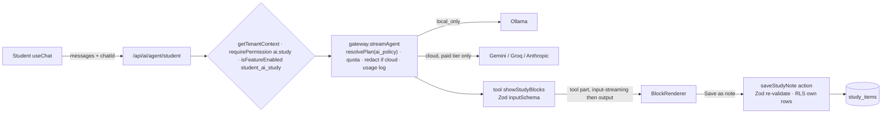

# 14 — Generative UI plan

Status: **in progress, as of 2026-10-31.** Approved and built: GU-01..GU-09 (ADRs D31–D35 in `12-decision-log.md`; commits `47c4145`, `704d10b`, `b68b4df`, `d05525c`, `f4da61b`, `2d3e66a`). GU-10 onward is still a plan. Sources are in §11.

Owner asks (2026-10-30): (1) default-on student study presets (terse, ELI5, anatomy), saveable chats and personal notes; (2) broader teacher agent capability, with every feature configurable per customer. Decisions: D30–D35 in `12-decision-log.md`.

## 1. What generative UI is

The model drives interactive UI via typed tool results rendered by our own components (L1), optionally composed into layouts (L2). Model-written HTML/JS pages (L3) are rejected for v1: 10–100x tokens, about a minute of latency, sandbox/CSP burden in a minors' app. Rationale: D31.

## 2. What this codebase already has

Built: `useChat` + `streamText` teacher agent with typed `tool-*` parts, inline quiz/remark editors, five lookup tools, entitlements via `isFeatureEnabled` (D30), the block catalog, `streamAgent`, study tables and the student chat/notebook (GU-03..GU-09). Still open: typed per-tool renderers for the teacher, class-insight and draft tools, composed views, style preferences, seed, E2E (GU-10..GU-20). The teacher route bypasses `gateway.ts` (D28, teacher only); the student route must not copy that (rule 6).

## 3. Architecture: AI SDK v7, closed in-house catalog

No generative-UI framework (D31): `ai` 7 + `@ai-sdk/react` plus one closed, Zod-validated block catalog under `src/modules/ai/blocks/` (discriminated union on `kind`). Frameworks and hosted gen-UI services were evaluated and rejected (per-call fees, second agent runtime, vendor risk, pre-1.0); students' free text goes to local or paid-tier cloud only, never a free tier (D32).

## 4. Mindmaps, charts, 3D: rendering decision

**Recommendation:** the model never emits markup. It emits a Zod-validated JSON node list, and our own React component renders it.

- **Mindmaps:** inline **SVG** with a zero-dependency layout. Leaves take sequential rows in depth-first order; a parent sits at the midpoint of its children; radial is the same rows mapped to angle and depth mapped to radius. Interactions: collapse/expand, tap a node, "Explain this node" (sends a chat turn in the student's style), zoom via `viewBox`, pan via native scroll, download SVG/PNG by serialising the SVG. The same data also renders as a `
` outline view (accessible, printable).
- **Charts:** the already-installed Recharts (D16), so no new dependency.

The "parts" variant of the mindmap block is the cheap form of the Anatomy skill (see below).

Chosen: own SVG + CSS plus the installed Recharts (about 0 new KB, works on 2–4 GB Android, prints, accessible). Upgrade paths: `d3-hierarchy` for tidier layout, `markmap-view` for animation (escape node content). Rejected for v1: Mermaid, Three.js, model-written HTML/SVG (D31).

**The three student skills are prompt presets, not Claude Code skills.** Gemini, Groq and qwen do not load `SKILL.md` files. Each "skill" becomes a versioned instruction fragment that the student can switch on or off, all three on by default (ask 1):

- **Caveman, dialect dropped:** terse and answer-first, filler cut, normal grammar.
- **Teach me like I am 5:** plain words and one everyday analogy per idea.
- **Anatomy:** we read "the anatomy skill" as NousResearch's MIT "Anatomy" agent skill. It builds interactive isometric SVG machines with a Node/Chrome verify loop: 40–150 parts per figure, frontier-model authoring work, not a per-request runtime.
  - **Default on, cheap form:** an "explain it as a machine of parts" preset, rendered as a `mindmap` block with `variant: parts`. Tap a part to see its job and what it connects to.
  - **Later (§10), curated library:** real Anatomy figures, generated offline once per CBSE topic by the platform team, reviewed, stored as static sanitized SVG and shared by every tenant. The cost is then one-time per topic, not per student.
  - **Rejected:** per-student on-demand Anatomy figures.
  - **Owner to confirm** this reading in GU-01.

**Personal style** is a closed schema saved per student. It sets defaults; the student can override them in chat ("make it radial with emojis"):

| Field | Values | Default |
|---|---|---|
| skills | terse, eli5, anatomy | all on |
| notes.density / notes.format | brief, standard, detailed / bullets, qa, paragraphs | standard / bullets |
| language | from `settings.communication.languages` (en, hi) + mixed | en |
| visual.theme | plain, colourful, high-contrast, print | colourful |
| mindmap.layout | tree, radial, outline, parts | tree |
| emoji | bool | false |
| myStyle (free text ≤ 300) | passed as a delimited data block (`04 §5` injection posture) | empty |

**Block catalog (shared by the student and teacher chats).** Caps follow DBT-27 (no string field above 500 characters, because Ollama crashes on long `maxLength`) and use flat lists rather than recursive trees, because recursion is fragile across Gemini, Groq and Ollama structured output.

| kind | Fields (caps) | Renderer |
|---|---|---|
| notes | ≤ 10 sections {heading ≤ 120, bullets ≤ 12 × ≤ 300, example? ≤ 500} | HTML/CSS, print CSS |
| mindmap | ≤ 60 nodes {id, parentId \| null, label ≤ 80, detail? ≤ 300}, depth ≤ 4, variant tree/radial/outline/parts | own SVG + `
` |
| chart | type bar/line/pie/area, ≤ 4 series × ≤ 50 points, unit; teacher: `dataRef {toolCallId, field}` instead of literal numbers | Recharts |
| flashcards | ≤ 20 {front ≤ 200, back ≤ 300} | CSS flip |
| practice | ≤ 10 MCQ, same shape as `QuizContentSchema`; never saved to assignments | own |
| table | ≤ 6 columns × ≤ 40 rows, cells ≤ 120; teacher: `dataRef` | HTML table |
| callout | tone info/tip/warning, text ≤ 300 | own |

No block field is ever rendered with `dangerouslySetInnerHTML`. Text is plain text in structured fields; there is no markdown and no HTML. Blocks load via `next/dynamic` only on AI pages.

## 5. Target features (`03` format)

Columns as in `03 §1`. Demo is `planned` for every row; the target after build is `limited`.

**A. Student study assistant, personalised notes, mindmaps, saved chats.** Skill selection (F-AI-08) is a separate, smaller piece than block rendering (F-AI-10). They combine because the student's saved style feeds both the instructions (skills, density, language) and the renderer (theme, layout).

| ID | Feature | Value | Phase | Demo | Pri | Deps | Owner | Sens | Accept |
|---|---|---|---|---|---|---|---|---|---|
| F-AI-08 | (existing row, pulled forward from Phase 3/P3 and re-scoped) Student study chat with default-on skill presets (terse, ELI5, anatomy-by-parts) and own-grade unit lookup | Learning in the student's own voice | 2 | planned | P2 | F-AI-01, GU-05 | ai | conf (minors' free text) | J-14, C-67 |
| F-AI-10 | Generative UI block catalog + renderer (§4), shared | Interactive notes and visuals at near-zero render cost | 2 | planned | P2 | F-AI-01 | ai | int | C-69 |
| F-AI-11 | Study notebook: save chat on demand, rename, folder, pin, delete; "Make notes" turns a chat into blocks in the saved style; edit before save; print | Retention, revision | 2 | planned | P2 | F-AI-08, F-AI-10 | ai | conf | J-14, C-68 |

**B. Teacher agent v2.**

| ID | Feature | Value | Phase | Demo | Pri | Deps | Owner | Sens | Accept |
|---|---|---|---|---|---|---|---|---|---|
| F-AI-12 | Teacher agent v2: typed renderer for every tool (lookups render as tables/charts, not prose); class-insight tools; data-bound composed views | Fewer misread numbers; class-level questions | 2 | planned | P2 | D28–D30, F-AI-10 | ai | conf | J-15, C-73, C-74 |
| F-AI-07 | (existing row, partial) Lesson-plan draft (curriculum only) and guardian-message draft (copy only, never sent) in the agent | Teacher time saved | 2 | planned | P2 | F-AI-12 | ai | int / conf | J-15 |
| F-PLT-02 | (existing row, slice) Closed feature catalog with per-key defaults; platform-admin-only toggle | "We control which customer gets what" | 2 (slice) | planned | P1 | D30 | core | conf | C-75 |

Proposed test ids, all free in `07 §6` and `08`:

- **C-67:** `local_only` student turn never calls a cloud factory; a cloud plan without the paid-tier attestation returns `ai_policy_blocked`.
- **C-68:** `study_items` / `study_preferences` are own-rows only, for every role, cross-institution included.
- **C-69:** unknown block `kind` or an oversize field is rejected in the tool and in the save action.
- **C-73:** a chart or table whose `dataRef` does not resolve renders "data unavailable", never model numbers.
- **C-74:** a class-insight tool's model-facing output (`toModelOutput`) contains no student names.
- **C-75:** a feature toggle by a non-platform-admin returns `forbidden`.
- **J-14:** `student.one` studies Quadratic Equations, gets a mindmap, saves it to a folder.
- **J-15:** `teacher.x-a` asks for X-A's attendance and results, gets a chart, and drafts a guardian message.

## 6. Task-packet breakdown with model tiering

Packet ids are plan-local (`GU-nn`); migration numbers are reserved in `10` §3. Tiers: Opus (architecture, security review gates) · Sonnet (multi-file implementation) · Haiku (single-file against an approved spec). Every packet follows CLAUDE.md's pre-code protocol and completion report.

### Built (GU-01..GU-09)

GU-01 decisions (D31–D33) · GU-02 entitlement catalog v2 (`src/lib/auth/entitlements.ts`, D33) · GU-03/04 block catalog, mindmap and chart blocks (`src/modules/ai/blocks/`) · GU-05 `streamAgent` in `gateway.ts` · GU-06 student skill presets (`src/modules/ai/prompts/student-skills.ts`) · GU-07 `study_items`/`study_preferences` (migration `20261028000049`, `0050` cap trigger) · GU-08 student route `/api/ai/agent/student` and study chat · GU-09 notebook (D35). Details: `12-decision-log.md` D31–D35 and the commits.

### Feature A: student (open)

- **GU-10: Style preferences.** Sonnet · 0.75 d · deps GU-07, GU-04 · review: lead.
  - `/portal/study/style` form over the closed style schema, with a live preview on sample blocks. Saved to `study_preferences`; read by the route (instructions) and the renderer (theme, layout).
  - Tests: schema unit test; db upsert own-row.
- **GU-11: Seed and J-14.** Sonnet · 1 d · deps GU-09, GU-10 · review: lead.
  - Seed for `student.one`: one saved chat, one note with a mindmap in folder "Maths", style defaults. Add the row to `05 §8.1` (rule 11). Enable the three student keys for `st-josephs-demo` only.
  - `e2e/j14-student-study.spec.ts` against a mock model (`ai/test`), so no network.
- **GU-12: Security review gate A.** Opus · 0.5 d · deps GU-08…GU-11 · review: owner.
  - Covers: minors' data path, policy routing, RLS, injection through `myStyle` and saved notes re-fed as context, XSS in the renderer, content-safety prompt and provider safety settings, quota starvation of teachers. Output: fix list and debt rows.

### Feature B: teacher

- **GU-13: Typed tool-renderer registry.** Sonnet · 1 d · deps GU-03, GU-04 · review: react-reviewer.
  - Add `outputSchema` to each tool in `teacher-tools.ts`. `TeacherAgentChat` gets a `TOOL_RENDERERS` map typed with `InferUITools`, which replaces the duck-typed guards.
  - Renderers: `findStudent` as a pick list (tap sends a follow-up); attendance as a stat row and bar; results as a table and subject chart (`dataRef`); assignments as a table. Partial `input-streaming` states.
  - No new data egress, so no new entitlement key.
  - Tests: unit on output schemas; J-15 later.
- **GU-14: Teacher prompt builders.** Haiku · 0.25 d · deps GU-01 · review: lead.
  - `src/modules/ai/prompts/guardian-message.ts` (uses the `{studentLabel}` placeholder, like `prompts/remark.ts`; en/hi from settings) and `src/modules/ai/prompts/lesson-plan.ts` (curriculum fields only).
  - Tests: unit tests mirroring `quiz-prompt.test.ts`.
- **GU-15: Class-insight tools.** Sonnet · 1 d · deps GU-13, GU-01 (D34) · review: security-reviewer + Opus.
  - Tools: `listMySections` (`listTeachableSections`), `getSectionAttendanceSummary` (`getSectionAttendancePatterns`, thresholds from `settings.attendance.alert_thresholds`), `getSectionExamSummary` (needs a section-scoped variant in `exams/queries.ts`, the owner module).
  - `toModelOutput` sends roll numbers and aggregates only; the UI gets names. Requires `convertToModelMessages(messages, { tools })`.
  - Gated by `teacher_ai_class_insights` (tool removed when off).
  - Tests: C-74, scope (another teacher's section returns the not-in-scope string).
- **GU-16: Draft tools.** Sonnet · 1 d · deps GU-14, GU-13 · review: security-reviewer.
  - `draftGuardianMessage(studentId, topic)`: editable textarea, copy button, "Not sent" label, never touches notifications.
  - `draftLessonPlan(curriculumUnitId, periods)`: renders as notes blocks with copy/print.
  - Both go through `runStructured`, like the existing draft tools. Gated by `teacher_ai_parent_messages` / `teacher_ai_lesson_plans`.
  - Tests: scope, entitlement off.
- **GU-17: Data-bound composed views (L2 for teachers).** Sonnet · 1 d · deps GU-15, GU-01 (binding spec) · review: Opus.
  - `composeView` tool: the model picks layout, chart type and fields; chart and table blocks may only bind `dataRef` to a tool output in the same message. The client resolves the ref; an unresolved ref renders "data unavailable". Gated by `teacher_ai_visuals`.
  - Tests: C-73 unit on the resolver.
- **GU-18: J-15 E2E.** Sonnet · 0.75 d · deps GU-15, GU-16, GU-17 · review: lead.
  - `e2e/j15-teacher-insight.spec.ts` with a mock model. `teacher.x-a` uses section X-A; seeded data is sufficient, no seed change.
- **GU-19: Security review gate B.** Opus · 0.5 d · deps GU-13…GU-18 · review: owner.
  - Covers: D34 egress, `toModelOutput` completeness, client-forged history (it can only mislead the teacher's own view; saves still go through existing actions), cost per turn.

### Close-out

- **GU-20: Docs and honesty alignment.** Haiku · 0.25 d · deps GU-12, GU-19 · review: lead.
  - Update `03` rows (§5), `05 §3` (ai owns `study_items`, `study_preferences`), `05 §8.1`, `07 §2.2` / `§4` / `§5` data-flow lines, and `11 §1` env names.
  - Add the debt rows GU-12 and GU-19 raise. Badge text must match §8 exactly.

## 7. Entitlement wiring (D30 pattern)

Same column (`institutions.settings.features`), same function (`isFeatureEnabled(ctx, key)`), and the same check position: after the role/permission check, before quota. It fails the same way: `ai_unavailable`, "… is not included in this school's plan.", with the page showing the same sentence. A sub-feature key also removes its tools from the tool set via `activeTools`, so the model never sees them.

| Key | Gates | Parent | Default (GU-02) |
|---|---|---|---|
| `teacher_ai_agent` | existing teacher agent (D30) | — | on (unchanged; D30 promise kept) |
| `teacher_ai_visuals` | `composeView` (GU-17) | `teacher_ai_agent` | off |
| `teacher_ai_class_insights` | section-level tools (GU-15) | `teacher_ai_agent` | off |
| `teacher_ai_lesson_plans` | `draftLessonPlan` | `teacher_ai_agent` | off |
| `teacher_ai_parent_messages` | `draftGuardianMessage` | `teacher_ai_agent` | off |
| `student_ai_study` | student route + `/portal/study` | — | off |
| `student_ai_visuals` | `showStudyBlocks` tool | `student_ai_study` | off |
| `student_ai_notebook` | save/organise/notes actions + notebook page | `student_ai_study` | off |

Two changes to D30, both already anticipated by D30's own "Revisit" line. The column and the function stay the same, so this is not a second mechanism.

1. **Per-key default.** D30 treats a missing key as enabled. Kept for `teacher_ai_agent`, that rule would switch minors' cloud AI on for every existing customer at deploy time. Every key added after D30 defaults **off**.
2. **Toggle authority.** Today `institution.settings.manage` (the school's own owner, principal or admin) flips the flag. Ask 2 says *we* decide, so writes move to `profiles.is_platform_admin` only (GU-02, C-75). A school-side opt-out of an entitled feature is deferred (§9).

## 8. Honesty labels (rule 7)

| Surface | Label text | Why |
|---|---|---|
| Student chat banner | "AI study helper — runs on {Local AI on your school's server \| Cloud AI: Google Gemini / Groq, paid tier}. What you type is sent there. Don't share personal details. AI can be wrong; check your textbook or teacher." | Provider disclosure; minors |
| Each AI message | existing `ProviderBadge` ("Generated locally" / "Generated in cloud (redacted)") | Same contract as quiz/remark (`07 §5`) |
| Skill chips | "Style: Short · Simple (ELI5) · Parts (Anatomy)" | ELI5 and terse answers simplify, so the student must know |
| Charts with model numbers | "AI-generated numbers — may be wrong" | No source behind them |
| Teacher data-bound charts | "From school records" | Distinguishes real data from AI text |
| Practice quiz block | "Practice only — not graded, not sent to your teacher" | Not an assignment |
| Saved note header (persisted) | "AI-assisted note · made from chat on {date}" | The note outlives the chat |
| Guardian-message draft | "Draft — not sent. Copy it to send yourself." | No real channel (DBT-01) |
| Study assistant page | `LimitedBadge` until GU-12 passes and bench data exists | `07 §5` "no capability claims before results" |
| Feature off | D30 sentence | Same honesty contract |

## 9. Risks

- **Minors and DPDP:** chats are children's personal data; local or paid-tier cloud only (D32), student-only visibility, hard delete by the student.
- **Quota and cost:** per-student daily cap so students cannot starve teachers (D32); `checkLimits` sums in JS (DBT-31).
- **Content safety and local-model adherence:** system-prompt guardrails; flat lists, DBT-27 caps, one repair retry.
- **Model churn:** model ids stay env-configurable; unknown id logs $0 (DBT-16).
- **Prompt injection** via `myStyle` and saved notes: delimited data blocks; tools write nothing except through validated own-row actions.
- **Bundle size:** blocks lazy-load; no 3D.

Rejected options (L3 pages, Three.js, Mermaid, `streamUI`, CopilotKit, Tambo, Thesys, json-render now, free-tier student chats, markdown/HTML inside blocks, model-typed numbers in teacher charts, default-on for new keys) are argued in D31–D33.

## 10. Revisit

- Catalog past about 12 block types or nested model-composed layouts: re-evaluate json-render (if >= 1.0) or A2UI.
- After a pilot school's real usage: re-cost with measured tokens and set the per-student cap from data.
- Curated Anatomy figure library (offline, per CBSE topic) once high-value topics are identified.
- DPDP legal review or Rules phase-in changes: revisit F-AI-11 retention and visibility.

## 11. Sources

Superseded — source URLs and pricing research are summarised in D31/D32 (`12-decision-log.md`); AI SDK facts were read from installed `node_modules` types.
